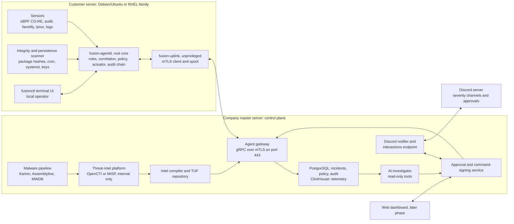
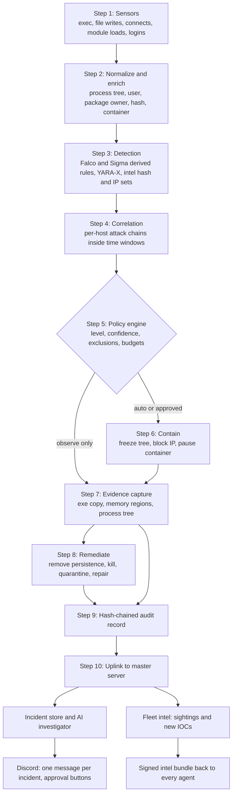
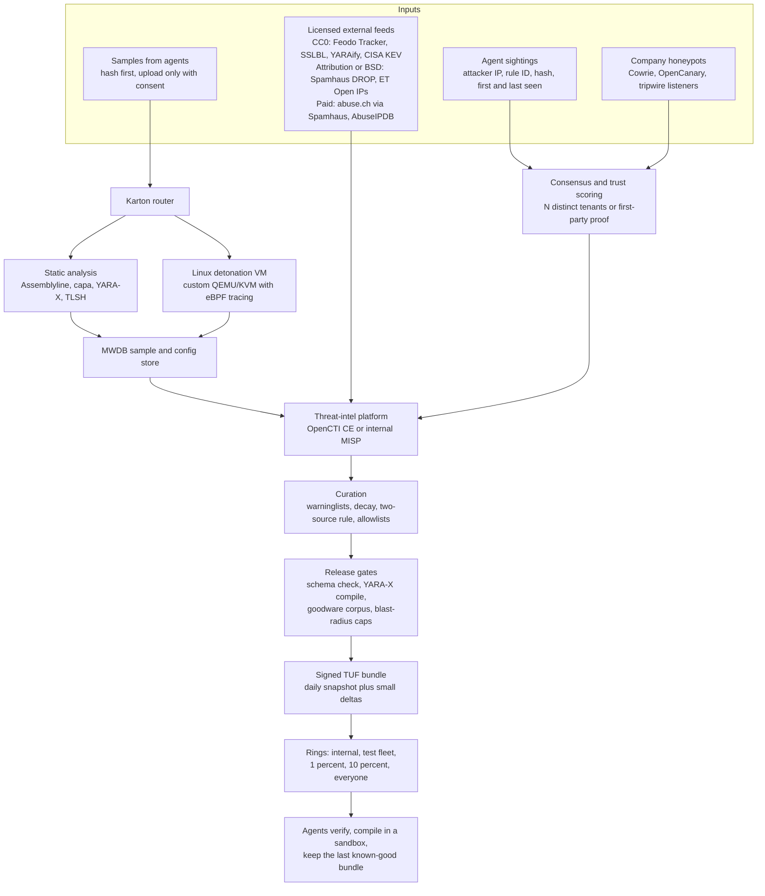
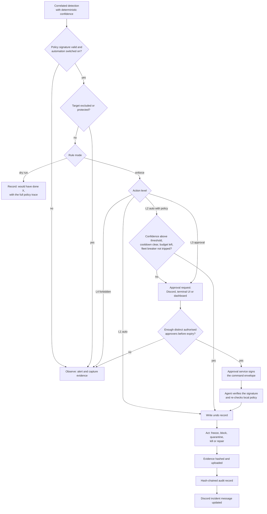
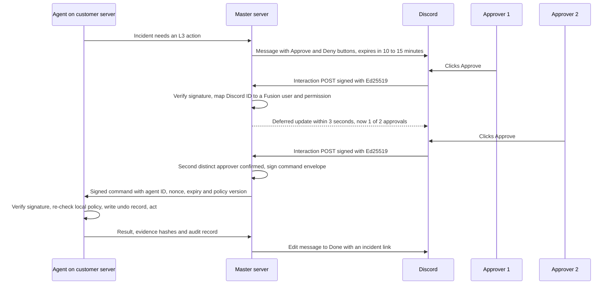

# Build Lean, Freeze First, License Carefully

The Fusion Apps should build its own small, statically linked Go agent rather than fork Wazuh or bolt together open-source suites, and it should make one containment sequence the heart of the first release: freeze the whole suspect process tree, strip every persistence point in every user account, then kill the tree and repair tampered system files from signed packages. That sequence defeats the company's own incident (an SSH compromise, a cryptominer whose watchdog kept restarting it, cron and systemd persistence, and replaced system binaries), which the research shows is the most common commodity attack on Linux cloud servers, matching TeamTNT, Outlaw, perfctl and P2Pinfect almost step for step. Cloud attacks routinely go from first access to impact in ten minutes or less ([Sysdig](https://sysdig.com/555-benchmark)), so high-confidence containment has to run automatically under signed policy, while Discord carries alerts and two-person approvals for riskier actions instead of acting as the authority. Licensing shapes the design as much as engineering does. Permissive libraries such as cilium/ebpf, YARA-X, google/nftables, Syft and Coraza can be embedded. GPL and AGPL tools such as ClamAV, maldet, fapolicyd, Suricata and Velociraptor must run as separate, unmodified processes. Wazuh code and rules, Elastic's rules and Volatility wrappers must not ship at all. Most popular "free" threat feeds forbid commercial use without a paid licence, which leaves CC0 and BSD feeds plus the fleet's own sightings as the legal core of the master server's intelligence. The research corrects or refines the draft plan in seventeen places, most importantly that ClamAV's 1.2–2.4 GiB memory appetite rules it out as a default on 1–2 GB VPSs, that YARA-X has replaced YARA, that RHEL hosts run Podman rather than Docker, that OpenVZ/LXC VPSs cannot run eBPF or audit, and that the March 2026 Trivy compromise forbids pulling scanner binaries at runtime. No reviewed competitor combines a low-memory agent, host EDR with integrity checking, policy-controlled remediation and chat-based approvals, which leaves open ground between $5–$45-per-server hosting suites ([Imunify360](https://imunify360.com/pricing/)) and enterprise workload protection near $95 per host per month ([AWS Marketplace](https://aws.amazon.com/marketplace/pp/prodview-of3ndsfqn2cwc)).

*Plan document for the founders and engineers of The Fusion Apps. Facts are stated as of 9 November 2026 and come from nine research note sets. Every external claim carries an inline source. The flags (single source), (vendor claim), (preprint), (secondary) and (unverified) mark claims that rest on thin evidence. Durations, targets and prices that the plan proposes are labelled as proposals, not findings.*

## Reading guide: five use modes and the terms that matter

Every module in Section 4 follows the same five-part template: what it does, how it defends, a packages table, a real attack it stops, and its automatic response with safety notes. Architecture, data flow, the response decision flow and the master-server intelligence pipeline are drawn in Mermaid. The per-module attack examples are plain-text boxes, so they read correctly even where Mermaid does not render. Each package in the tables gets one of five **use modes**, which decide what the company may legally and safely do with it.

| Use mode | What it means for The Fusion Apps |
|---|---|
| **Embed** | Compiled into, or shipped inside, the closed-source agent or master server. Only permissive licences (MIT, BSD, Apache-2.0, ISC), permissively licensed rule data, or the company's own code qualify. |
| **Run alongside** | A separate, unmodified program that the customer installs from a distro or vendor repository. The agent talks to it over a socket, a command line or files, and never links it. |
| **Master-side** | Runs only on company servers and is never distributed to customers, which changes how GPL and AGPL obligations apply. |
| **Reference** | Read the code, documentation or rules for ideas. Do not copy code or rule text. |
| **Test only** | Used in the validation lab to attack the product. Never shipped. |

The plan uses a small set of specialist terms. Each is defined once here and explained again in context where it first matters.

| Term | Plain-English meaning |
|---|---|
| EDR (endpoint detection and response) | Software on each server that records what happens, spots attacks and can act against them |
| Persistence | Anything an attacker leaves behind so their code comes back after a kill or a reboot: cron jobs, systemd services, shell start-up files, SSH keys |
| Watchdog | A helper process or timer whose only job is to restart the attacker's main program when it dies |
| eBPF | A safe way to run tiny programs inside the Linux kernel that observe events such as program starts, file writes and network connections, with low overhead |
| BTF and CO-RE | Kernel type information that lets one compiled eBPF program run unchanged on many kernel versions ("compile once, run everywhere") |
| Linux audit (auditd) | The kernel's older built-in event log. It works without BTF but is slower, and only one program can own it at a time |
| fanotify | A kernel interface that reports which process opened or executed a file and can refuse the execution |
| cgroup | The kernel's way of grouping processes, which lets the agent freeze or kill a whole group in one step |
| nftables | The modern Linux firewall. Its "sets" with timeouts let blocks expire by themselves |
| LD_PRELOAD rootkit | A malicious library forced into every program (often via `/etc/ld.so.preload`) so that tools like `ps` and `ls` lie about what is running |
| YARA and YARA-X | Pattern rules that describe malware families. YARA-X is the new engine, written in Rust |
| IOC (indicator of compromise) | A concrete clue such as a bad IP address, domain or file hash |
| KEV and EPSS | CISA's catalogue of vulnerabilities known to be exploited, and a daily probability that a vulnerability will be exploited within 30 days |
| SBOM | Software bill of materials: the list of packages inside a server or container image |
| WAF | Web application firewall, which inspects HTTP requests for attacks |
| TUF | The Update Framework, a signing scheme that stops tampered, stale or rolled-back updates |
| mTLS | Mutual TLS, in which agent and server each prove their identity with a certificate |
| MITRE ATT&CK | A public catalogue of attacker techniques with IDs such as T1053.003 (cron persistence) |

## 1. The incident Fusion suffered is the internet's most common Linux server attack

The company's incident was not unusual, and that is the most useful finding for product design. The closest public match is TeamTNT's 2024 campaign against CentOS VPSs, which Group-IB attributed with moderate confidence. It brute-forced SSH, switched off iptables, UFW, SELinux and AppArmor, uninstalled Alibaba's cloud security agent, killed competing miners, renamed `curl` and `wget`, replaced the crontab with a 30-minute job backdated to 2018-05-15, loaded the Diamorphine kernel rootkit, locked files with `chattr` before disabling `chattr` itself, created a sudo-capable user called `hilde` with planted SSH keys, moved SSH to port 11222 and cleared shell history ([Group-IB](https://www.group-ib.com/blog/teamtnt/)). Elastic's 2025 analysis of the Outlaw ("Dota") worm shows the same shape: SSH brute force, a watchdog called `upd` that restarts the miner, `@reboot` crontab lines, and an attacker key planted in a recreated `~/.ssh` and locked with `chattr +ia` ([Elastic](https://www.elastic.co/security-labs/outlaw-linux-malware)). perfctl, which Aqua says likely targeted millions of servers over three to four years, adds trojanized `ldd`, `top`, `lsof` and `crontab`, an LD_PRELOAD rootkit and a separate watchdog binary ([Aqua](https://www.aquasec.com/blog/perfctl-a-stealthy-malware-targeting-millions-of-linux-servers/)). The incident was almost certainly commodity tooling, which means **reinfection is likely unless every credential and key is rotated**, because Ebury, Outlaw and P2Pinfect all spread with stolen credentials ([ESET](https://www.welivesecurity.com/en/eset-research/ebury-alive-unseen-400k-linux-servers-compromised-cryptotheft-financial-gain/)).

Volume and speed explain why the response must be automatic. P2Pinfect alone accounted for **50–80% of malware installs** in AhnLab's SSH honeypots across 2025 and early 2026 ([AhnLab Q4 2025](https://asec.ahnlab.com/en/92004/)), and one DShield honeypot logged more than 20 million SSH brute-force attempts between February and May 2026 ([Aviatrix](https://aviatrix.ai/threat-research-center/behavior-of-coordinated-ssh-brute-force-attacks-2026/)). SSH is not the whole story, though. Google reports that software exploitation overtook weak credentials as the top cloud initial-access vector in the second half of 2025, at **44.5% against 27.2%** ([Help Net Security](https://www.helpnetsecurity.com/2026/03/11/google-cloud-environments-cyber-threats-report/)). VulnCheck found that 28.96% of vulnerabilities added to KEV in 2025 were exploited on or before the day the CVE was published ([VulnCheck](https://www.vulncheck.com/blog/state-of-exploitation-2026)). Sysdig has tracked cloud attacks reaching impact in **ten minutes or less** since 2023 and benchmarks defenders at 5 seconds to detect, 5 minutes to triage and 5 minutes to respond ([Sysdig](https://sysdig.com/555-benchmark)). A human reading Discord cannot beat that clock, so the product needs a policy that acts on its own for high-confidence chains and asks humans only for steps that can break production.

The research also separates two classes of attack that need different defences. Noisy, financially motivated miners converge on about a dozen host artifacts: `/etc/ld.so.preload`, cron directories, systemd units and timers, shell start-up files, `authorized_keys`, PAM modules, executables in `/tmp`, `/var/tmp` or `/dev/shm`, processes whose binary has been deleted, `chattr` flags, kernel-thread names on user processes, pool or Tor traffic, and kernel module loads. A small agent that watches these well covers most real attacks on SMB servers. Stealthy backdoors in the authentication path are different: the Plague PAM backdoor scored **0 of 66** on VirusTotal ([Nextron](https://www.nextron-systems.com/2025/08/01/plague-a-newly-discovered-pam-based-backdoor-for-linux/)), the CWPdoor control-panel backdoor disclosed on 5 November 2026 scored **0 of 63** ([The Hacker News](https://thehackernews.com/2026/11/hackers-hide-linux-backdoor-in-control.html)), and Ebury has compromised about 400,000 servers since 2009 ([ESET](https://www.welivesecurity.com/en/eset-research/ebury-alive-unseen-400k-linux-servers-compromised-cryptotheft-financial-gain/)). For these, signature antivirus fails and **integrity checking against trusted package hashes is the only reliable host-side control**. A 2026 campaign documented by Group-IB adds a third lesson: miners now hide redundant cron jobs in several low-privilege accounts, so cleaning only root's crontab leaves the implant in place ([Group-IB](https://www.group-ib.com/blog/xmrig-covert-linux-pam-abuse/)).

The market leaves a clear gap. Hosting-panel suites are affordable but built around web hosting. Enterprise EDR and cloud workload protection are priced and sold for security teams. Open-source tools either need heavy servers or stop at blocking IP addresses.

| Product | Model | Price signal | Gap for SMB VPS fleets |
|---|---|---|---|
| Imunify360 | Panel-centric agent suite (malware scan, firewall, IDS) | $12–$45 per server per month list, $5–$20 in bulk ([Imunify360](https://imunify360.com/pricing/)) | Built for cPanel-style hosting; no evidence of cron, systemd or preload chain remediation |
| BitNinja | Per-server agent with WAF, honeypots and IP reputation | $6–$48 per month, conflicting third-party figures ([FitGap](https://us.fitgap.com/products/019391/bitninja)) | Web and network focus, not process or persistence EDR |
| Sandfly | Agentless scanning over SSH | $99 per year for 10 hosts on the home tier ([Sandfly](https://sandflysecurity.com/pricing/)) | Polling, not real-time process control |
| Wazuh | Open-source agent plus self-hosted server | Free; cloud estimated from $571 per month (secondary) ([CostBench](https://costbench.com/software/siem/wazuh/)) | Heavy server stack and do-it-yourself response scripts |
| CrowdSec | Log-behaviour engine plus firewall "bouncers" | Free community plan; paid plans per engine ([CrowdSec](https://www.crowdsec.net/pricing)) | Blocks IPs; does not touch on-host malware or persistence |
| Microsoft Defender for Servers | eBPF sensor tied to Microsoft's portal | About $5 or $15 per server per month (secondary) ([apis.io](https://apis.io/plans/microsoft-defender/microsoft-defender-plans-pricing/)) | Requires the Microsoft security stack |
| Sysdig Secure | Cloud-native application protection | $0.13 per host-hour, about $95 per host per month ([AWS Marketplace](https://aws.amazon.com/marketplace/pp/prodview-of3ndsfqn2cwc)) | Price and container-first positioning |

None of the reviewed sources describes a product that combines a low-RAM agent sized for SMB VPSs, on-host EDR with integrity monitoring, policy-controlled remediation of miner and persistence chains, and approve-or-deny from a chat tool. That gap is inferred from the absence of evidence rather than confirmed product by product. The research's working hypothesis is that an EDR priced at roughly $2–$8 per server per month with fleet bundles would sit in open space; this is a hypothesis to test with customers, not a finding.

## 2. The research corrects the draft plan in seventeen places

The draft plan is sound in shape: a Go agent, eBPF telemetry, a rule engine, a policy-gated response engine, a master server and Discord. The research changes many of its details. The first table covers the ten corrections the founders asked about. The second covers seven further refinements that matter just as much in practice.

| # | Draft plan said | What the research found (Nov 2026) | Change to make |
|---|---|---|---|
| 1 | ClamAV plus YARA as the malware engine on every server | `clamd` uses about 1.2 GiB of RAM just to load signatures and about 2.4 GiB during the daily concurrent reload; Cisco recommends 3 GiB or more ([ClamAV Docker docs](https://github.com/Cisco-Talos/clamav-documentation/blob/main/src/manual/Installing/Docker.md), [ClamAV intro](https://github.com/Cisco-Talos/clamav-documentation/blob/main/src/Introduction.md)). The figures are dated September 2020 and need re-measuring. In a 2021 test it caught 97.9% of known ELF malware but only 25% of evasive payloads ([Royal Holloway](https://royalholloway.ac.uk/media/16777/giusepperaffaisg.pdf)). | ClamAV becomes optional: hosts with 4 GB or more, or central scanning on the master server. Use `clamd` over its socket and never link `libclamav` (GPLv2). |
| 2 | YARA | Classic YARA is in maintenance mode. YARA-X has been stable since 4 June 2025 and reached v1.23.0 on 5 November 2026; its API differs and it cannot scan process memory ([VirusTotal](https://virustotal.github.io/yara-x/blog/yara-x-is-stable/), [YARA-X vs YARA](https://virustotal.github.io/yara-x/docs/intro/yara-x-vs-yara/)). | Embed YARA-X (BSD-3) and have the agent read process memory itself. |
| 3 | Build on an open-source HIDS such as Wazuh (implied shortcut) | Wazuh's GPLv2 licence explicitly covers its rules and decoders and treats proprietary installers and programs that "execute" Wazuh as derivative works; the 5.0 engine is AGPL-3.0 and 5.0 is a breaking rewrite (RC2 on 30 Oct 2026); its indexer needs 4–16 GB of RAM ([Wazuh licence](https://github.com/wazuh/wazuh/blob/main/LICENSE), [Wazuh 5.0 RC2](https://github.com/wazuh/wazuh/releases/tag/v5.0.0-rc2), [Wazuh indexer](https://documentation.wazuh.com/current/installation-guide/wazuh-indexer/index.html)). | Build a company-owned agent. Learn from Wazuh's feature set and offer at most an alert-forwarding integration to a customer's existing Wazuh. |
| 4 | Use CrowdSec blocklists and threat intelligence | The engine is MIT, but the Console EULA forbids using its IPs or scenarios "to provide services on behalf of third parties" or redistributing them. Commercial use needs the Partnership Program; Platinum blocklists start at $1,900 per month ([CrowdSec pricing](https://www.crowdsec.net/pricing), [CrowdSec EULA](https://booking.crowdsec.net/hubfs/EULA%20Crowdsec%20v2%20.pdf)). | Re-implement the detection logic natively, or let customers enrol their own engines; negotiate partner terms before shipping CrowdSec data. |
| 5 | abuse.ch as free malware intelligence | Authentication became mandatory on 30 June 2025. Commercial use of URLhaus, MalwareBazaar and ThreatFox "may require a paid subscription" through Spamhaus; only Feodo Tracker, SSLBL and YARAify are CC0; section 7.3 bars using the data to train or improve AI products without consent ([abuse.ch terms](https://abuse.ch/terms-of-use/), [abuse.ch blog](https://abuse.ch/blog/community-first/)). | Use the CC0 feeds freely; budget a Spamhaus subscription or earn free access by contributing for six months; keep abuse.ch data away from the AI layer until legal clears it. |
| 6 | Security baseline and security score (implicitly CIS) | CIS says its Product Vendor Membership "provides the only licensing rights to integrate" its Benchmarks into products, with certification required; the free PDFs are CC BY-NC-SA ([CIS vendor page](https://www.cisecurity.org/cis-securesuite/pricing-and-categories/product-vendor/), [CIS terms](https://www.cisecurity.org/terms-of-use-for-non-member-cis-products)). | Build checks from ComplianceAsCode (BSD-3) rules re-implemented in Go. Never market a "CIS score" without membership. |
| 7 | Trivy as the image and vulnerability scanner | Trivy's own release pipeline was compromised in March 2026: a malicious v0.69.4 binary and deb/rpm packages for about three hours on 19 March, malicious Docker Hub images 0.69.5 and 0.69.6 on 22 March, and 76 of 77 `trivy-action` tags force-pushed (CVE-2026-33634) ([Aqua](https://www.aquasec.com/blog/trivy-supply-chain-attack-what-you-need-to-know/), [GitHub advisory](https://github.com/aquasecurity/trivy/security/advisories/GHSA-69fq-xp46-6x23)). | Never fetch scanners at runtime. Generate SBOMs in-process with the Syft library and match them on the master; if Trivy is used, pin it by SHA-256 and verify signatures. |
| 8 | MITRE ATT&CK mapping with familiar IDs | ATT&CK v19 (28 Apr 2026) split Defense Evasion into Stealth (TA0005) and Defense Impairment (TA0112) and renumbered "Impair Defenses": disabling security tools moved to T1685, firewall tampering to T1686, history-logging defeat to T1690; the current version is v20.1 of 13 October 2026 ([ATT&CK updates](https://attack.mitre.org/resources/updates/), [v19 release](https://attack.mitre.org/resources/updates/updates-april-2026/)) (single source in the research). | Store the ATT&CK version with every rule mapping, migrate T1562 tags, and re-check each remap against ATT&CK's own change log. |
| 9 | Docker/container security | Red Hat removed the Docker engine from RHEL 8 and 9 and calls upstream Docker unsupported on RHEL. Podman has no daemon, writes events to journald, runs rootless per user, and Podman 6 (netavark 2.0) dropped iptables support ([RHEL 9 docs](https://docs.redhat.com/en/documentation/red_hat_enterprise_linux/9/html/building_running_and_managing_containers/assembly_starting-with-containers_building-running-and-managing-containers), [podman-events](https://docs.podman.io/en/latest/markdown/podman-events.1.html), [netavark](https://github.com/containers/netavark/blob/main/RELEASE_NOTES.md)). | Design the container module for Docker and Podman, rootful and rootless, from day one. |
| 10 | eBPF plus auditd on every server | Inside OpenVZ and LXC container-VPSs the kernel refuses audit outside the initial user namespace, ignores proc-connector subscribers from other namespaces, and LXD restricts eBPF to device-cgroup programs ([kernel audit.c](https://github.com/torvalds/linux/blob/master/kernel/audit.c), [cn_proc.c](https://git.kernel.org/pub/scm/linux/kernel/git/torvalds/linux.git/tree/drivers/connector/cn_proc.c), [LXD docs](https://documentation.ubuntu.com/lxd/en/latest/syscall-interception/)). Ubuntu 20.04 kernels also lack BTF ([BTFHub](https://github.com/aquasecurity/btfhub/blob/main/docs/supported-distros.md)). | Ship a four-tier sensor ladder and sell container-VPS coverage explicitly as "best effort". |

| # | Draft plan said | What the research found | Change to make |
|---|---|---|---|
| 11 | Quarantine and process termination | Killing a miner by PID races its watchdog. Writing to `cgroup.freeze` stops a whole process tree, and `cgroup.kill` (Linux 5.14+) kills it while handling concurrent forks ([kernel cgroup v2 docs](https://docs.kernel.org/admin-guide/cgroup-v2.html), [Kernelnewbies 5.14](https://kernelnewbies.org/Linux_5.14)). | Freeze first, remove persistence, then kill. Never quarantine package-owned system binaries; reinstall them from signed repositories after approval. |
| 12 | Sigma-like rules | Sigma rules (Detection Rule License 1.1) are commercially usable, but every alert built from them must carry the rule author; Elastic's rules (Elastic License 2.0) and Wazuh's rules (GPLv2) are unsafe to ship ([DRL 1.1](https://github.com/SigmaHQ/Detection-Rule-License), [ELv2](https://www.elastic.co/licensing/elastic-license)). | Put an `author` field into the alert schema for the TUI, Discord and dashboard. Source rules from Falco (Apache-2.0) and Sigma; treat Elastic as reading material only. |
| 13 | Discord alerts and authenticated slash commands | Discord text messages are not end-to-end encrypted; HTTP interactions must verify an Ed25519 signature and answer within 3 seconds, and Discord deliberately sends bad signatures to test endpoints ([Discord interactions](https://docs.discord.com/developers/interactions/overview), [Discord DAVE](https://discord.com/blog/meet-dave-e2ee-for-audio-video)). | Host the interactions endpoint on the master server, require two approvers for high-impact actions, step up to the dashboard for destructive ones, and keep secrets out of messages. |
| 14 | Lock the compromised account | `passwd -l` does not stop SSH-key logins; `usermod --expiredate 1` does ([passwd(1)](https://man7.org/linux/man-pages/man1/passwd.1.html)). | Account response means expire, lock, revoke keys and end sessions, behind approval. |
| 15 | GeoIP enrichment (MaxMind is the common default) | MaxMind's GeoLite EULA requires consent before disclosure to third parties, and redistribution in a sold product needs a per-product licence of $5,000–$10,000 a year (figure from a search snippet) ([MaxMind EULA](https://www.maxmind.com/en/geolite2/eula), [MaxMind support](https://support.maxmind.com/hc/en-us/articles/4408928143643)). | Use IPinfo Lite (CC BY-SA 4.0) or DB-IP Lite (CC BY 4.0) with attribution. |
| 16 | Exposure checks (nmap is the common default) | The Nmap Public Source License forbids redistribution inside commercial products without the paid Nmap OEM licence ([NPSL](https://nmap.org/npsl/)). | Use naabu and Nuclei (MIT) or ZMap (Apache-2.0) on the master server. |
| 17 | Vulnerability data (NVD is the common default) | Since 15 April 2026 NIST enriches only prioritised CVEs, leaving about 29,000 older ones "Not Scheduled"; Red Hat publishes no OVAL data for RHEL 10 or later ([NIST](https://www.nist.gov/news-events/news/2026/04/nist-updates-nvd-operations-address-record-cve-growth), [The Hacker News](https://thehackernews.com/2026/04/nist-limits-cve-enrichment-after-263.html), [Red Hat](https://access.redhat.com/security/oval-v2-deprecation-announcement)). | Match packages against distro-native feeds and prioritise with KEV, EPSS, exposure and reachability. |

## 3. One static Go agent reports to a company-controlled master server

The product has two halves. On each customer server runs one statically linked Go binary, installed as two systemd services: a privileged core that owns the sensors, rules, policy engine and actuator, and an unprivileged uplink that talks to the master server. On the company side runs the master server, which holds incidents, policy, the threat-intelligence platform, the malware-analysis pipeline, the approval service, the Discord integration and, later, the web dashboard. Telemetry and evidence flow up from agents. Signed rules, intelligence bundles, policies and approved commands flow down. Discord only ever touches the master server, never an agent.

### 3.1 The architecture keeps every privileged decision on the host and every human decision on the master



The privileged core has no network listener and opens no outbound sockets of its own. It talks to the uplink and the terminal UI over a local Unix socket, checking the caller's identity with `SO_PEERCRED`. All parsing of network input therefore happens in the unprivileged process, and a compromised uplink cannot forge commands, because the core verifies command signatures itself. This design copies OpenSSH's privilege separation and answers the Kaseya and SolarWinds lessons covered in Section 6.8. Building with `CGO_ENABLED=0` gives a static binary that never passes through the dynamic linker. The research's inference is that this makes the agent immune to `/etc/ld.so.preload` rootkits of the kind perfctl uses to make `ps` and `top` lie ([Aqua](https://www.aquasec.com/blog/perfctl-a-stealthy-malware-targeting-millions-of-linux-servers/)). The single exception is the YARA-X engine, which Section 4.3 places in a separate static helper so that the core stays pure Go.

### 3.2 Data flows from kernel events to a Discord message in ten steps



Each stage has one job. Sensors filter inside the kernel, using eBPF maps of interesting paths, process names and ports, so a small VPS does not drown in events. Enrichment attaches the process tree, user, systemd unit or container, the package that owns the file and its hash. Stateless rules flag single events, and the correlation stage stitches them into chains such as *SSH login from a new IP, then a write to `/tmp`, then `chmod +x`, then execution, then a connection to a mining-pool port, then a cron write*. Only a correlated, scored detection reaches the policy engine, which decides whether to observe, act or ask (Section 6). Containment always comes before cleanup, and evidence is captured between the two, so a watchdog cannot restart the miner and the forensic picture survives. CISA's 2026 guidance makes the same point for patching: "Apply patches only after evidence is collected" ([CISA BOD 26-04 guidance](https://www.cisa.gov/news-events/directives/bod-26-04-implementation-guidance-prioritizing-security-updates-based-risk)). If eBPF fails to load because of a kernel or verifier difference, the agent degrades to the next sensor tier rather than crash-looping.

### 3.3 A four-tier sensor ladder covers modern kernels, old kernels and container-VPSs

The agent probes the host at start-up (`/sys/kernel/btf/vmlinux`, whether `bpf()` works, audit netlink access, namespace identity) and picks the best available tier.

| Tier | Mechanism and Go library | Where it applies | What it sees | Limits |
|---|---|---|---|---|
| 1. eBPF CO-RE | Company-written eBPF programs loaded with cilium/ebpf (MIT), a pure-Go library ([cilium/ebpf](https://github.com/cilium/ebpf)) | Kernels with BTF | exec, fork and exit with full arguments; writes to watched paths; connect and accept; module loads; memfd (fileless) execution; credential changes; `bpf()` loads | Needs BTF and, ideally, the BPF ring buffer, usually kernel 5.8+ or a backport ([Falco kernel docs](https://falco.org/docs/concepts/event-sources/kernel/)) |
| 2. Linux audit | elastic/go-libaudit (Apache-2.0) ([go-libaudit](https://github.com/elastic/go-libaudit)) | Kernels without BTF, or where eBPF is locked down | exec with arguments, file watches with user and login ID, module loads | Kernel backlog defaults to 64, failure modes range from silent loss to panic ([auditctl(8)](https://man7.org/linux/man-pages/man8/auditctl.8.html)); osquery notes that only one consumer can own audit ([osquery](https://osquery.readthedocs.io/en/stable/deployment/file-integrity-monitoring/)) |
| 3. Proc connector plus fanotify | vishvananda/netlink (Apache-2.0) and `golang.org/x/sys/unix` | Hosts without eBPF or audit | process-start notices (PID only); file events with the acting PID; exec blocking with `FAN_OPEN_EXEC_PERM` on kernel 5.0+ ([fanotify_mark(2)](https://man7.org/linux/man-pages/man2/fanotify_mark.2.html)) | No arguments, so short-lived processes such as `curl … \| sh` can be missed; permission events must fail open |
| 4. Polling and sweeps | `/proc` reads, log tailing, package verification, persistence diffs | OpenVZ, LXC and other container-VPSs | process snapshots, auth logs, cron/systemd/keys/preload changes, hashes against master intel | Misses short-lived processes; sold as "best effort" |

Container-VPSs land on tier 4 for hard kernel reasons: audit control is refused outside the initial user namespace ([kernel audit.c](https://github.com/torvalds/linux/blob/master/kernel/audit.c)), the proc connector ignores subscribers outside the initial user and PID namespaces ([cn_proc.c](https://git.kernel.org/pub/scm/linux/kernel/git/torvalds/linux.git/tree/drivers/connector/cn_proc.c)), and LXD restricts guest eBPF to device-cgroup programs ([LXD docs](https://documentation.ubuntu.com/lxd/en/latest/syscall-interception/)). OpenVZ kernels are branches of old enterprise kernels, such as the RHEL 6-based 2.6.32 line that reached end of life in November 2019 ([OpenVZ wiki](https://wiki.openvz.org/Download/kernel)) (the wiki page is outdated). Where a customer already runs `auditd` for compliance, common on RHEL, the agent should read audit records rather than take audit over.

The target distributions mostly support tier 1 today.

| Distribution | Default kernel | BTF for CO-RE | Notes for the agent |
|---|---|---|---|
| Debian 11 | 5.10 | Yes ([BTFHub](https://github.com/aquasecurity/btfhub/blob/main/docs/supported-distros.md)) | Free LTS support ended 31 August 2026 ([Debian LTS](https://wiki.debian.org/LTS)) (not re-verified) |
| Debian 12 | 6.1 (not re-verified) | Yes (inferred) | — |
| Debian 13 | 6.12 ([Debian](https://www.debian.org/releases/trixie/release-notes/whats-new.en.html)) | Yes | The tested kernel lacked `CONFIG_BPF_KPROBE_OVERRIDE`, so no in-kernel syscall override ([benchmark](https://github.com/sammonsempes/EBPF-Runtime-Detection-Benchmark)) |
| Ubuntu 20.04 | 5.4 GA, 5.8 HWE | **No** ([BTFHub](https://github.com/aquasecurity/btfhub/blob/main/docs/supported-distros.md)) | Needs external BTF or the audit tier; low priority because standard support has ended |
| Ubuntu 22.04, 24.04, 26.04 | 5.15, 6.8, 7.0 ([Canonical](https://canonical.com/blog/2026/04/23/canonical-releases-ubuntu-26-04-lts-resolute-raccoon)) | Yes | 26.04 LTS shipped Linux 7.0 on 23 April 2026 |
| RHEL, AlmaLinux, Rocky 8 | 4.18 | Yes from 8.2 | Ring buffer backported by 8.10; older 8.x needs a perf-buffer fallback |
| RHEL, AlmaLinux, Rocky 9 | 5.14 ([Red Hat](https://access.redhat.com/articles/3078)) | Yes | — |
| RHEL, AlmaLinux, Rocky 10 | 6.12 ([Red Hat](https://access.redhat.com/articles/3078)) | Yes | Red Hat publishes CSAF/VEX, not OVAL, vulnerability data |
| Fedora (current) | 6.x | Yes | RPM 6.0 signing changes |
| Amazon Linux 2023 | 6.1, with 6.12 and 6.18 options ([AWS](https://docs.aws.amazon.com/linux/al2023/ug/compare-with-al2-kernel.html)) | Yes (inferred) | Versioned, frozen repositories affect patching |

### 3.4 The agent must stay small enough for a 1 GB VPS

Existing open-source sensors are too heavy to be the product. In an October 2026 benchmark on an 8-CPU Debian 13 host, Falco used 124–127 MiB and 30–60% of one core and could not block anything. Tetragon blocked 22 of 24 attacks but used 371–436 MiB and, with enforcement policies, raised median syscall latency by 72–84%. Tracee used 145–164% of a core, and KubeArmor emitted 430,000–580,000 telemetry lines per minute ([EBPF-Runtime-Detection-Benchmark](https://github.com/sammonsempes/EBPF-Runtime-Detection-Benchmark)) (single source, indicative). A 2025 peer-reviewed study on Kubernetes disagreed on Falco's CPU use ([SciTePress](https://www.scitepress.org/Papers/2025/142727/142727.pdf)), so the company must measure its own agent with the same scenarios on 1–2 vCPU machines. For comparison, the Wazuh agent averages about 35 MB of RAM ([Wazuh](https://documentation.wazuh.com/current/installation-guide/wazuh-agent/index.html)) and AWS caps its GuardDuty eBPF agent at 10% of vCPU and 128 MB–1 GB of memory depending on instance size ([AWS](https://docs.aws.amazon.com/guardduty/latest/ug/prereq-runtime-monitoring-ec2-support.html)).

The research proposes hard caps enforced by systemd rather than by good intentions. For the core: `CPUQuota=20%`, `MemoryHigh=200M` (the kernel throttles at this level and never OOM-kills), `MemoryMax=300M` (the absolute limit), `TasksMax=128` and `GOMEMLIMIT` near 180 MiB. For the uplink: `MemoryMax=150M` and `CPUQuota=10%` ([kernel cgroup v2 docs](https://docs.kernel.org/admin-guide/cgroup-v2.html)). Since Go 1.25 the runtime sizes its thread pool to the cgroup CPU limit automatically ([Go blog](https://go.dev/blog/container-aware-gomaxprocs)). Under memory pressure the agent sheds low-value telemetry first and never drops detections or audit records. These caps are ceilings; the steady-state target in Section 13 is well below them.

### 3.5 Transport, identity and heartbeats make a lost agent visible within minutes

The uplink holds one gRPC bidirectional stream over TLS 1.3 with mutual certificates on port 443, batching events every 1–5 seconds with zstd compression and carrying heartbeats, commands and acknowledgements on the same stream ([grpc-go](https://github.com/grpc/grpc-go/blob/master/LICENSE), Apache-2.0). Commands from the master are separately signed envelopes (Ed25519 signature, agent ID, nonce, expiry, policy version, action and target), and the core verifies them independently of TLS. Enrolment uses a single-use bootstrap token: the agent generates its own key pair, sends a certificate request with host facts, and receives a short-lived certificate (for example 30 days, renewed at two-thirds of its life) with an identity such as `spiffe://fusion/<tenant>/agent/<uuid>`. The command-signing key is kept separate from the TLS certificate authority, and a known machine ID showing up with a new key raises an alert.

Every 30 seconds the agent sends a heartbeat with its versions (agent, content, policy), the head of its audit hash chain, the health of each sensor (eBPF attached, fanotify active, firewall table present), its isolation state and its resource use. The master marks an agent late after three missed heartbeats and offline after five to ten minutes, and it distinguishes an announced shutdown from silent loss. This dead-man's switch is the main defence against malware that uninstalls security agents (Section 6.7). Offline, the agent keeps working from its last known-good rules and intelligence, and it spools up to about 256 MB in bbolt (MIT) or pure-Go SQLite (BSD) with priority eviction ([bbolt](https://github.com/etcd-io/bbolt/blob/main/LICENSE)).

On the master, PostgreSQL holds agents, policy, incidents, approvals and append-only audit checkpoints, and ClickHouse (Apache-2.0) holds high-volume telemetry with a 30–90-day retention ([ClickHouse](https://github.com/ClickHouse/ClickHouse/blob/master/LICENSE)). TimescaleDB's Community Edition is under a licence that "prevents third parties from selling TimescaleDB Community Edition as a service", so it needs counsel before use in a hosted product ([Tiger Data](https://www.tigerdata.com/docs/about/latest/timescaledb-editions)). NATS JetStream is a sound internal queue: after a 2025 dispute, CNCF and Synadia agreed that the NATS repositories stay "under the Apache 2.0 license" ([CNCF](https://www.cncf.io/announcements/2025/05/01/cncf-and-synadia-align-on-securing-the-future-of-the-nats-io-project/)). Events use a compact internal protobuf schema on the wire and are mapped to OCSF (Apache-2.0) on export, whose Remediation classes fit the response audit trail ([OCSF](https://github.com/ocsf/ocsf-schema/blob/main/LICENSE)).

### 3.6 Most of the proposed stack survives, while eight items change or tighten

| Draft stack item | Recommendation | Reason |
|---|---|---|
| Go agent | **Keep.** One static binary (`CGO_ENABLED=0`) run as two systemd services | Runs unchanged on every target distribution and resists LD_PRELOAD rootkits |
| eBPF plus auditd | **Change** to eBPF CO-RE first, with audit, fanotify and polling as fallbacks | Audit is single-owner and slow; container-VPSs support neither |
| ClamAV plus YARA | **Change** to YARA-X, hashes and behaviour in the agent; ClamAV optional and separate | Memory, GPL and detection-quality findings (Section 2) |
| Sigma-like rules | **Refine** to a company rule format evaluated with expr (MIT) or CEL (Apache-2.0), with importers for Falco and Sigma rules | expr and CEL always terminate; Sigma's licence requires author attribution |
| NestJS backend | **Open decision.** The research did not evaluate NestJS. It favours Go for the agent-facing services (gateway, content validator, intel compiler, command signer) | The content validator must run the same compiled rule loader as the agent (the CrowdStrike lesson), and one language shrinks the dependency surface (the xz lesson). NestJS remains reasonable for the dashboard API later |
| Next.js dashboard | **Keep, later** (Phase 3); the terminal UI comes first | "Working first, UI next" |
| PostgreSQL | **Keep**, and add ClickHouse for telemetry | Separate transactional and high-volume data |
| Redis Streams or NATS | **Choose NATS JetStream** inside the control plane; agents speak only gRPC | Apache-2.0 confirmed; Redis Streams was not researched |
| LLM with restricted tools | **Keep and tighten**: control plane only, read-only parameterised tools, recommendations default to approval | Section 7 |
| Discord webhooks | **Refine**: webhooks for notification, a signed interactions endpoint for approvals | Section 6.6 |
| Docker Compose | **Keep** for the master server | Assemblyline's single-machine appliance and Greenbone's community edition already run as Docker containers |
| TLS with signed policies | **Extend**: mTLS, separately signed commands, and TUF for all content | Section 5.4 |
| systemd | **Keep**, with hardened units, watchdog and resource caps | Section 3.4 and 6.7 |

### 3.7 Packaging and signing need care on both apt and dnf

Package the one static binary with nFPM and GoReleaser (both MIT) into `.deb` and `.rpm` files ([nFPM](https://github.com/goreleaser/nfpm/blob/main/LICENSE.md)). Publish the apt repository with aptly (MIT) and the dnf repository with `createrepo_c`, which is GPL-2.0 but runs only on the company's build server ([aptly](https://github.com/aptly-dev/aptly/blob/master/LICENSE), [createrepo_c](https://github.com/rpm-software-management/createrepo_c/blob/master/LICENSE)). One suite serves every Debian and Ubuntu release and one repository serves RHEL 8–10, AlmaLinux, Rocky, Fedora and Amazon Linux 2023, split only by CPU architecture, because the binary is static.

Three signing details trip vendors up. Debian 13 removed `apt-key`, so keys belong in `/etc/apt/keyrings/` and are referenced with `Signed-By` ([Kicksecure](https://www.kicksecure.com/wiki/Dev/APT)). Debian's APT now rejects repository keys whose binding signatures use SHA-1, effective 1 February 2026, which broke repositories such as Tor's and NVIDIA's (evidence from forums and bug trackers, no official release note found) ([NVIDIA forum](https://forums.developer.nvidia.com/t/apt-update-fails-due-to-obsolete-key/359462)). On the RPM side, `gpgcheck` and `repo_gpgcheck` both default to False in `dnf.conf`, so the `.repo` file must set both explicitly ([DNF reference](https://dnf.readthedocs.io/en/latest/conf_ref.html)), and RPM 6.0 adds OpenPGP v6 and post-quantum keys while Fedora 43 still defaults to the legacy enforcement behaviour ([Fedora](https://fedoraproject.org/wiki/Changes/RPM-6.0)). Signing keys belong on an offline primary key with subkeys in a hardware token, never in CI secrets: the attackers behind the Trivy compromise stole GPG keys from Aqua's bot account ([Wiz](https://www.wiz.io/blog/trivy-compromised-teampcp-supply-chain-attack)).

Ship a `fusion-agent-selinux` subpackage following Fedora's independent-policy pattern, starting in permissive mode until denial logs are clean across the distribution matrix ([Fedora](https://fedoraproject.org/wiki/SELinux/IndependentPolicy)), and an AppArmor profile in complain mode for Debian and Ubuntu. Customers update the binary through their package manager and can pin versions. Rules and intelligence travel separately through the TUF channel described in Section 5.4, in rings, with customer-controlled pinning.

## 4. Eleven defensive modules, each tied to an attack it stops

The eleven modules below follow the draft plan's list and the same five-part template. In the packages tables, "RHEL repos" means Red Hat's own BaseOS or AppStream repositories (or the AlmaLinux and Rocky equivalents), "EPEL" means Fedora's Extra Packages for Enterprise Linux, "vendor repo" means the project's own apt or dnf repository, and "Kali" marks offensive tools from Kali Linux that belong only in the validation lab. Licence and version facts are as of 9 November 2026. ATT&CK IDs follow the cited vendor reports or the research's own mapping. Where an ID belongs to the pre-v19 "Impair Defenses" family, the v20.1 equivalent is given, subject to the single-source caveat in Section 2.

Response levels in the "automatic response" parts use the scheme defined in Section 6.1: **L1** acts automatically on reversible, small-blast-radius steps; **L2** acts automatically only when policy, a deterministic confidence threshold, exclusions and budgets all agree; **L3** needs human approval; **L4** is never automated.

### 4.1 Real-time system activity monitoring sees every program start, file write and connection

#### What it does

This is the always-on sensor and behaviour layer that every other module builds on. It records each program start with its full command line, parent and grandparent, user and login user, working directory, and whether its input and output are a pipe, a network socket or a terminal. It also records writes to sensitive paths, outbound and inbound connections, kernel module loads, fileless execution from memory (`memfd`), credential changes and eBPF program loads, and attributes each event to a process, a systemd unit or a container. From these it raises detections such as "web server spawned a shell", "program running from `/tmp` whose file has been deleted", "process named like a kernel thread but backed by a normal executable" and "the same miner hash restarted by cron seconds after it was killed". It also owns the draft plan's **root privilege-escalation monitoring**: a process gaining UID 0 without passing through `sudo`, `su` or a setuid binary in the expected way, unusual use of `pkexec`, and `su` invoked from root through `pam_rootok` to hop into low-privilege accounts, which is exactly how a 2026 miner campaign hid ([Group-IB](https://www.group-ib.com/blog/xmrig-covert-linux-pam-abuse/)).

#### How it defends

The tier-1 sensor attaches small eBPF programs to kernel tracepoints and hooks and filters events inside the kernel, so only interesting ones reach user space. Eight primitives cover every behaviour in the company's incident. Exec events carry argument lists and parent chains, which catch web shells, `curl … | sh` downloads (a shell whose standard input is a pipe written by `curl`), and reverse shells (a shell whose input and output are a TCP socket). An exe-integrity check flags `/proc/<pid>/exe` links ending in ` (deleted)` or pointing at `memfd:`, and compares the running binary's hash with the package database and master intelligence. File-write events with writer attribution watch a short list of paths: cron, systemd, `authorized_keys`, `/etc/ld.so.preload`, account files and binary directories. Attribute changes catch `chattr +i`. Module-load events catch kernel rootkits. Connection events catch pool and command-and-control traffic. A masquerade heuristic flags names like `kworker/*` or `[...]` on processes that have a real executable or a non-kernel parent. A respawn correlator ties a killed miner to the cron job, systemd unit or sibling process that restarted it. Public rule sets cover most of this, but two gaps are notable: no public Falco or Sigma rule detects "deleted binary still running" or a miner watchdog's respawn pattern, so the agent implements both natively.

The agent can also block. With fanotify's `FAN_OPEN_EXEC_PERM` (kernel 5.0+), it can refuse execution of a file whose hash the master server has marked bad, before the program runs ([fanotify_mark(2)](https://man7.org/linux/man-pages/man2/fanotify_mark.2.html)). Every exec on a watched mount waits for the agent's answer, so the handler must be tiny and must fail open on timeout. Richer in-kernel blocking is uneven across distributions: Tetragon-style syscall override needs `CONFIG_BPF_KPROBE_OVERRIDE`, which the tested Debian 13 kernel lacked ([benchmark](https://github.com/sammonsempes/EBPF-Runtime-Detection-Benchmark)), and BPF-LSM needs `bpf` in the kernel's active LSM list, which many distributions omit ([Tracee docs](https://aquasecurity.github.io/tracee/dev/docs/install/lsm-support)). A signal from the agent and fanotify exec-deny are therefore the portable blocking tools.

Detection content comes from two permissive sources. Falco's rules (Apache-2.0) had 25 stable, 32 incubating and 39 sandbox rules on 9 November 2026, each tagged with maturity and ATT&CK technique ([falcosecurity/rules](https://github.com/falcosecurity/rules)). SigmaHQ held 211 Linux rules under DRL 1.1 ([SigmaHQ](https://github.com/SigmaHQ/sigma/tree/master/rules/linux)). Many of the most relevant rules are immature, though: Falco's web-shell, reverse-shell and miner rules sit in its sandbox tier, so each imported rule must be re-tested in the lab. Elastic's 380 Linux rules are under the Elastic License 2.0 and serve only as reading material ([elastic/detection-rules](https://github.com/elastic/detection-rules)).

The **behavioural baseline** differentiator lives here. During a learning window, the agent records each host's normal parent-to-child process pairs, listening sockets and outbound destinations per service, then raises anything new against that baseline. This is how it catches attacks that no signature describes yet.

#### Packages and tools

| Tool | Debian/Ubuntu package | RHEL/EPEL package | Licence | Use mode | How it works / notes |
|---|---|---|---|---|---|
| cilium/ebpf with bpf2go | Go module | Go module | MIT | Embed | Pure-Go loader for the company's own CO-RE eBPF programs; v0.22.0 of 29 June 2026 ([cilium/ebpf](https://github.com/cilium/ebpf)) |
| Company eBPF C programs | — | — | Dual GPL-2.0 / BSD-2 (proposed) | Embed (own code) | Kernel-side code dual-licensed by industry convention while user space stays proprietary ([elastic/ebpf](https://github.com/elastic/ebpf), [Falco libs](https://github.com/falcosecurity/libs/blob/master/NOTICES)) |
| elastic/go-libaudit | Go module | Go module | Apache-2.0 | Embed | Speaks the audit netlink protocol for the tier-2 sensor; maintenance mode at v2.6.2 ([go-libaudit](https://github.com/elastic/go-libaudit)) |
| auditd | `auditd`, `audispd-plugins` | `audit`, `audispd-plugins` (RHEL repos) | GPL-2.0 | Run alongside (coexist) | If the customer runs it, read its records rather than take it over ([audit-userspace](https://github.com/linux-audit/audit-userspace/releases)) |
| vishvananda/netlink | Go module | Go module | Apache-2.0 | Embed | Proc-connector process events for tier 3 ([netlink](https://github.com/vishvananda/netlink/blob/main/proc_event_linux.go)) |
| expr and cel-go | Go modules | Go modules | MIT / Apache-2.0 | Embed | Rule and policy conditions that always terminate ([expr](https://github.com/expr-lang/expr), [cel-go](https://github.com/google/cel-go)) |
| sigma-go | Go module | Go module | MIT | Embed | Evaluates imported Sigma rules ([sigma-go](https://github.com/bradleyjkemp/sigma-go)) |
| Falco rules | — | — | Apache-2.0 | Embed (translate, keep NOTICE) | Best-structured public host rules, with ATT&CK tags ([falcosecurity/rules](https://github.com/falcosecurity/rules)) |
| SigmaHQ Linux rules | — | — | DRL 1.1 | Embed with author attribution | Every alert from a Sigma-derived rule must name the rule's author ([DRL 1.1](https://github.com/SigmaHQ/Detection-Rule-License)) |
| Falco | Vendor repo `falco` | Vendor repo `falco` | Apache-2.0 (driver MIT or GPL-2.0) | Run alongside (optional) | Rules over syscall events from a modern eBPF probe; detect-only; v0.45.2; no distro packages ([Falco packages](https://falco.org/docs/setup/packages/)) |
| Tetragon | Vendor tarball | Vendor tarball | Apache-2.0 (BPF code GPL/BSD) | Run alongside (optional) | Synchronous in-kernel kill and override on modern kernels; needs BTF ([Tetragon](https://tetragon.io/docs/installation/faq/)) |
| osquery | Vendor repo | Vendor repo | Apache-2.0 or GPL-2.0 (choice) | Run alongside (optional) | SQL tables for processes (`on_disk` flags deleted binaries), crontab, units and keys; scheduled rather than real-time ([osquery licence](https://github.com/osquery/osquery/blob/master/LICENSE)) |
| Tracee, KubeArmor, Kunai | — | — | Apache-2.0 / Apache-2.0 (BPF GPL-2.0) / GPL-3.0 | Reference | Tracee has had no release since November 2025 ([Tracee](https://github.com/aquasecurity/tracee/releases)); Kunai's unscoped kill rule killed `dockerd` in the benchmark ([benchmark](https://github.com/sammonsempes/EBPF-Runtime-Detection-Benchmark)) |
| Snoopy, Laurel, process accounting | `acct` | `psacct` | GPL-2.0 / GPL-3.0 | Avoid | Snoopy calls itself "not a reliable auditing solution"; accounting writes records only when a process exits ([Snoopy](https://github.com/a2o/snoopy)) |
| bpftrace | `bpftrace` | `bpftrace` (Alma/Rocky repos) | Apache-2.0 | Test only | Ad-hoc kernel tracing for investigations, not an agent ([bpftrace](https://github.com/bpftrace/bpftrace/releases)) |
| Falco event-generator | — (GitHub release) | — | Apache-2.0 | Test only | About 70 scripted syscall actions such as "Execution from /dev/shm" ([event-generator](https://github.com/falcosecurity/event-generator)) |

#### The attack it stops

perfctl ran for three to four years and, according to Aqua, likely targeted millions of servers. Its execution chain is the textbook case for process telemetry, because nearly every step leaves an exec-level trace even though the malware hides from normal tools ([Aqua](https://www.aquasec.com/blog/perfctl-a-stealthy-malware-targeting-millions-of-linux-servers/), [BleepingComputer](https://www.bleepingcomputer.com/news/security/linux-malware-perfctl-behind-years-long-crypto-mining-campaign/)).

```text
+----------------------------------------------------------------------------------------------+
| ATTACK  perfctl (Aqua Nautilus, 3 Oct 2024): years-long stealthy miner campaign              |
+----------------------------------------------------------------------------------------------+
| 1. Exploits Apache RocketMQ CVE-2023-33246 and runs the 'rconf' script ............... T1190 |
| 2. Payload copies itself to /tmp under its parent's name (e.g.                               |
|    /tmp/sh), deletes the original ..................................... T1036.005, T1070.004 |
| 3. Escalates to root with an embedded PwnKit exploit (CVE-2021-4034) ................. T1068 |
| 4. LD_PRELOAD rootkit libgcwrap.so; fake ldd/top/lsof/crontab                                |
|    put first in PATH ........................................... T1574.006, T1574.007, T1014 |
| 5. ~/.profile hook and the watchdog /usr/bin/wizlmsh keep it alive ............... T1546.004 |
| 6. Mines Monero with XMRig over Tor and adds proxyjacking ............. T1496.001, T1496.002 |
+----------------------------------------------------------------------------------------------+
                                                |
                                                v
+----------------------------------------------------------------------------------------------+
| DETECTION (Fusion agent and master server)                                                   |
+----------------------------------------------------------------------------------------------+
| a. exec chain java (RocketMQ) -> sh -> download; a new executable runs from /tmp             |
| b. /proc/<pid>/exe ends in '(deleted)'; named 'sh' but exe is not /usr/bin/sh -> masquerade  |
| c. UID changes to 0 through pkexec under a service account -> privilege escalation           |
| d. the static agent's /proc view differs from a dynamically linked ps -> rootkit hiding PIDs |
| e. Tor connections from the same tree; sustained CPU on an otherwise idle server             |
+----------------------------------------------------------------------------------------------+
                                                |
                                                v
+----------------------------------------------------------------------------------------------+
| RESPONSE (L1 automatic, L2 automatic with policy, L3 approval required)                      |
+----------------------------------------------------------------------------------------------+
| L1  freeze the whole process tree in a quarantine cgroup, so the watchdog cannot respawn it  |
| L2  copy /proc/<pid>/exe, maps and environ; vault perfcc, wizlmsh, libgcwrap.so and the fake |
|     ~/.local/bin tools; revert ~/.profile, the /etc/profile PATH edit and the preload hook   |
| L2  cgroup.kill the frozen tree;  L1 block Tor and pool egress with a time-to-live           |
| L3  patch polkit (PwnKit) and RocketMQ; verify packages; rotate credentials                  |
+----------------------------------------------------------------------------------------------+
```

#### Automatic response and safety notes

When exec-from-`/tmp`, a deleted binary and pool or Tor egress coincide, the policy freezes the whole process tree automatically (L1), captures `/proc/<pid>/exe` and the process's memory map, removes persistence, and then kills the tree (L2). It also pushes the hash to the master so every other agent can refuse that file at exec time. Protected targets are matched by cgroup, path, package ownership and hash, never by process name, because malware names itself `kworker` or `ssh`. New rules start in observe-only mode. fanotify permission handlers carry a timeout and fail open with an alert, because a hung handler would block every program start on the watched mount. The Kunai benchmark result, where an unscoped kill rule took down `dockerd`, is the cautionary example for scoping every kill rule tightly.

### 4.2 SSH and authentication protection stops the incident's entry point

#### What it does

This module detects password guessing, password spraying, slow brute force, successful logins after failures, logins from new networks, and SSH key implants. It audits `sshd` configuration against a hardened baseline, bans attacking IP addresses at the host firewall with bans that expire inside the kernel, and ends attacker sessions. Draft MVP item 1, SSH brute-force and successful-login detection, lives here.

#### How it defends

The agent reads authentication events from `/var/log/auth.log` on Debian and Ubuntu, `/var/log/secure` on RHEL, or journald on both. Since OpenSSH 9.8, session log lines come from a separate `sshd-session` process, so parsers must handle both names ([OpenSSH release notes](https://www.openssh.org/releasenotes.html)). Detection uses "leaky bucket" counters, calibrated on CrowdSec's MIT-licensed scenarios: five failures within ten seconds from one IP; a slow variant of ten failures within sixty seconds; five or more distinct usernames from one IP (spraying or user enumeration); and an alert-only "time-based" bucket for attackers who space attempts more than ten minutes apart ([ssh-bf](https://github.com/crowdsecurity/hub/blob/master/scenarios/crowdsecurity/ssh-bf.yaml), [ssh-slow-bf](https://github.com/crowdsecurity/hub/blob/master/scenarios/crowdsecurity/ssh-slow-bf.yaml), [ssh-time-based-bf](https://github.com/crowdsecurity/hub/blob/master/scenarios/crowdsecurity/ssh-time-based-bf.yaml)). The highest-value rule is a success that follows failures from the same source, which is the moment of compromise. Spraying from many IPs at once defeats per-IP counters, so the master server aggregates failures per username across sources and across customers.

Prevention matters more than detection here. OpenSSH has throttled failing clients by default since 9.8 through `PerSourcePenalties` (5-second penalty per authentication failure, up to 10 minutes), and 10.3 added a penalty for invalid usernames ([sshd_config(5)](https://man.openbsd.org/sshd_config), [OpenSSH release notes](https://www.openssh.org/releasenotes.html)). RHEL 9 is believed to ship an older OpenSSH without this feature (unverified), so the agent's own bans still matter there. The module audits configuration in read-only mode first and proposes, behind approval, key-only login, no root login, `AllowGroups`, `MaxAuthTries 3` and `LogLevel VERBOSE`. ssh-audit 3.9.0 (MIT) ships hardening guides for Debian 13, Rocky 10 and Ubuntu 26.04, while distro packages lag at 3.1–3.3 ([ssh-audit](https://github.com/jtesta/ssh-audit), [Repology](https://repology.org/project/ssh-audit/versions)). For multi-factor login, FIDO2 security keys (OpenSSH 8.2+) or short-lived SSH certificates are stronger than one-time codes. `pam_faillock` needs care: it does not count public-key failures and can let attackers lock out named admins on purpose ([faillock.conf(5)](https://github.com/linux-pam/linux-pam/blob/master/modules/pam_faillock/faillock.conf.5.xml)).

Bans go into the agent's own nftables table, never into firewalld's, UFW's or Docker's. Each ban is an element in a set with a timeout, so it expires inside the kernel even if the agent crashes ([nft(8)](https://www.netfilter.org/projects/nftables/manpage.html)). Bans escalate from 15 minutes to an hour to a day. After a ban, the agent deletes the attacker's live connection-tracking entries and ends their `sshd-session` processes, because an established connection otherwise survives the new rule ([conntrack(8)](https://manpages.debian.org/trixie/conntrack/conntrack.8.en.html)). Geographic and network-owner anomalies, such as a first login from a new country or a hosting provider's network, use IPinfo Lite (CC BY-SA 4.0) or DB-IP Lite (CC BY 4.0) and only ever raise alerts ([IPinfo](https://ipinfo.io/lite), [DB-IP](https://db-ip.com/db/lite.php)).

#### Packages and tools

| Tool | Debian/Ubuntu package | RHEL/EPEL package | Licence | Use mode | How it works / notes |
|---|---|---|---|---|---|
| OpenSSH server | `openssh-server` | `openssh-server` | BSD-style (customer's) | Configure | PerSourcePenalties by default since 9.8; latest 10.6 of 6 Oct 2026 ([OpenSSH](https://www.openssh.org/releasenotes.html)) |
| CrowdSec hub scenarios | — | — | MIT | Embed (re-implement thresholds, attribute) | YAML leaky-bucket definitions for SSH and HTTP attacks ([hub licence](https://github.com/crowdsecurity/hub/blob/master/LICENSE)) |
| CrowdSec Security Engine | Vendor repo `crowdsec` (distro 1.4.6 is stale) | Vendor repo (not in EPEL) | MIT engine; data under EULA | Run alongside (optional) | Go engine under 100 MB RAM, v1.8.2; its blocklist data needs a partner licence ([CrowdSec docs](https://docs.crowdsec.net/u/getting_started/intro), [Repology](https://repology.org/project/crowdsec/versions)) |
| google/nftables | Go module | Go module | Apache-2.0 | Embed | Pure-Go netlink control of the agent's own table, with per-element timeouts; pre-1.0 ([google/nftables](https://github.com/google/nftables)) |
| ti-mo/conntrack | Go module | Go module | MIT | Embed | Deletes live flows after a ban ([conntrack](https://github.com/ti-mo/conntrack/blob/master/LICENSE)) |
| conntrack tools | `conntrack` | `conntrack-tools` | System tool | Use (fallback) | `conntrack -D` removes tracked connections ([conntrack(8)](https://manpages.debian.org/trixie/conntrack/conntrack.8.en.html)) |
| Fail2ban | `fail2ban` | `fail2ban` (EPEL) | GPL-2.0 | Run alongside (fallback) | Regex jails over logs; v1.1.1 of 15 Aug 2026; expiry handled by the daemon, not the kernel ([Fail2ban](https://github.com/fail2ban/fail2ban/releases)) |
| sshguard | `sshguard` | `sshguard` (EPEL) | ISC-style | Run alongside / Reference | Attack-score daemon in C; v2.6.0 of 17 Oct 2026 ([sshguard](https://github.com/SSHGuard/sshguard/blob/master/CHANGELOG.rst)) |
| ssh-audit | `ssh-audit` (3.3.0 on Debian 13) | `ssh-audit` (EPEL, 3.3.0) | MIT | Run alongside / Reference | Audits algorithms and policy; upstream 3.9.0 has 2026 distro guides ([ssh-audit](https://github.com/jtesta/ssh-audit)) |
| pam_faillock | in `libpam-modules` | in `pam` | Linux-PAM | Configure cautiously | Locks accounts after failed passwords; ignores key failures ([faillock.conf(5)](https://github.com/linux-pam/linux-pam/blob/master/modules/pam_faillock/faillock.conf.5.xml)) |
| fwknop | `fwknop` packages | `fwknop` (EPEL) | GPL-2.0 | Optional | Single-packet authorisation hides SSH from scanners; last tagged release 2024 ([fwknop](https://github.com/mrash/fwknop)) |
| tlog / pam_tty_audit | `tlog` (Ubuntu) | `tlog` (RHEL repos) | GPL-2.0 / Linux-PAM | Run alongside (opt-in) | Session recording to journald, with privacy implications ([tlog](https://github.com/Scribery/tlog)) |
| IPinfo Lite, DB-IP Lite | data download | data download | CC BY-SA 4.0 / CC BY 4.0 | Embed data (attribution) | Country and network-owner lookups for alert-only anomalies |
| MaxMind GeoLite | data download | data download | EULA plus CC BY-SA | Avoid in the shipped agent | Disclosure needs consent; resale needs a paid licence ([MaxMind EULA](https://www.maxmind.com/en/geolite2/eula)) |
| Hydra, Patator, legba | Kali `hydra`, `patator`, `legba` | — | AGPL-3.0 / GPL-2.0 / GPL-3.0 | Test only | Brute-force and spraying generators for the lab ([Hydra](https://github.com/vanhauser-thc/thc-hydra)) |

#### The attack it stops

Outlaw ("Dota") is an SSH worm-miner of Romanian origin that Elastic analysed in April 2025. Its chain is the company's incident in miniature ([Elastic](https://www.elastic.co/security-labs/outlaw-linux-malware)).

```text
+----------------------------------------------------------------------------------------------+
| ATTACK  Outlaw / 'Dota' SSH worm-miner (Elastic Security Labs, 1 Apr 2025)                   |
+----------------------------------------------------------------------------------------------+
| 1. BLITZ brute-forces SSH with target lists and passwords from its C2 ............ T1110.001 |
| 2. Logs in; tddwrt7s.sh fetches dota3.tar.gz and installs to                                 |
|    ~/.configrc6 ........................................................... T1105, T1059.004 |
| 3. Recreates ~/.ssh with an attacker key and locks it with chattr                            |
|    +ia ................................................................ T1098.004, T1222.002 |
| 4. @reboot and weekly crontab lines; the 'upd' watchdog restarts the miner ....... T1053.003 |
| 5. Modified XMRig named kswapd0 mines via ports 80, 442 and 4444 ...... T1036.005, T1496.001 |
| 6. Changes the victim's password and scans the subnet to spread ........... T1531, T1021.004 |
+----------------------------------------------------------------------------------------------+
                                                |
                                                v
+----------------------------------------------------------------------------------------------+
| DETECTION (Fusion agent and master server)                                                   |
+----------------------------------------------------------------------------------------------+
| a. auth log: 5 failures in 10 s from one IP -> 'SSH brute force' (medium)                    |
| b. 'Accepted password' from the same IP inside the window -> 'brute force succeeded'         |
|    (critical)                                                                                |
| c. authorized_keys rewritten and the immutable bit set on ~/.ssh -> 'key implant' (high)     |
| d. kswapd0 backed by a real executable in a home directory -> kernel-thread masquerade       |
+----------------------------------------------------------------------------------------------+
                                                |
                                                v
+----------------------------------------------------------------------------------------------+
| RESPONSE (L1 automatic, L2 automatic with policy, L3 approval required)                      |
+----------------------------------------------------------------------------------------------+
| L1  ban the IP in the agent's nft set (24 h, expires in the kernel); flush conntrack; end    |
|     the attacker's sshd-session                                                              |
| L2  freeze the tree; clear the immutable bit; vault the added key line (backup kept) and the |
|     cron lines; cgroup.kill the miner and its upd watchdog                                   |
| L3  expire and lock the account, rotate passwords, enforce key-only SSH (sshd -t + rollback  |
|     timer)                                                                                   |
+----------------------------------------------------------------------------------------------+
```

#### Automatic response and safety notes

IP bans and session termination are L1 because they are reversible and expire by themselves. The agent never bans an address that holds a currently established, legitimate SSH session, configured admin ranges, the master server, the default gateway, DNS resolvers or the cloud metadata address. It never bans prefixes wider than a /24 (IPv4) or /48 (IPv6) automatically, and it caps bans per minute. The same allowlist must be pushed into CrowdSec, Fail2ban and sshguard where they run, because an nftables drop anywhere in the ruleset is final. Any rule that touches the SSH port goes through a commit-confirm timer that reverts it unless the operator confirms. Account actions are L3, because `passwd -l` does not stop key logins: the correct sequence is `usermod -e 1` plus `usermod -L`, adding the attacker key to a root-owned `RevokedKeys` file, removing the key line (after clearing any immutable bit), validating with `sshd -t`, reloading `ssh.service` (Debian/Ubuntu) or `sshd.service` (RHEL) and running `loginctl terminate-user` ([passwd(1)](https://man7.org/linux/man-pages/man1/passwd.1.html), [sshd_config(5)](https://man.openbsd.org/sshd_config)). The `RevokedKeys` file must be replaced atomically, because an unreadable file disables public-key login for every user. A break-glass admin account must always remain.

### 4.3 The malware engine pairs YARA-X and hashes with behaviour, not ClamAV alone

#### What it does

The engine judges files and processes. It scans new or changed executables, scripts and web roots, and the memory of suspicious processes, using exact SHA-256 hashes from the master server, TLSH similarity hashes that cluster new builds of known families, YARA-X rules, and cheap heuristics such as high entropy and UPX packer markers. It also runs rootkit "cross-view" checks that catch software hiding processes, files, sockets or eBPF programs. Its verdicts combine with behaviour from Section 4.1, because a fresh or repacked miner often has no signature at all.

#### How it defends

When a new binary runs, or a file lands in a watched directory, the agent hashes it and checks the master's hash set first. On a miss it scans the file with YARA-X and computes TLSH and per-section entropy using Go's ELF parser. YARA-X cannot scan process memory itself, so the agent reads `/proc/<pid>/maps` and `/proc/<pid>/mem` and feeds readable regions to the scanner ([YARA-X vs YARA](https://virustotal.github.io/yara-x/docs/intro/yara-x-vs-yara/)), which is how Loki-RS does it ([Loki-RS](https://github.com/Neo23x0/Loki-RS)). Memory scanning matters because miners such as RedTail keep their configuration encrypted on disk and decrypt it only at runtime ([Akamai](https://www.akamai.com/blog/security-research/2024/may/2024-redtail-cryptominer-pan-os-cve-exploit)). YARA-X's Go binding uses its C library, so the research recommends running it as a small static helper process, keeping the core pure Go and immune to preload rootkits, and pinning v1.23.0 or later, which fixed memory leaks in the Go API ([YARA-X releases](https://github.com/VirusTotal/yara-x/releases)).

Rootkit detection exploits the static binary. A user-space rootkit such as perfctl's `libgcwrap.so` or Kinsing's `libsystem.so` hooks the C library of dynamically linked programs, so `ps` and `ls` lie, but the agent reads the kernel directly. It compares a raw listing of `/proc` with a brute-force probe of every PID (`kill(pid, 0)`, `getpgid`) and with what a normal `ps` reports; any difference proves hiding. It compares `/proc/net/tcp` with a netlink socket dump, enumerates eBPF programs, maps and links, and compares `/proc/modules` with `/sys/module`. The eBPF rootkit LinkPro, analysed by Synacktiv in October 2025, hid its programs from `bpftool` but not its maps and links, and its fallback preload library hid port 2233 from `/proc/net/tcp` while `ss` still showed it ([Synacktiv](https://www.synacktiv.com/en/publications/linkpro-ebpf-rootkit-analysis)). Any non-empty `/etc/ld.so.preload` is high severity, since the file normally does not exist (a general-practice inference, not a measured statistic).

ClamAV becomes an optional, separate integration. On hosts with 4 GB or more, the agent can stream files to `clamd` over its Unix socket using the `INSTREAM` or `FILDES` commands ([ClamAV protocol](https://github.com/Cisco-Talos/clamav-documentation/blob/main/src/manual/Usage/ClamdProtocol.md)), which keeps the GPL program separate under the GNU FAQ's "pipes, sockets and command-line arguments" reasoning ([GNU GPL FAQ](https://www.gnu.org/licenses/gpl-faq.html#MereAggregation)). Better still, the master server runs ClamAV centrally against uploaded unknown files. Four operational facts apply. Miner signatures partly sit in the `PUA.Unix.Coinminer` class, which is off by default ([ClamAV PUA FAQ](https://github.com/Cisco-Talos/clamav-documentation/blob/main/src/faq/faq-pua.md)). Cloud IP ranges are "most likely" rate-limited by the signature servers, so the master should run a private `cvdupdate` mirror ([FreshClam FAQ](https://github.com/Cisco-Talos/clamav-documentation/blob/main/src/faq/faq-freshclam.md)). ClamAV 1.0 LTS loses database downloads on 28 November 2026, which affects Ubuntu 24.04 hosts pinned to its release pocket ([ClamAV EOL policy](https://github.com/Cisco-Talos/clamav-documentation/blob/main/src/faq/faq-eol.md)). The on-access scanner refuses `/` as a watched path and fails open on errors by default ([ClamAV on-access](https://github.com/Cisco-Talos/clamav-documentation/blob/main/src/manual/OnAccess.md)).

Rule content is the licensing minefield. Safe sources are the Neo23x0 signature-base (DRL 1.1, which requires the rule author in every match message), ReversingLabs' rules (MIT), Malpedia's signator rules (CC BY-SA 4.0) and YARA Forge's curated "core" package, provided each rule's own licence is honoured ([signature-base](https://github.com/Neo23x0/signature-base), [ReversingLabs](https://github.com/reversinglabs/reversinglabs-yara-rules/blob/develop/LICENSE), [Malpedia](https://github.com/malpedia/signator-rules)). Elastic's protections-artifacts contain the best public Linux miner and perfctl rules but are ELv2-licensed, and YARA Forge itself excludes them for that reason ([YARA Forge config](https://github.com/YARAHQ/yara-forge/blob/master/yara-forge-config.yml)), so the company writes its own XMRig, watchdog, perfctl, Kinsing and web-shell rules. Every new rule must compile under YARA-X, produce zero hits on a goodware corpus of all ELF binaries from the target distributions' base images, back-test against known family clusters, and start in shadow mode.

#### Packages and tools

| Tool | Debian/Ubuntu package | RHEL/EPEL package | Licence | Use mode | How it works / notes |
|---|---|---|---|---|---|
| YARA-X | none (not packaged) | none (not packaged) | BSD-3-style | Embed (static helper) | Rust pattern engine, faster than YARA on regex-heavy rules; v1.23.0 of 5 Nov 2026 ([YARA-X](https://github.com/VirusTotal/yara-x/blob/main/LICENSE)) |
| YARA (classic) | `yara` (4.5.2 on trixie) | Fedora only; not in EPEL | BSD-3-style | Reference | Maintenance mode, bug fixes only ([YARA](https://github.com/VirusTotal/yara)) |
| glaslos/tlsh, glaslos/ssdeep | Go modules | Go modules | Apache-2.0 / MIT | Embed | Pure-Go similarity hashes for clustering variants ([tlsh](https://github.com/glaslos/tlsh), [ssdeep](https://github.com/glaslos/ssdeep)) |
| ssdeep (libfuzzy) | `ssdeep` | `ssdeep` (EPEL) | GPL-2.0 | Master-side | Last release 2017; keep out of the agent ([ssdeep](https://github.com/ssdeep-project/ssdeep/blob/master/COPYING)) |
| ClamAV | `clamav`, `clamav-daemon`, `clamav-freshclam` | `clamav`, `clamd`, `clamav-freshclam` (EPEL) | GPL-2.0 | Run alongside (≥4 GB hosts) or master-side | Signature daemon; 1.5.4 and 1.4.6 LTS of 7 Aug 2026; needs 1.2–2.4 GiB RAM ([ClamAV releases](https://github.com/Cisco-Talos/clamav/releases), [Debian](https://qa.debian.org/madison.php?package=clamav), [EPEL](https://mdapi.fedoraproject.org/epel9/pkg/clamav)) |
| SaneSecurity signatures | download | download | Free for commercial use; no copying | Customer fetches directly | The master must not re-host them without permission ([SaneSecurity](https://sanesecurity.com/legal/)) |
| chkrootkit | `chkrootkit` | Fedora only; not in EPEL | Free software | Run alongside (second opinion) | 0.59 (Jan 2026) added a "process executed from memory" check ([chkrootkit](https://www.chkrootkit.org/)) |
| unhide | `unhide` | Fedora only; not in EPEL | GPL-3.0 | Run alongside (second opinion) | Brute-forces PIDs to find hidden processes; can be fooled by preload hooks on `kill` ([unhide](https://github.com/YJesus/Unhide/releases)) |
| rkhunter | `rkhunter` | `rkhunter` (EPEL) | GPL | Reference | Last upstream release 2018; noisy property checks ([SourceForge](https://sourceforge.net/projects/rkhunter/files/rkhunter/)) |
| LKRG | No official package | Rocky SIG/Security repo | GPL-2.0 | Run alongside (opt-in hardened tier) | Kernel module checking kernel integrity; "experimental", panics by default, about 2–2.5% overhead ([LKRG](https://github.com/lkrg-org/lkrg), [lkrg.org](https://lkrg.org/)) |
| Loki-RS | — | — | GPL-3.0 | Reference | Architecture template: YARA-X plus `/proc/<pid>/mem` scanning ([Loki-RS](https://github.com/Neo23x0/Loki-RS)) |
| THOR Lite | — | — | Proprietary free licence | Avoid on customer systems | Not allowed "on third-party networks" or in paid work ([THOR Lite](https://www.nextron-systems.com/thor-lite/)) |
| capa | `flare-capa` (pip) | `flare-capa` (pip) | Apache-2.0 | Master-side | Summarises an ELF's capabilities for analysts and the AI; pin ≥10.0.0 ([capa](https://github.com/mandiant/capa)) |
| signature-base, ReversingLabs, YARA Forge core | — | — | DRL 1.1 / MIT / per-rule | Embed in intel bundle | Keep authors and licences in bundle metadata |
| Elastic protections-artifacts | — | — | ELv2 | Reference | Strong Linux rules that may not be redistributed ([protections-artifacts](https://github.com/elastic/protections-artifacts)) |
| EICAR file, Kali `clamav`/`yara` | Kali | — | — | Test only | Safe end-to-end trigger for the scanning path ([EICAR](https://en.wikipedia.org/wiki/EICAR_test_file)) |

#### The attack it stops

Kinsing (also called H2Miner) is one of the longest-running Linux miner families. Its late-2023 wave combined an n-day exploit, a privilege-escalation trial, an XMRig miner and a preload rootkit ([Trend Micro](https://www.trendmicro.com/en_us/research/23/k/cve-2023-46604-exploited-by-kinsing.html), [Trend Micro 2020](https://www.trendmicro.com/en_gb/research/20/k/analysis-of-kinsing-malwares-use-of-rootkit.html), [Aqua](https://www.aquasec.com/blog/loony-tunables-vulnerability-exploited-by-kinsing/), [Sandfly](https://sandflysecurity.com/blog/log4j-kinsing-linux-malware-in-the-wild)).

```text
+----------------------------------------------------------------------------------------------+
| ATTACK  Kinsing / H2Miner (composite of documented 2020-2023 waves)                          |
+----------------------------------------------------------------------------------------------+
| 1. Exploits Apache ActiveMQ CVE-2023-46604 (CVSS 9.8) ................................ T1190 |
| 2. Trial wave: glibc 'Looney Tunables' CVE-2023-4911 to root, then IMDS                      |
|    cloud-key theft ........................................................ T1068, T1552.005 |
| 3. Drops the XMRig miner as /tmp/kdevtmpfsi ...................................... T1496.001 |
| 4. /etc/ld.so.preload -> /etc/libsystem.so rootkit hides kinsing and                         |
|    kdevtmpfsi ............................................................. T1574.006, T1014 |
| 5. systemd service 'bot' plus a cron job that re-downloads the                               |
|    installer .......................................................... T1543.002, T1053.003 |
+----------------------------------------------------------------------------------------------+
                                                |
                                                v
+----------------------------------------------------------------------------------------------+
| DETECTION (Fusion agent and master server)                                                   |
+----------------------------------------------------------------------------------------------+
| a. new ELF in /tmp: master hash miss -> YARA-X miner rule hits the file and process memory   |
| b. /etc/ld.so.preload created (normally absent) -> high severity                             |
| c. PID visible to the static agent but missing from a dynamically linked ps -> hiding proven |
| d. request to 169.254.169.254 from a non-agent process -> cloud credential theft             |
| e. sustained CPU with RandomX-like behaviour from the same process                           |
+----------------------------------------------------------------------------------------------+
                                                |
                                                v
+----------------------------------------------------------------------------------------------+
| RESPONSE (L1 automatic, L2 automatic with policy, L3 approval required)                      |
+----------------------------------------------------------------------------------------------+
| L1  freeze the tree;  L2 vault kdevtmpfsi and libsystem.so (wrapped, never executable)       |
| L2  clear immutable bits with agent code; empty ld.so.preload; stop, disable, vault and mask |
|     bot.service; vault the cron line; then cgroup.kill                                       |
| L2  publish the hash to master intel -> fleet-wide exec-deny through fanotify                |
| L3  patch ActiveMQ and glibc; rotate cloud credentials exposed through IMDS                  |
+----------------------------------------------------------------------------------------------+
```

#### Automatic response and safety notes

The engine never quarantines a package-owned binary on a hash match alone; it requires a package-integrity mismatch plus a detection, because quarantining `/usr/bin/top` breaks the system. Package-owned files are repaired by reinstalling the package at L3. Dropped files go to a quarantine vault at `/var/lib/fusion/quarantine`, root-only, stored wrapped (encrypted or XOR-encoded) and non-executable, with full metadata for restoration. Cisco itself calls ClamAV's `--remove` "generally a terrible idea ... False positives happen!" ([ClamAV scanning docs](https://github.com/Cisco-Talos/clamav-documentation/blob/main/src/manual/Usage/Scanning.md)), so every scanner integration moves files to the vault rather than deleting them. Rootkit findings that implicate the kernel (an unexplained module, hidden PIDs that the static view also cannot account for) lead to L3 isolation and a rebuild recommendation, because a host with a kernel rootkit cannot be trusted to clean itself.

### 4.4 Persistence and backdoor detection watches every place malware hides a restart

#### What it does

This module baselines and watches every persistence point the draft plan lists, for **every** account, not just root. That covers `/etc/passwd`, `/etc/shadow` and `/etc/group`; `sudoers` and `sudoers.d`; every `authorized_keys` file and any path set by `AuthorizedKeysFile`; system and per-user cron (Debian keeps user crontabs in `/var/spool/cron/crontabs`, RHEL's cronie in `/var/spool/cron` ([Debian crontab(1)](https://manpages.debian.org/bookworm/cron/crontab.1.en.html), [cronie crontab(1)](https://man7.org/linux/man-pages/man1/crontab.1.html))), anacron and `at`; systemd units, timers, drop-ins and generators in `/etc`, `/usr/lib` and `/run`, plus user units in `~/.config/systemd/user`; `rc.local`; `/etc/profile`, `profile.d`, `bash.bashrc` and each user's `.bashrc`, `.profile` and `.bash_logout`; `/etc/ld.so.preload`; PAM modules and `/etc/pam.d`; `sshd_config` and its drop-ins; firewall configuration; udev rules and `modules-load.d`; and critical binaries such as `sshd`, `sudo`, `passwd`, `ps`, `top`, `ldd`, `lsof`, `crontab`, `libkeyutils` and `pam_*.so`. Draft MVP items 3 and 4, cron/systemd persistence and critical-file integrity, live here.

#### How it defends

Three mechanisms work together. Real-time file-write events with writer attribution (eBPF, fanotify or audit watches) show *who* changed a file, which matters because attackers fake timestamps: TeamTNT backdated its crontab to 2018-05-15 ([Group-IB](https://www.group-ib.com/blog/teamtnt/)). A baseline diff shows *what* changed since the last approved state. Package verification shows whether a system file still matches what the distribution shipped. The local package databases are not a trust anchor, because root can edit them: Debian's `debsums` uses MD5 checksums in an "easily modifiable place", and an Ubuntu maintainer wrote that "debsums is not intended to be a security tool" ([debian-devel](https://lists.debian.org/debian-devel/2017/01/msg00596.html), [Launchpad](https://bugs.launchpad.net/ubuntu/+source/dpkg/+bug/1100295)). The agent therefore verifies binaries against hashes taken from signed repository metadata or packages that the master server fetched itself. Package verification also misses new files that no package owns, such as Ebury's planted `libns2.so`, and PATH hijacks such as perfctl's `~/.local/bin/top` ([ESET IOCs](https://github.com/eset/malware-ioc/tree/master/windigo)). The baseline diff of library directories and user `bin` paths covers those.

To keep noise down, every change is matched against package-manager transaction logs (`/var/log/dpkg.log`, apt history, `dnf history`). Changes explained by a signed package update are approved automatically. Unexplained changes alert: a binary that no longer matches its package, a new unit or cron job, an SELinux mode flip, a new listener. Coverage has to be complete, because real campaigns use the odd corners: the March 2026 trojanized Trivy installed a systemd *user* service ([Wiz](https://www.wiz.io/blog/trivy-compromised-teampcp-supply-chain-attack)), sedexp persisted through a udev rule ([Aon](https://aon.com/en/insights/cyber-labs/unveiling-sedexp)), Koske linked `rc.local` to a custom service ([Aqua](https://www.aquasec.com/blog/ai-generated-malware-in-panda-image-hides-persistent-linux-threat/)), and Plague installed a malicious PAM module ([Nextron](https://www.nextron-systems.com/2025/08/01/plague-a-newly-discovered-pam-based-backdoor-for-linux/)).

Prevention is available as an opt-in "lockdown" profile. fapolicyd (GPL-3.0) is an application allowlisting daemon that uses fanotify exec-permission events to stop untrusted binaries such as `/tmp/kdevtmpfsi` from running, and with `integrity = sha256` it also blocks a modified trusted path ([fapolicyd](https://github.com/linux-application-whitelisting/fapolicyd)). It is native on RHEL and also packaged in Debian main and Ubuntu universe ([Debian](https://qa.debian.org/madison.php?package=fapolicyd)). On RHEL 9 and 10, IMA appraisal can refuse to execute any package file whose per-file signature fails, but Red Hat warns that missing reference values cause boot failures, and Debian packages cannot carry the needed signatures ([Red Hat](https://docs.redhat.com/en/documentation/red_hat_enterprise_linux/9/html/managing_monitoring_and_updating_the_kernel/enhancing-security-with-the-kernel-integrity-subsystem_managing-monitoring-and-updating-the-kernel), [Debian spec](https://wiki.debian.org/Teams/Dpkg/Spec/DebSignatures)) (Red Hat facts via search excerpts). One 2026 caution applies to all hashing: page-cache exploits such as Copy Fail (CVE-2026-31431, in KEV since 1 May 2026) alter binaries in memory "without touching disk" ([The Hacker News](https://thehackernews.com/2026/05/cisa-adds-actively-exploited-linux-root.html)), so the agent re-hashes critical binaries right after any alert and again after a reboot.

#### Packages and tools

| Tool | Debian/Ubuntu package | RHEL/EPEL package | Licence | Use mode | How it works / notes |
|---|---|---|---|---|---|
| Fusion persistence and FIM engine | — | — | Proprietary (own code) | Build | Writer-attributed events plus baseline diff plus trusted package hashes |
| dpkg verify / debsums | `dpkg`, `debsums` | — | System tools | Use as a signal, not a trust anchor | Compares files with MD5 sums the attacker can edit ([debsums(1)](https://manpages.debian.org/trixie/debsums/debsums.1.en.html)) |
| rpm -Va | — | `rpm` | System tool | Use as a signal | Flags changed size and digest, e.g. `S.5....T.` on a swapped `pam_unix.so` |
| AIDE | `aide` (0.19.1 on trixie) | `aide` (RHEL repos; not EPEL) | GPL-2.0 | Run alongside (optional nightly) | Baseline FIM; 0.19.5 of 22 Oct 2026, SHA3-256 by default ([AIDE](https://github.com/aide/aide/releases)) |
| Samhain | `samhain` (old 4.1.4) | none | GPL | Reference | Signed database and stealth mode; 4.5.4 upstream ([Samhain](https://www.la-samhna.de/samhain/s_download.html)) |
| Tripwire open source | `tripwire` | `tripwire` (EPEL) | GPL | Reference | No release since 2018 ([Tripwire](https://github.com/Tripwire/tripwire-open-source/releases)) |
| fapolicyd | `fapolicyd` (Debian main; Ubuntu universe) | `fapolicyd` (RHEL repos; not EPEL) | GPL-3.0 | Run alongside (opt-in lockdown, RHEL first) | Exec allowlisting via fanotify; v2.0.2 of 14 Oct 2026 ([fapolicyd](https://github.com/linux-application-whitelisting/fapolicyd/releases)) |
| IMA/EVM tools | `ima-evm-utils` | `ima-evm-utils`, `rpm-plugin-ima` | GPL | Advanced RHEL 9/10 option | Kernel refuses unsigned or altered executables |
| osquery | Vendor repo | Vendor repo | Apache-2.0 or GPL-2.0 | Run alongside (optional) | Scheduled queries over `crontab`, `systemd_units`, `authorized_keys` ([osquery](https://osquery.readthedocs.io/en/stable/deployment/file-integrity-monitoring/)) |
| godbus/dbus, go-systemd | Go modules | Go modules | BSD-2 / Apache-2.0 | Embed | Stop, disable and mask units through systemd's own API ([go-systemd](https://github.com/coreos/go-systemd/blob/main/LICENSE)) |
| Metasploit persistence modules | Kali `metasploit-framework` | — | BSD-3 | Test only | 21 Linux persistence modules: cron, systemd, rc.local, profile, udev, PAM backdoor, SSH key ([Metasploit](https://github.com/rapid7/metasploit-framework)) |
| Atomic Red Team | — | — | MIT | Test only | Unit tests for T1053.003, T1543.002, T1098.004, T1574.006, T1556.003 ([ART](https://github.com/redcanaryco/atomic-red-team)) |

#### The attack it stops

TeamTNT's 2024 CentOS campaign, documented by Group-IB, is the closest public analogue to the company's incident and touches almost every persistence point in this module ([Group-IB](https://www.group-ib.com/blog/teamtnt/)).

```text
+----------------------------------------------------------------------------------------------+
| ATTACK  TeamTNT on CentOS 7 VPSs (Group-IB, 18 Sep 2024; moderate-confidence attribution)    |
+----------------------------------------------------------------------------------------------+
| 1. SSH brute force, then upload of a setup script ................................ T1110.001 |
| 2. Stops iptables/UFW and SELinux/AppArmor; runs Alibaba's agent                             |
|    uninstaller .............................................................. T1686, T1685 * |
| 3. Deletes /var/log/syslog; kills competing miners ............................... T1070.002 |
| 4. Wipes cron, adds a 30-minute job, backdates the crontab to                                |
|    2018-05-15 ......................................................... T1053.003, T1070.006 |
| 5. Renames curl/wget to tntcurl/tntwget; loads the Diamorphine                               |
|    kernel rootkit .................................................. T1036, T1547.006, T1014 |
| 6. chattr-locks files, then disables chattr; blocks reboot and recovery ... T1222.002, T1490 |
| 7. Adds sudo user 'hilde', plants keys for hilde and root, moves SSH                         |
|    to port 11222 ...................................................... T1136.001, T1098.004 |
| 8. Clears shell history with history -c .......................................... T1070.003 |
| * T1562.004 and T1562.001 before ATT&CK v19                                                  |
+----------------------------------------------------------------------------------------------+
                                                |
                                                v
+----------------------------------------------------------------------------------------------+
| DETECTION (Fusion agent and master server)                                                   |
+----------------------------------------------------------------------------------------------+
| a. crontab written by a shell, not by the crontab tool; mtime is ignored, so backdating      |
|    fails                                                                                     |
| b. new sudo-capable account, new authorized_keys lines and an sshd_config Port change        |
| c. package verification: /usr/bin/curl missing; unowned tntcurl and tntrecht in PATH         |
| d. finit_module event plus kernel taint; setenforce 0 and firewall stop -> tamper            |
| e. chattr executed against cron and ~/.ssh paths                                             |
+----------------------------------------------------------------------------------------------+
                                                |
                                                v
+----------------------------------------------------------------------------------------------+
| RESPONSE (L1 automatic, L2 automatic with policy, L3 approval required)                      |
+----------------------------------------------------------------------------------------------+
| L1  freeze the tree;  L2 vault the cron entry and restore the baseline crontab               |
| L2  restore firewall rules and the SELinux/AppArmor mode (logged); vault tntrecht            |
| L3  disable 'hilde' (usermod -e 1 -L), revoke planted keys, revert sshd_config with rollback |
| L3  kernel module loaded -> isolate the host (master channel kept) and recommend a rebuild   |
| L3  reinstall curl and wget from signed repositories; rotate every credential                |
+----------------------------------------------------------------------------------------------+
```

#### Automatic response and safety notes

Persistence entries created by an attacker are disabled at L2 while the process tree is frozen, so the watchdog cannot re-create them. Each removal is preceded by an undo record and a vault copy. `systemctl mask` fails while a unit file still exists in `/etc/systemd/system`, so the agent moves the attacker's unit file to the vault first and then masks the name ([systemctl(1)](https://man7.org/linux/man-pages/man1/systemctl.1.html)). The agent never freezes or kills `cron.service` or `crond.service` itself, which would stop legitimate jobs; it moves only the suspect processes into its own quarantine cgroup. Attackers lock persistence with `chattr +i` and sometimes disable the `chattr` binary, so the agent carries its own code to clear the immutable flag and records that it did. Changes to accounts, `sudoers`, PAM, `sshd_config` and package-owned binaries are L3. Original admin keys are never deleted, and restores re-apply ownership, mode and SELinux labels.

### 4.5 Configuration monitoring turns a known-good baseline into drift alerts and exposure findings

#### What it does

At enrolment the agent takes a signed snapshot of the server and sends it to the master. The snapshot covers packages with versions and repository origins; hashes of package-owned executables and libraries; users, groups, `sudoers` and SSH keys; listening sockets with their owning process and package; a hash of the firewall ruleset; `sysctl` values and mount options; SELinux or AppArmor mode and booleans; enabled units, timers and cron entries; setuid binaries; loaded kernel modules; and the kernel command line. Three features run on top of it. Hardening checks score the server against a secure baseline. An exposure audit finds services that the internet can reach without authentication. Drift detection alerts on any change that no package update explains. Integration with cloud-provider APIs comes in a later phase.

#### How it defends

The hardening checks re-implement, in Go, a curated subset of ComplianceAsCode (the SCAP Security Guide), the only open, machine-readable, multi-distribution rule corpus. It is BSD-3 licensed, at v0.1.82, with CIS, STIG and ANSSI profiles for Ubuntu 22.04/24.04, Debian 12/13, RHEL 8–10, AlmaLinux 9 and Amazon Linux 2023 ([ComplianceAsCode](https://github.com/ComplianceAsCode/content/tree/master/products), [licence](https://github.com/ComplianceAsCode/content/blob/master/LICENSE)). Several rules map straight onto the incident: `mount_option_tmp_noexec`, `mount_option_dev_shm_noexec`, `sshd_disable_root_login`, `sysctl_kernel_yama_ptrace_scope` and `rpm_verify_hashes`. Debian 12 still packages SSG 0.1.65, seventeen releases behind, so the agent ships its own signed rule bundle rather than depending on distribution packages ([Debian sources](https://sources.debian.org/src/scap-security-guide/)). The checks are mapped to CIS control IDs internally but are never marketed as a CIS score (Section 2, item 6).

The module also proposes, and never imposes, sandboxing for internet-facing services. systemd can make the whole filesystem read-only for a service, forbid execution except from listed paths (`NoExecPaths=` with `ExecPaths=`), restrict network address families and namespaces, and deny all outbound traffic except an allowlist ([systemd.exec(5)](https://man7.org/linux/man-pages/man5/systemd.exec.5.html), [systemd.resource-control(5)](https://www.freedesktop.org/software/systemd/man/latest/systemd.resource-control.html)). On RHEL, SELinux confines PHP-FPM as the web-server domain `httpd_t`, and three booleans that would allow running files from temporary directories, writable-executable memory and outbound connections all default to off ([httpd_selinux(8)](https://www.mankier.com/8/httpd_selinux)). Administrators often flip `httpd_can_network_connect` on as a quick fix, which silently removes the protection, so drift detection treats that flip as a finding. Mounting `/tmp` and `/dev/shm` with `noexec` is friction rather than a boundary, because it does not stop `sh /tmp/x` or fileless execution.

The exposure audit works from both sides. Locally, the agent lists listening sockets, classifies each bind address as wildcard, public, private or loopback, maps it to a process and package, evaluates the effective nftables, iptables, firewalld and UFW rules, and models Docker's own chains separately, because Docker-published ports bypass UFW and firewalld rules ([Docker docs](https://docs.docker.com/engine/network/packet-filtering-firewalls/)). Service-specific checks then turn "exposed" into "exposed and unauthenticated": Redis `bind`, `protected-mode` and `requirepass`; MongoDB `bindIp` and authorisation; PostgreSQL `pg_hba.conf` entries with `trust`; MySQL accounts with `%` hosts and empty passwords; Elasticsearch security settings; a Docker `daemon.json` listening on `tcp://0.0.0.0:2375`; and panels such as cPanel and Webmin. From the master, with recorded customer consent, a scan of enrolled public IPs using naabu or ZMap and safe Nuclei templates catches cloud firewalls and port forwards the host cannot see ([naabu](https://github.com/projectdiscovery/naabu), [ZMap](https://github.com/zmap/zmap)). This prevention pays off: Wiz counted about 330,000 internet-exposed Redis instances, about 60,000 without authentication ([Wiz](https://www.wiz.io/blog/wiz-research-redis-rce-cve-2025-49844)), and a 2026 study found ransom or wipe notes on 46.3% of 65,907 exposed database and admin systems, including 3,525 of 3,532 exposed MongoDB instances ([Security Affairs](https://securityaffairs.com/192711/cyber-crime/the-hidden-ransomware-economy-running-on-exposed-databases.html)). CISA's BOD 26-04 of June 2026 makes "publicly exposed" a formal input to patch deadlines ([CISA](https://www.cisa.gov/news-events/directives/bod-26-04-prioritizing-security-updates-based-risk)).

Cloud-provider integration, planned for Phase 3, is limited by what VPS providers expose. Prowler (Apache-2.0) covers AWS, Azure, GCP and Kubernetes but has no DigitalOcean, Hetzner, Linode or OVH provider ([Prowler](https://github.com/prowler-cloud/prowler)). DigitalOcean shows its security history only in the control panel ([DigitalOcean](https://docs.digitalocean.com/platform/teams/how-to/view-security-history/)). Hetzner removed its list-all-actions endpoint and has no audit log ([Hetzner changelog](https://docs.hetzner.cloud/changelog)). Linode keeps 90 days of account events, with audit logs in limited availability ([Akamai](https://techdocs.akamai.com/linode-api/reference/get-events)). OVHcloud can forward audit, IAM and activity logs to its Logs Data Platform ([OVHcloud](https://docs.ovhcloud.com/en/guides/manage-and-operate/iam/logs-forwarding)). For VPS-only customers the realistic control-plane checks are firewall drift (rules opening SSH, Docker or database ports to 0.0.0.0/0), snapshot recency, unexpected new servers or API tokens, and provider events where they exist, all with read-only tokens stored on the master and never on the monitored host.

#### Packages and tools

| Tool | Debian/Ubuntu package | RHEL/EPEL package | Licence | Use mode | How it works / notes |
|---|---|---|---|---|---|
| ComplianceAsCode (SCAP Security Guide) | `ssg-base`, `ssg-debian`, `ssg-debderived` (0.1.76 on trixie) | `scap-security-guide` (RHEL repos; not EPEL) | BSD-3-Clause | Embed (re-implement rules, attribute) | Rule corpus with CIS, STIG and ANSSI profiles; v0.1.82 upstream ([CaC releases](https://github.com/ComplianceAsCode/content/releases)) |
| OpenSCAP | `openscap-scanner`, `openscap-utils` | `openscap-scanner` (RHEL repos) | LGPL-2.1 | Run alongside (optional) | Evaluates SCAP content; v1.4.6 ([OpenSCAP](https://github.com/OpenSCAP/openscap/blob/main/COPYING)) |
| CIS Benchmarks | PDF | PDF | CC BY-NC-SA 4.0; vendor membership for products | Needs a paid licence to embed | Product use requires Product Vendor Membership and certification ([CIS](https://www.cisecurity.org/cis-securesuite/pricing-and-categories/product-vendor/)) |
| Lynis | `lynis` (3.1.4 on trixie) | `lynis` (EPEL, 3.1.7) | GPL-3.0 | Reference / customer-run | Shell-script auditor with a "hardening index" ([Lynis](https://github.com/CISOfy/lynis/blob/master/LICENSE)) |
| tiger, kernel-hardening-checker | `tiger` (Debian only) | — | GPL / GPL-3.0 | Reference | Ideas for checks; do not link GPL code ([kernel-hardening-checker](https://github.com/a13xp0p0v/kernel-hardening-checker)) |
| systemd-analyze security | part of `systemd` | part of `systemd` | System tool | Use | Scores a unit's sandboxing exposure ([systemd-analyze](https://www.freedesktop.org/software/systemd/man/latest/systemd-analyze.html)) |
| naabu, Nuclei and templates | Kali `naabu`, `nuclei` | — | MIT | Master-side | Port discovery and safe exposure fingerprints ([Nuclei](https://github.com/projectdiscovery/nuclei)) |
| ZMap | — | — | Apache-2.0 | Master-side | Fast single-port scanning; v4.4.0 ([ZMap](https://github.com/zmap/zmap)) |
| nmap | `nmap` | `nmap` | Nmap Public Source License | Test only (OEM licence to embed) | NPSL forbids redistribution in commercial products ([NPSL](https://nmap.org/npsl/)) |
| masscan | `masscan` | — | AGPL-3.0 | Avoid shipping | Last tagged release 2021 ([masscan](https://github.com/robertdavidgraham/masscan)) |
| Greenbone Community Edition | containers | containers | GPL-2 / AGPL-3.0 | Avoid in product | Needs at least 2 CPUs, 4 GB RAM and 20 GB disk ([Greenbone](https://greenbone.github.io/docs/latest/22.4/container/index.html)) |
| Prowler | `prowler` (pip) | `prowler` (pip) | Apache-2.0 | Master-side (Phase 3) | Cloud posture checks for AWS, Azure, GCP and Kubernetes |
| Steampipe and provider plugins | — | — | AGPL-3.0 engine; Apache-2.0 plugins | Reference | Study the DigitalOcean, Linode and Hetzner plugins; do not embed the engine ([Steampipe](https://github.com/turbot/steampipe)) |
| Stratus Red Team | — | — | Apache-2.0 | Test only | Cloud attack emulation for AWS, Azure, GCP and Kubernetes ([Stratus](https://github.com/DataDog/stratus-red-team)) |

#### The attack it stops

P2Pinfect, first seen in July 2023 and given a ransomware stage in May 2024, abuses exposed Redis and then changes the server's SSH configuration, which is exactly the drift this module watches ([Darktrace](https://www.darktrace.com/blog/from-dormant-to-dangerous-p2pinfect-evolves-to-deploy-new-ransomware-and-cryptominer)).

```text
+----------------------------------------------------------------------------------------------+
| ATTACK  P2Pinfect (Cado/Darktrace; first seen Jul 2023; ransomware stage from May 2024)      |
+----------------------------------------------------------------------------------------------+
| 1. Exposed Redis: SLAVEOF to the attacker's node, loads a .so; CONFIG                        |
|    writes a cron job ...................................................... T1190, T1053.003 |
| 2. Also sprays common SSH passwords .............................................. T1110.003 |
| 3. Adds an SSH key; edits the sshd config to allow root password login;                      |
|    restarts SSH .................................................................. T1098.004 |
| 4. 'export LD_PRELOAD=...' in .bashrc hides its PIDs and ports                               |
|    60100-60150 ........................................................ T1546.004, T1574.006 |
| 5. Mines to c3pool on TCP 19999; rsagen ransomware appends .encrypted ..... T1496.001, T1486 |
+----------------------------------------------------------------------------------------------+
                                                |
                                                v
+----------------------------------------------------------------------------------------------+
| DETECTION (Fusion agent and master server)                                                   |
+----------------------------------------------------------------------------------------------+
| a. install-time exposure audit: Redis on 0.0.0.0:6379 with no requirepass -> P0, before any  |
|    attack                                                                                    |
| b. redis-server writing into /var/spool/cron or ~/.ssh -> critical behaviour                 |
| c. drift: PermitRootLogin and PasswordAuthentication changed, no package transaction         |
|    explains it                                                                               |
| d. new LD_PRELOAD line in a user's .bashrc -> rootkit persistence                            |
+----------------------------------------------------------------------------------------------+
                                                |
                                                v
+----------------------------------------------------------------------------------------------+
| RESPONSE (L1 automatic, L2 automatic with policy, L3 approval required)                      |
+----------------------------------------------------------------------------------------------+
| L1  ban the replication peer and the SSH sprayers                                            |
| L2  freeze and kill the redis-spawned tree; vault the cron entry and the .bashrc edit        |
| L3  one click: bind Redis to localhost or set requirepass, with automatic rollback           |
| L3  revert sshd_config to the baseline (sshd -t, rollback timer); revoke the added key;      |
|     rotate passwords                                                                         |
+----------------------------------------------------------------------------------------------+
```

#### Automatic response and safety notes

Configuration changes can break production, so almost everything here is L3. Restricting an exposed port, setting a Redis password or reverting `sshd_config` is offered as a one-click change with an automatic rollback timer, `sshd -t` validation and a check that an allowlisted admin path still works. Hardening drop-ins are proposals with a preview, and `MemoryDenyWriteExecute=` is advisory only because it conflicts with PHP's PCRE and OPcache JIT compilers ([systemd.exec(5)](https://man7.org/linux/man-pages/man5/systemd.exec.5.html)). Behaviour that follows a misconfiguration, such as the `redis` user writing to cron, is a detection for Sections 4.1 and 4.4 and can be contained at L2. A new baseline is accepted only after an operator approves it in the terminal UI or on the master. SELinux or AppArmor being switched off is a high-severity tamper signal; the agent re-enables it automatically only when other attack signals coincide.

### 4.6 Container security must cover Docker and Podman, rootful and rootless

#### What it does

The module inventories every container engine on the host and checks the posture of each container: privileged mode, added capabilities, host namespaces, sensitive mounts such as `/` or `docker.sock`, running as root, writable root filesystems and ports published on 0.0.0.0. It checks whether the engine API itself is exposed on TCP. At runtime it flags risky container creations, escape behaviour (`chroot`, `nsenter`, `unshare`, `mount`, writes to the cgroup `release_agent`), and payloads dropped and executed inside containers. It builds SBOMs of running images and checks signatures. When something goes wrong it contains the container while keeping evidence. This covers the draft plan's container monitoring, escape detection, image security and incident response.

#### How it defends

The agent reads engine state through the local Unix socket with a hard-coded allowlist of methods and paths, the same model as Tecnativa's docker-socket-proxy: in monitoring mode only `GET`, `HEAD` and the events stream are allowed, and response endpoints such as `pause` are enabled only by policy ([docker-socket-proxy](https://github.com/Tecnativa/docker-socket-proxy)). It never re-exposes the socket, and the company never offers a "monitoring container" that mounts `docker.sock`, which is exactly the configuration attackers abuse. Docker replays only its last 256 events after a reconnect, so the agent resynchronises from a full container list every time ([docker events](https://docs.docker.com/reference/cli/docker/system/events/)). Each host process is mapped to its container through `/proc/<pid>/cgroup` (`docker-<id>.scope` for Docker, `libpod-<id>` for Podman, `cri-containerd-<id>` for Kubernetes), and namespace identifiers are compared with PID 1's to catch processes isolated by hand that no engine knows about.

RHEL changes the design. Red Hat removed the Docker engine from RHEL 8 and 9 and calls upstream Docker unsupported there; the `podman-docker` package redirects `docker` commands to Podman ([RHEL 9 docs](https://docs.redhat.com/en/documentation/red_hat_enterprise_linux/9/html/building_running_and_managing_containers/assembly_starting-with-containers_building-running-and-managing-containers)). Podman has no central daemon, so the agent reads its events from journald ([podman-events](https://docs.podman.io/en/latest/markdown/podman-events.1.html)), discovers rootless engines through per-user sockets under `/run/user/<uid>/podman/`, and parses Quadlet unit files, because systemd will restart a Quadlet-managed container that the agent stops ([podman-systemd.unit](https://docs.podman.io/en/latest/markdown/podman-systemd.unit.5.html)).

Runtime detection ports Falco's Apache-2.0 container rules, including "Detect release_agent File Container Escapes" (stable), "Launch Privileged Container", "Launch Sensitive Mount Container" and "Drop and execute new binary in container" ([Falco rules](https://github.com/falcosecurity/rules/blob/main/rules/falco_rules.yaml)). Patch level is checked deterministically against known escape bugs: runc CVE-2024-21626 "Leaky Vessels", fixed in 1.1.12 ([Snyk](https://snyk.io/blog/cve-2024-21626-runc-process-cwd-container-breakout/)); the November 2025 runc trio CVE-2025-31133, CVE-2025-52565 and CVE-2025-52881, fixed in 1.2.8, 1.3.3 and 1.4.0-rc.3 ([oss-security](https://www.openwall.com/lists/oss-security/2025/11/05/3)); and the low-severity CVE-2026-41579, fixed in 1.3.6, 1.4.3 and 1.5.0 ([Red Hat](https://access.redhat.com/security/cve/CVE-2026-41579)). No runc or containerd bug is in KEV, but the cgroup v1 `release_agent` escape CVE-2022-0492 was added on 2 June 2026, which shows that old techniques still work on older hosts ([CISA KEV](https://www.cisa.gov/known-exploited-vulnerabilities-catalog)).

For images, the agent builds an SBOM per running image digest with the Syft library (Apache-2.0) and ships only the SBOM; the master matches it against vulnerability data, so hosts need neither a scanner binary nor a vulnerability database ([Syft](https://github.com/anchore/syft)). Signature gates use Sigstore's cosign, because Docker is retiring Docker Content Trust ([Docker](https://www.docker.com/blog/retiring-docker-content-trust/)). On Podman, `containers-policy.json` can require Sigstore signatures at pull time, which makes the gate preventive; Docker has no native equivalent, so on Docker hosts the agent checks each new container's image against an allowlist and pauses violators when policy allows ([containers-policy.json](https://github.com/containers/image/blob/main/docs/containers-policy.json.5.md)).

#### Packages and tools

| Tool | Debian/Ubuntu package | RHEL/EPEL package | Licence | Use mode | How it works / notes |
|---|---|---|---|---|---|
| Docker Engine and Podman | Docker CE repo; `podman` (trixie and later) | Docker CE repo (unsupported by Red Hat); `podman` (RHEL default) | Platform being monitored | Monitor | Engines whose APIs, events and cgroups the agent reads |
| Syft | `syft` (Debian sid only) | not in Fedora | Apache-2.0 | Embed (library) | SBOM generator for images and filesystems ([Syft](https://github.com/anchore/syft)) |
| Grype, OSV-Scanner | — | `grype` (Fedora) | Apache-2.0 | Master-side matching | Vulnerability matching against SBOMs ([Grype](https://github.com/anchore/grype), [OSV-Scanner](https://github.com/google/osv-scanner)) |
| Trivy | Vendor repo (not in Debian) | `trivy` (Fedora; EPEL 9 at an old 0.50.4) | Apache-2.0 | Run alongside, pinned by SHA-256 only | Never 0.69.4–0.69.6; never "latest" ([Aqua](https://www.aquasec.com/blog/trivy-supply-chain-attack-what-you-need-to-know/)) |
| cosign and sigstore-go | `cosign` (trixie and later) | not in Fedora | Apache-2.0 | Embed (verify) | Checks image and artifact signatures ([cosign](https://github.com/sigstore/cosign)) |
| Falco container rules | — | — | Apache-2.0 | Embed (port) | Escape, privileged-launch and drop-and-exec logic |
| Docker Bench for Security | not packaged | not packaged | Apache-2.0 | Run alongside (on demand) / Reference | Shell checks pinned to CIS Docker Benchmark v1.6.0, two versions behind v1.8.0 ([Docker Bench](https://github.com/docker/docker-bench-security), [CIS](https://www.cisecurity.org/insights/blog/cis-benchmarks-august-2025-update)) |
| Dockle | — | — | Conflicting: Apache-2.0 file vs AGPL-3.0 badge | Avoid until clarified | Image linter ([Dockle](https://github.com/goodwithtech/dockle)) |
| Hadolint | — | `hadolint` (Fedora) | GPL-3.0 | Customer CI only | Dockerfile linter ([Hadolint](https://github.com/hadolint/hadolint)) |
| CRIU | `criu` | `criu` (Fedora; not EPEL) | GPL | Run alongside (optional) | Memory checkpoint of a container for evidence ([podman checkpoint](https://docs.podman.io/en/latest/markdown/podman-container-checkpoint.1.html)) |
| CDK, deepce | static binary / shell script | — | Apache-2.0 | Test only | Container escape toolkits for the lab ([CDK](https://github.com/cdk-team/CDK), [deepce](https://github.com/stealthcopter/deepce)) |
| Vulhub `docker/unauthorized-rce` | Docker Compose target | — | MIT | Test only | Unauthenticated Docker API on TCP 2375 ([Vulhub](https://github.com/vulhub/vulhub)) |

#### The attack it stops

Commando Cat, reported by Trend Micro in June 2024 after Cado first documented it, is the dominant container attack pattern on VPS hosts: an exposed Docker API, a container mounting the host, a `chroot` escape and a miner ([Trend Micro](https://www.trendmicro.com/en_us/research/24/f/commando-cat-a-novel-cryptojacking-attack-.html), [The Hacker News](https://thehackernews.com/2024/06/commando-cat-cryptojacking-attacks.html)).

```text
+----------------------------------------------------------------------------------------------+
| ATTACK  Commando Cat (Trend Micro, Jun 2024; first documented by Cado)                       |
+----------------------------------------------------------------------------------------------+
| 1. Finds the Docker Engine API exposed on TCP 2375 ................................... T1190 |
| 2. Creates a container from the cmd.cat/chattr image, binds host / and docker.sock ... T1610 |
| 3. Uses chroot to step into the host filesystem from inside the container ............ T1611 |
| 4. Fetches a shell script that installs a Monero miner on the host ........ T1105, T1496.001 |
+----------------------------------------------------------------------------------------------+
                                                |
                                                v
+----------------------------------------------------------------------------------------------+
| DETECTION (Fusion agent and master server)                                                   |
+----------------------------------------------------------------------------------------------+
| a. posture: dockerd listening on tcp://0.0.0.0:2375 -> critical, before any attack           |
| b. container create with bind source '/' + docker.sock + an image not on the allowlist ->    |
|    critical                                                                                  |
| c. chroot by a process in a docker-<id>.scope cgroup, then writes to host paths -> escape    |
| d. miner behaviour: CPU, Stratum traffic, new cron or systemd entries on the host            |
+----------------------------------------------------------------------------------------------+
                                                |
                                                v
+----------------------------------------------------------------------------------------------+
| RESPONSE (L1 automatic, L2 automatic with policy, L3 approval required)                      |
+----------------------------------------------------------------------------------------------+
| L2  docker pause (cgroup freezer: processes, memory and sockets kept for evidence)           |
| L2  collect inspect + diff + export + a tar of each volume; hash and upload                  |
| L1  ban the API client's IP;  L2 clean host persistence created from the container           |
| L3  remove the container; bind dockerd to its Unix socket or to TLS on 2376                  |
+----------------------------------------------------------------------------------------------+
```

#### Automatic response and safety notes

`pause` is the default containment step because it uses the cgroup freezer: the processes are suspended without being told, and memory and sockets are preserved for evidence ([docker pause](https://docs.docker.com/reference/cli/docker/container/pause/)). `stop` sends SIGTERM and then SIGKILL and destroys volatile state. The agent never removes a container before collecting `inspect`, `diff`, `export` and a separate archive of each volume, because neither `export` nor `commit` includes volumes ([docker export](https://docs.docker.com/reference/cli/docker/container/export/)). Podman's `checkpoint --export` produces a portable memory-plus-filesystem evidence file, while Docker's checkpointing is still experimental ([Docker checkpoint](https://docs.docker.com/reference/cli/docker/checkpoint/)). Containers using `--network host` cannot be disconnected, so the agent pauses them or blocks their cgroup's traffic. `dockerd`, `containerd` and runtime shims are protected targets. Removing a container and changing how the engine listens are L3. If the container is the payload of a host-side watchdog, the host's cron and systemd persistence is cleaned in the same transaction, or the watchdog will simply recreate it.

### 4.7 Network detection, threat intelligence and resource-abuse checks catch the miner by behaviour

#### What it does

This module attributes every network connection to a process, user, systemd unit and container. It scores outbound traffic for signs of mining pools, Tor, IRC, reverse shells and command-and-control beacons, applies the master server's intelligence sets (IP ranges, domains and hashes), detects resource hijacking (sustained CPU on an idle server, huge pages, model-specific-register writes), enforces per-service outbound allowlists, and optionally runs a DNS sinkhole and a network intrusion detection system on larger servers. Draft MVP items 5 and 6, cryptominer and suspicious-CPU detection and malware process-plus-network correlation, live here.

#### How it defends

The eBPF connect and accept probes tie each flow to a PID, executable and cgroup, the same information BCC's `tcpconnect` tool prints ([bcc](https://github.com/iovisor/bcc/blob/master/tools/tcpconnect_example.txt)). That attribution is worth more than packet capture for this incident class, because it immediately answers "which program is talking to the pool". Ports are a weak signal: Outlaw mined over ports 80, 442 and 4444 and sometimes Tor ([Elastic](https://www.elastic.co/security-labs/outlaw-linux-malware)). The strong signals are protocol content and process context. The Stratum mining protocol is JSON-RPC with `"method":"login"` and an `"agent"` field, or `mining.subscribe` and `mining.authorize`; Emerging Threats' open ruleset has signatures for both, and rules in its BSD-licensed ID range may be redistributed ([ET Open](https://rules.emergingthreats.net/open/suricata-7.0.3/emerging.rules.tar.gz), [ET licence](https://rules.emergingthreats.net/open/suricata-7.0.3/LICENSE)). Command lines containing `stratum+tcp`, known miner binary names and pool domains complete the picture; Falco ships such lists but keeps its pool-port rule disabled by default because of DNS noise ([Falco sandbox rules](https://github.com/falcosecurity/rules/blob/main/rules/falco-sandbox_rules.yaml)). A reverse shell shows up as a shell whose standard input and output are a network socket.

Prevention comes from per-service outbound allowlists. A typical Laravel server's `php-fpm` needs only its database, Redis, mail and a few APIs. systemd's `IPAddressDeny=any` plus explicit `IPAddressAllow=` entries, enforced through cgroup eBPF, or nftables rules matching a service's cgroup, turn "web exploit downloads a miner" into a blocked, alerting event ([systemd.resource-control(5)](https://www.freedesktop.org/software/systemd/man/latest/systemd.resource-control.html), [nft(8)](https://www.netfilter.org/projects/nftables/manpage.html)). These allowlists start in learning mode for about a week so that legitimate integrations are captured before anything is blocked. An optional local Unbound resolver with a response-policy zone generated by the master blocks pool and malware domains and logs every hit; dnsmasq can sinkhole too but has no dnstap structured logging ([Unbound](https://unbound.docs.nlnetlabs.nl/en/latest/manpages/unbound.conf.html), [dnsmasq](https://thekelleys.org.uk/dnsmasq/docs/dnsmasq-man.html)). Malware can bypass DNS with hard-coded IPs or DNS-over-HTTPS, so DNS controls complement the firewall rather than replace it. The agent ships compact flow summaries to the master, which scores beacon periodicity across the fleet in the style of RITA, keeping Zeek and RITA off small servers ([RITA](https://github.com/activecm/rita)).

A full network IDS is optional and only for servers with 2–4 GB or more. Suricata 8.0.8 is the only maintained branch, because 7.0 reached end of life on 7 July 2026, yet Debian 13, Ubuntu 24.04 and EPEL 8/9 still package 7.0 ([Suricata EOL](https://suricata.io/our-story/eol-policy/), [Repology](https://repology.org/project/suricata/versions)). One user reported 160–454 MB of memory in AF_PACKET mode with tpacket-v3 and about 48,000 ET Open rules (single forum report) ([Suricata forum](https://forum.suricata.io/t/real-world-data-af-packet-tpacket-v3-vs-v2-memory-impact/6193)). Inline blocking through NFQUEUE is dangerous on a single-NIC VPS: if Suricata stops, all queued packets, including SSH, are dropped unless the `bypass` option is set ([Suricata IPS docs](https://docs.suricata.io/en/latest/ips/setting-up-ipsinline-for-linux.html)). Blocking should therefore come from the agent's own firewall table, driven by Suricata's alerts.

Threat intelligence reaches the agent as compact typed sets (an IP radix tree, a domain set, a hash set and compiled YARA-X rules) inside a signed bundle, never as raw feeds. Which feeds may legally go into that bundle is the subject of Section 5.2.

#### Packages and tools

| Tool | Debian/Ubuntu package | RHEL/EPEL package | Licence | Use mode | How it works / notes |
|---|---|---|---|---|---|
| Fusion connect/accept tracer | — | — | Own code (eBPF GPL/BSD) | Build | Process-attributed flows, Stratum and reverse-shell detection |
| google/nftables, ti-mo/conntrack | Go modules | Go modules | Apache-2.0 / MIT | Embed | Agent-owned firewall table with expiring sets; flow teardown |
| nftables, firewalld, UFW | `nftables`, `ufw` | `nftables`, `firewalld` (RHEL default) | System components | Coexist | Never edit their tables; firewalld owns its table exclusively by default ([firewalld.conf](https://github.com/firewalld/firewalld/blob/main/doc/xml/firewalld.conf.xml)) |
| Suricata 8 | OISF PPA or backports (distro 7.0 is end-of-life) | EPEL 10 (8.0.7) or OISF COPR | GPL-2.0 | Run alongside (optional, ≥2–4 GB) | Signature IDS; feed its `eve.json` alerts to the agent ([Suricata](https://suricata.io/download/)) |
| ET Open rules | download | download | GPL-2.0, BSD or ET Pro by rule-ID range | Embed BSD-range rules only | Stratum, coin-miner, attack-response and compromised-host signatures |
| Unbound | `unbound` | `unbound` | System component | Run alongside (optional) | Response-policy-zone sinkhole plus dnstap logging |
| dnsmasq | `dnsmasq` | `dnsmasq` | System component | Run alongside (optional) | Simple sinkhole, no dnstap |
| Zeek, RITA | OBS packages; — | EPEL (stale 4.2.0); — | BSD-style / GPL-3.0 | Master-side / Reference | Beaconing and long-connection analytics ([Zeek](https://docs.zeek.org/en/master/install.html)) |
| Snort 3 | Ubuntu ships only Snort 2.9 | — | GPL-2.0 | Avoid | No distro packages; best rules are paid ([Snort 3](https://github.com/snort3/snort3/releases)) |
| NFTBan | — | — | MPL-2.0 | Reference | Suricata-to-nftables ban daemon reporting 300–500 ms alert-to-ban latency ([forum](https://forum.suricata.io/t/af-packet-mode-guidance-requested-on-performance-oriented-suricata-tuning-for-single-server-automated-response-nftban/6146)) |
| CoinBlockerLists | download | download | Unverified (reportedly AGPL-3.0) | Avoid until verified | Mining-pool lists; self-curate pools instead |
| XMRig (Debian build) | `xmrig` (donation patched to 0) | — | GPL-3.0 | Test only | Offline benchmark mode needs no network ([XMRig docs](https://xmrig.com/docs/miner/benchmark)) |
| Sliver, Metasploit payloads | Kali `sliver`, `metasploit-framework` | — | GPL-3.0 / BSD-3 | Test only | C2 over mTLS, WireGuard, HTTP(S) and DNS; reverse shells ([Sliver](https://github.com/BishopFox/sliver)) |

#### The attack it stops

Group-IB's July 2026 report on a covert XMRig campaign shows why mining detection must rely on behaviour and must check every account. The campaign avoided running as root, hid in several user accounts and spoofed its process name ([Group-IB](https://www.group-ib.com/blog/xmrig-covert-linux-pam-abuse/)).

```text
+----------------------------------------------------------------------------------------------+
| ATTACK  Covert non-root XMRig campaign (Group-IB, published 30 Jul 2026)                     |
+----------------------------------------------------------------------------------------------+
| 1. Logs in through a trusted third party's standard account ................... T1199, T1078 |
| 2. Gets root, then uses su via pam_rootok to become several                                  |
|    low-privilege users .................................................. T1564.013 (vendor) |
| 3. Plants redundant cron jobs in multiple unmonitored accounts ................... T1053.003 |
| 4. Uses /tmp/.lock as a mutex, deletes its own binary, renames                               |
|    itself 'ssh' ....................................................... T1070.004, T1036.005 |
| 5. Speaks Stratum with User-Agent 'Java/Agent' to the pool unable.download ....... T1496.001 |
| 6. Tampers with authentication logs .............................................. T1070.002 |
+----------------------------------------------------------------------------------------------+
                                                |
                                                v
+----------------------------------------------------------------------------------------------+
| DETECTION (Fusion agent and master server)                                                   |
+----------------------------------------------------------------------------------------------+
| a. outbound Stratum JSON-RPC ('method':'login' + 'agent') from a PID whose exe is            |
|    '(deleted)'                                                                               |
| b. a process named 'ssh' whose executable is not /usr/bin/ssh -> masquerade                  |
| c. DNS lookup of a pool domain from the intel bundle; sustained CPU on an idle server        |
| d. the same hash respawned by cron under users X, Y and Z -> persistence in every account    |
| e. USER_START events with pam_rootok; auth-log truncation -> tamper (logs already off-host)  |
+----------------------------------------------------------------------------------------------+
                                                |
                                                v
+----------------------------------------------------------------------------------------------+
| RESPONSE (L1 automatic, L2 automatic with policy, L3 approval required)                      |
+----------------------------------------------------------------------------------------------+
| L1  block the pool domain and IPs (time-limited nft set plus DNS sinkhole)                   |
| L2  freeze every matching process; copy /proc/<pid>/exe; cgroup.kill                         |
| L2  vault the cron entries in every account, not only root's                                 |
| L3  disable the third-party account, rotate its credentials, review su and sudo policy       |
+----------------------------------------------------------------------------------------------+
```

#### Automatic response and safety notes

Blocking a pool domain or IP is L1, with a time-to-live. Freezing and killing the miner's tree is L2, gated on corroborating signals such as a deleted or masquerading executable combined with Stratum traffic or a master-intel hash match. The never-block list always includes the default gateway, DNS resolvers, package mirrors, the cloud metadata address and the master server. Intelligence entries tagged as shared infrastructure (CDNs, cloud ranges) are alert-only and never auto-blocked. An IP becomes an auto-block indicator only when two independent sources or a high-confidence first-party detection agree (Section 5). Egress allowlists start in learning mode, and NFQUEUE inline blocking is avoided altogether.

### 4.8 Web application security joins WAF events to the process tree behind PHP, Laravel, Node and WordPress

#### What it does

The module detects exploitation of web applications by correlating web-layer events (WAF hits, access-log anomalies) with host events: PHP-FPM, nginx, Apache or Node spawning shells or downloaders, new `.php` files in upload directories, and code drift in web roots. It checks the posture of each stack: Laravel debug mode and exposed `vendor/` directories, WordPress core and plugin versions, Node and PHP lockfiles. It integrates with the customer's WAF if they have one.

#### How it defends

The core is a deterministic join. A WAF or access-log event supplies the source IP, URL, time and, if nginx passes its `$request_id` to PHP through a `fastcgi_param`, a join key. An exec event follows in which the parent chain includes `php-fpm` running as `www-data` and the child is `sh`, `bash`, `curl`, `wget`, `python`, `perl`, `nc` or `base64` within a few seconds. A follow-on event completes the chain: an outbound connection to a new destination, a write to `/tmp` or the web root, or a cron or systemd change. When the scored chain is high-confidence, the agent acts. Falco's sandbox rule "Web Server Spawned Shell" encodes the single-event version of this logic ([Falco sandbox rules](https://github.com/falcosecurity/rules/blob/main/rules/falco-sandbox_rules.yaml)).

On the web side, OWASP's Core Rule Set v4 (Apache-2.0; v4.30.0 and LTS v4.25.2) is the shared detection core, and rule 933110 flags PHP file uploads ([CRS](https://github.com/coreruleset/coreruleset), [REQUEST-933](https://github.com/coreruleset/coreruleset/blob/main/rules/REQUEST-933-APPLICATION-ATTACK-PHP.conf)). Debian 13, Ubuntu 24.04 and AlmaLinux/Rocky 9 still package the outdated CRS 3.3 ([Repology](https://repology.org/project/modsecurity-crs/versions)). CRS runs on ModSecurity v3, now an OWASP project, or on Coraza, an Apache-2.0 Go library that is "100% compatible" with CRS v4 and can be embedded later for a reverse-proxy mode ([OWASP ModSecurity](https://owasp.org/www-project-modsecurity/), [Coraza](https://github.com/corazawaf/coraza)). CrowdSec AppSec adds MIT-licensed "virtual patch" rules, including ones for Laravel Ignition CVE-2021-3129 and PHPUnit CVE-2017-9841; its benchmark measured 0.23 ms per request for virtual patching and 1.06 ms for full CRS, but 79.5 ms for a 16 KB POST under CRS, so full CRS should run out-of-band on form-heavy Laravel sites ([vpatch-CVE-2021-3129](https://github.com/crowdsecurity/hub/blob/master/appsec-rules/crowdsecurity/vpatch-CVE-2021-3129.yaml), [vpatch-CVE-2017-9841](https://github.com/crowdsecurity/hub/blob/master/appsec-rules/crowdsecurity/vpatch-CVE-2017-9841.yaml), [benchmark](https://docs.crowdsec.net/docs/appsec/benchmark)).

On the host side, FIM alerts when the web or PHP-FPM user creates or modifies `.php`, `.phtml`, `.phar` or `.js` files under code paths; any `.php` file under `wp-content/uploads/` or Laravel's `storage/` is critical. Git-deployed apps get a drift check against `git ls-files` hashes. Posture checks flag `APP_DEBUG=true`, which is the precondition for CVE-2021-3129 ([NVD](https://nvd.nist.gov/vuln/detail/CVE-2021-3129)), and a web-exposed `vendor/` folder, the precondition for CVE-2017-9841 ([NVD](https://nvd.nist.gov/vuln/detail/CVE-2017-9841)). For dependency intelligence, Composer 2.9 blocks insecure package versions by default ([Packagist](https://blog.packagist.com/composer-2-9/)), OSV-Scanner (Apache-2.0) reads composer and npm lockfiles, and Wordfence Intelligence v3 offers a WordPress vulnerability feed that is free for commercial use with an API key (terms not fully read) ([Wordfence](https://www.wordfence.com/help/wordfence-intelligence/v3-accessing-and-consuming-the-vulnerability-data-feed/)). The WPScan CLI and API need a paid commercial licence ([WPScan licence](https://github.com/wpscanteam/wpscan/blob/master/LICENSE)). The 2025–2026 KEV catalogue shows core platforms being hit as hard as plugins: React2Shell (CVE-2025-55182) in React Server Components and Next.js, Laravel Livewire (CVE-2025-54068), four WordPress core CVEs between July and November 2026, and two unauthenticated PHP RCEs added on 26 October 2026 ([CISA KEV](https://www.cisa.gov/sites/default/files/feeds/known_exploited_vulnerabilities.json)).

#### Packages and tools

| Tool | Debian/Ubuntu package | RHEL/EPEL package | Licence | Use mode | How it works / notes |
|---|---|---|---|---|---|
| OWASP CRS v4 | `modsecurity-crs` (outdated 3.3.x) | `mod_security_crs` (outdated 3.3.5) | Apache-2.0 | Run alongside (upstream v4) | Anomaly-scoring rules for SQLi, RCE, LFI and PHP injection |
| ModSecurity v3 | distro builds | distro builds | Apache-2.0 | Run alongside (customer web server) | WAF engine, OWASP-maintained since Feb 2024; v3.0.17 |
| Coraza | Go module | Go module | Apache-2.0 | Embed (later reverse-proxy or log replay) | CRS-compatible WAF library in Go; v3.8.1 |
| CrowdSec AppSec and vpatch rules | Vendor repo | Vendor repo | MIT | Run alongside (recommended) | Virtual patches for Laravel and PHPUnit CVEs, rate limits for logins |
| BunkerWeb | — | — | AGPL-3.0 (+ paid PRO) | Customer option only | nginx-based secure proxy with CRS ([BunkerWeb](https://github.com/bunkerity/bunkerweb)) |
| NAXSI | — | — | GPL-3.0 fork; original archived | Avoid | Development stopped ([NAXSI](https://github.com/nbs-system/naxsi)) |
| Linux Malware Detect (maldet) | upstream install | upstream install | GPL-2.0 | Run alongside (web hosts) | PHP-shell signatures; v2.0.1 is about 43x faster and alerts to Discord; pin it and disable self-update ([maldet](https://github.com/rfxn/linux-malware-detect)) |
| signature-base web-shell rules | — | — | DRL 1.1 | Embed in intel bundle | 59 web-shell YARA rules; attribute authors |
| OSV-Scanner | — | — | Apache-2.0 | Embed / master-side | Lockfile and image dependency matching |
| Composer audit | `composer` | `composer` (EPEL) | Customer tool | Use | Blocks insecure versions at resolve time by default |
| Wordfence Intelligence v3 | API | API | Free for commercial use (API key) | Master-side feed | WordPress plugin and theme vulnerabilities |
| WPScan, Patchstack API | Kali `wpscan` (non-free) | — | Commercial licence / paid | Test only / optional paid feed | WPScan's free API is 25 requests a day for non-commercial use ([WPScan](https://wpscan.com/pricing/)); Patchstack from $149 a month ([Patchstack](https://docs.patchstack.com/patchstack-app/upgrades/vulnerability-database-api)) |
| Enlightn, PHP Malware Finder | — | — | LGPL-3.0, both archived | Reference | Re-implement Laravel checks natively ([Enlightn](https://github.com/enlightn/enlightn)) |
| Nuclei, sqlmap, Nikto, weevely, commix | Kali packages | — | MIT / GPL-2.0+ / GPL-3.0 (restricted DB) / GPL-3.0 / GPL-3.0 | Test only | Known-CVE traffic, SQLi, scanning, PHP web shells and command injection ([Nikto](https://github.com/sullo/nikto/blob/master/COPYING), [weevely](https://github.com/epinna/weevely3)) |

#### The attack it stops

Androxgh0st, the subject of a joint FBI and CISA advisory in January 2024, targets exactly the PHP and Laravel stack Fusion's customers run ([CISA AA24-016A](https://www.cisa.gov/news-events/cybersecurity-advisories/aa24-016a)).

```text
+----------------------------------------------------------------------------------------------+
| ATTACK  Androxgh0st botnet (FBI/CISA advisory AA24-016A, 16 Jan 2024)                        |
+----------------------------------------------------------------------------------------------+
| 1. Scans for Laravel sites; GET/POST /.env to steal AWS, SMTP and Twilio keys .... T1552.001 |
| 2. POSTs '<?php' to /vendor/phpunit/.../eval-stdin.php (CVE-2017-9841) ............... T1190 |
| 3. Exploits Laravel APP_KEY deserialization (CVE-2018-15133) ......................... T1190 |
| 4. Runs commands as www-data; drops a web shell or a downloader ....... T1059.004, T1505.003 |
+----------------------------------------------------------------------------------------------+
                                                |
                                                v
+----------------------------------------------------------------------------------------------+
| DETECTION (Fusion agent and master server)                                                   |
+----------------------------------------------------------------------------------------------+
| a. posture, before the attack: vendor/ web-exposed, APP_DEBUG=true, /.env served with HTTP   |
|    200                                                                                       |
| b. WAF virtual-patch hit on eval-stdin.php from IP X at time t (CrowdSec AppSec or access    |
|    log)                                                                                      |
| c. php-fpm (www-data) spawns sh -> curl/wget within seconds of t -> 'web RCE' incident       |
| d. new .php file under storage/ or wp-content/uploads/ -> web shell                          |
+----------------------------------------------------------------------------------------------+
                                                |
                                                v
+----------------------------------------------------------------------------------------------+
| RESPONSE (L1 automatic, L2 automatic with policy, L3 approval required)                      |
+----------------------------------------------------------------------------------------------+
| L1  ban IP X                                                                                 |
| L2  kill only the php-fpm child tree (the site keeps serving); vault the new .php file       |
| L2  temporary egress deny on the php-fpm cgroup, with a time-to-live                         |
| L3  rotate every secret in .env and the APP_KEY; remove the vendor/ exposure; patch          |
+----------------------------------------------------------------------------------------------+
```

#### Automatic response and safety notes

Banning the source IP is L1. Killing the spawned child tree, applying a temporary outbound block to the PHP-FPM cgroup and moving a new `.php` file into the vault are L2. The web server itself keeps serving: the agent kills only the children of the exploited worker, never the PHP-FPM master or nginx. The outbound block on PHP-FPM can break payment or mail integrations, so it carries a short time-to-live and respects the learned allowlist. Rotating secrets, changing web-server configuration and patching are L3. FIM does not go quiet during WordPress upgrades, because CVE-2026-119977 (in KEV since 3 November 2026) exploits the upgrade window itself through web-accessible staging paths ([CISA KEV](https://www.cisa.gov/sites/default/files/feeds/known_exploited_vulnerabilities.json)); instead the agent alerts on PHP executing from upgrade staging directories.

### 4.9 Ransomware and data protection freezes the encrypting process within seconds

#### What it does

The module detects mass encryption and destruction of files, watches decoy "canary" files that no legitimate program should ever touch, checks that backups and snapshots exist and are recent, and contains an encrypting process before it finishes. It also feeds the exposure audit in Section 4.5, because on Linux servers the most common "ransomware" is not encryption at all but bots that copy and delete exposed databases.

#### How it defends

Linux ransomware is now routine and often undetected by signatures. LockBit 5.0 targets Linux, ESXi and Proxmox as well as Windows ([SecurityBrief](https://securitybrief.co.uk/story/lockbit-5-0-ransomware-targets-windows-linux-esxi)), Gunra's Linux variant runs up to 100 encryption threads with partial encryption ([Dark Reading](https://www.darkreading.com/threat-intelligence/nimble-gunra-ransomware-linux-variant)), Pay2Key's 2026 Linux encryptor switches off SELinux and AppArmor before encrypting ([Morphisec](https://www.morphisec.com/?p=9858)), and only 14 of more than 60 antivirus engines detected RansomEXX2 when IBM analysed it ([IBM X-Force](https://www.ibm.com/think/x-force/ransomexx-upgrades-rust)). The module therefore relies on behaviour. File events with writer attribution let it measure, per process, how fast files are being rewritten or renamed and whether a new extension appears. Canary files placed in data directories (web roots, home directories, database dump folders) give a near-certain signal, because nothing legitimate writes to them. Known ransom-note file names and a jump in the entropy of rewritten files add confirmation. Thresholds are tuned in the lab with Atomic Red Team's T1486 tests, which encrypt a throwaway directory with `gpg`, `7z`, `ccrypt` or `openssl` ([ART](https://github.com/redcanaryco/atomic-red-team)).

Recovery depends on backups the attacker cannot reach. The module checks that snapshots or backups exist and are recent, and later (Phase 3) reads snapshot status through provider APIs from the master server. A compromised host must never hold a token that can delete snapshots. Exposed databases are handled by prevention: the 2026 study of 65,907 exposed systems found that most attacks copy and delete data rather than encrypt it, and that MongoDB was hit on 3,525 of 3,532 instances on its default port ([Security Affairs](https://securityaffairs.com/192711/cyber-crime/the-hidden-ransomware-economy-running-on-exposed-databases.html)), which the Section 4.5 exposure audit flags before any attack.

#### Packages and tools

| Tool | Debian/Ubuntu package | RHEL/EPEL package | Licence | Use mode | How it works / notes |
|---|---|---|---|---|---|
| Fusion canary and rate engine | — | — | Proprietary (own code) | Build | Canary files, per-process rename and write rates, note names, entropy |
| fanotify and eBPF file events | kernel | kernel | — | Use | Attribute every write and rename to a process ([fanotify(7)](https://man7.org/linux/man-pages/man7/fanotify.7.html)) |
| Canarytokens | — | — | GPL-3.0 with a broad "derivative work" clause | Avoid embedding | Thinkst sells alternative licences for proprietary embedding; customers may use it externally ([Canarytokens licence](https://github.com/thinkst/canarytokens/blob/master/LICENSE)) |
| OpenCanary | Python install (pip) | Python install (pip) | BSD-3 | Master-side decoy sensors | Low-resource multi-protocol honeypot daemon; port-scan module uses iptables only ([OpenCanary](https://github.com/thinkst/opencanary)) |
| Snapshot tooling (snapper, LVM thin, cloud snapshots) | `snapper`, `apt-btrfs-snapshot` | `snapper`, LVM | System tools | Customer platform | Pre-change snapshots for rollback of patches and recovery |
| Provider snapshot APIs | — | — | Provider terms | Master-side (Phase 3) | Snapshot recency checks; never from the host |
| Atomic Red Team T1486, T1485 | — | — | MIT | Test only | Encrypt or overwrite a canary directory to tune thresholds |

#### The attack it stops

P2Pinfect's `rsagen` ransomware stage, added in May 2024, is a good model because the same family is the most common payload in SSH honeypots ([Darktrace](https://www.darktrace.com/blog/from-dormant-to-dangerous-p2pinfect-evolves-to-deploy-new-ransomware-and-cryptominer), [AhnLab Q4 2025](https://asec.ahnlab.com/en/92004/)).

```text
+----------------------------------------------------------------------------------------------+
| ATTACK  P2Pinfect 'rsagen' ransomware stage (Darktrace; from 16 May 2024)                    |
+----------------------------------------------------------------------------------------------+
| 1. Foothold via exposed Redis replication or SSH password spraying ........ T1190, T1110.003 |
| 2. User-space rootkit hides its processes and ports ....................... T1574.006, T1014 |
| 3. rsagen encrypts files and appends .encrypted ...................................... T1486 |
| 4. Drops the ransom note 'Your data has been locked!.txt' ............................ T1486 |
+----------------------------------------------------------------------------------------------+
                                                |
                                                v
+----------------------------------------------------------------------------------------------+
| DETECTION (Fusion agent and master server)                                                   |
+----------------------------------------------------------------------------------------------+
| a. write or rename on a canary file -> critical (nothing legitimate touches it)              |
| b. one process renaming many files per second to a new extension -> mass encryption          |
| c. known ransom-note file name created; entropy jump in rewritten files                      |
| d. the static agent's cross-view check exposes the hidden PID doing the writes               |
+----------------------------------------------------------------------------------------------+
                                                |
                                                v
+----------------------------------------------------------------------------------------------+
| RESPONSE (L1 automatic, L2 automatic with policy, L3 approval required)                      |
+----------------------------------------------------------------------------------------------+
| L2  freeze the writer's cgroup at once (encryption stops mid-way, memory is kept)            |
| L2  capture evidence; block the process's egress                                             |
| L3  isolate the host (master channel kept); restore from snapshot or backup                  |
| L3  then clean persistence, rotate credentials and close the Redis or SSH entry point        |
+----------------------------------------------------------------------------------------------+
```

#### Automatic response and safety notes

A write to a canary file, or a single process renaming many files to a new extension, triggers an L2 freeze of that process's cgroup immediately: encryption stops mid-way and memory is preserved for analysis. Blocking the process's outbound traffic is also L2. Host isolation (keeping the master channel open), restoring from snapshot and deleting anything are L3. The agent never deletes encrypted files. Canaries must be excluded from indexers and backup jobs so that legitimate reads do not raise alarms; exclusions are signed, owned and expiring objects (Section 6.4). The research found no public threshold values for "files per second" or entropy, so these are lab-tuning tasks.

### 4.10 Secret and credential protection finds exposed keys without ever uploading them

#### What it does

The module finds secrets exposed on the host (in web roots, `.env` files, `.git` directories, configuration files and container image layers), tests whether the web server is actually serving `.env` or `.git` to the internet, watches canary credentials that only an intruder would use, detects theft of cloud credentials from the instance metadata service, and drives rotation when a secret has leaked. It does all of this without sending a secret off the host.

#### How it defends

Real-world numbers explain the priority. An extortion campaign analysed by Unit 42 in 2024 reached 110,000 domains through exposed `.env` files ([Unit 42](https://unit42.paloaltonetworks.com/large-scale-cloud-extortion-operation/)). EMERALDWHALE stole more than 15,000 cloud credentials by scanning for exposed `/.git/config` and Laravel `.env` files ([Sysdig](https://www.sysdig.com/blog/emeraldwhale)). GitGuardian and Synacktiv pulled about 260,000 Laravel `APP_KEY` values from GitHub in 2025 and found about 600 applications trivially exploitable for remote code execution, because a known key lets an attacker forge encrypted payloads that Laravel unserialises ([GitGuardian](https://blog.gitguardian.com/exploiting-public-app_key-leaks/), [The Hacker News](https://thehackernews.com/2025/07/over-600-laravel-apps-exposed-to-remote.html)).

The agent embeds a Go secret scanner. Betterleaks v2 (MIT), maintained by Gitleaks' original author, has a Go SDK whose scanners "make no provider requests" ([Betterleaks](https://github.com/betterleaks/betterleaks)). Titus (Apache-2.0), the successor to the archived Nosey Parker, is a Go library with 487 rules and opt-in validation ([Titus](https://github.com/praetorian-inc/titus)). Gitleaks v8 (MIT) is a stable fallback in security-fixes-only mode ([Gitleaks](https://github.com/gitleaks/gitleaks)). TruffleHog is AGPL-3.0 and stays out of the binary ([TruffleHog](https://github.com/trufflesecurity/trufflehog)). Findings leave the host only as a rule ID, path, line, entropy score, the first and last few characters and an HMAC-SHA256 of the secret keyed per customer, because a plain hash of a low-entropy password can be brute-forced. The master can still track whether a secret was rotated. Live validation, which sends the secret to the provider's API, is off by default.

A local self-test requests, with each site's correct `Host` header, paths such as `/.env`, `/.env.production`, `/.git/config`, `/vendor/phpunit/phpunit/src/Util/PHP/eval-stdin.php`, `/storage/logs/laravel.log`, `/_ignition/execute-solution`, `/telescope` and `/phpinfo.php`, and raises a P0 finding on any HTTP 200 with matching content. The agent also scans access logs for scanner bursts on those paths that returned 200, which means the secret has probably already leaked. Laravel posture checks flag `APP_DEBUG=true`, `SESSION_DRIVER=cookie`, a `.env` inside the web root and an `APP_KEY` shared across environments. Canary credentials provide the hands-on-keyboard signal: decoy files such as `/root/.aws/credentials`, `/var/www/.env.backup` and `~/.ssh/id_ed25519_old`, a decoy database user and a decoy SSH account, all built natively rather than with Canarytokens because of its licence. Decoy cloud keys issued from a master-side AWS account alert when used, with the 2–30-minute delay that AWS logging imposes ([Canarytokens docs](https://docs.canarytokens.org/guide/aws-keys-token.html)). Kinsing's 2023 trial campaign harvested IAM role credentials from the cloud metadata service ([Aqua](https://www.aquasec.com/blog/loony-tunables-vulnerability-exploited-by-kinsing/)), so a request to `169.254.169.254` from a web or database process is itself a detection.

#### Packages and tools

| Tool | Debian/Ubuntu package | RHEL/EPEL package | Licence | Use mode | How it works / notes |
|---|---|---|---|---|---|
| Betterleaks v2 | not in Debian | `betterleaks` (EPEL 9/10, Fedora) | MIT | Embed (SDK) | Regex plus entropy plus token filtering; Go SDK |
| Titus | Go module | Go module | Apache-2.0 | Embed (library) | 487 rules with a pure-Go fallback engine; validation opt-in |
| Gitleaks v8 | `gitleaks` (trixie and later) | `gitleaks` (Fedora) | MIT | Embed (fallback) | Mature `detect` package; patches only from now on |
| TruffleHog | Debian sid only | — | AGPL-3.0 | Avoid linking | 800+ secret types with live validation; legal review even side by side |
| Kingfisher | — | — | Apache-2.0 | Reference (port rules as data) | Rust; validates by default, so `--no-validate` is required ([Kingfisher](https://github.com/mongodb/kingfisher)) |
| detect-secrets | — | — | Apache-2.0 | Reference | Baseline-and-diff approach; slow development ([detect-secrets](https://github.com/Yelp/detect-secrets)) |
| Nosey Parker | — | — | Apache-2.0, archived | Avoid | Replaced by Titus ([Nosey Parker](https://github.com/praetorian-inc/noseyparker)) |
| Trivy secret scanner | Vendor repo | `trivy` (Fedora) | Apache-2.0 | Run alongside (pinned) | Skips detected base-image layers, so it can miss secrets baked into them ([Trivy docs](https://github.com/aquasecurity/trivy/blob/main/docs/guide/scanner/secret.md)) |
| Cowrie | pip, Docker or git install | pip, Docker or git install | BSD-3 | Master-side honeypots | SSH and Telnet honeypot that captures attacker credentials and payloads; v3.1.6 ([Cowrie](https://github.com/cowrie/cowrie/blob/main/README.rst)) |
| LinPEAS (PEASS-ng) | GitHub release | GitHub release | GPL-2.0+; embedding licences sold | Test only | Privilege-escalation and secret-hunting script attackers run ([PEASS-ng](https://github.com/peass-ng/PEASS-ng/blob/master/LICENSE)) |

#### The attack it stops

EMERALDWHALE, documented by Sysdig in October 2024, needed no exploit at all. It simply collected secrets that web servers handed out ([Sysdig](https://www.sysdig.com/blog/emeraldwhale)).

```text
+----------------------------------------------------------------------------------------------+
| ATTACK  EMERALDWHALE credential theft (Sysdig, 30 Oct 2024)                                  |
+----------------------------------------------------------------------------------------------+
| 1. Mass-scans with httpx and masscan for exposed /.git/config and                            |
|    Laravel .env files ..................................................... T1595, T1552.001 |
| 2. Downloads repository credentials and cloud keys; sells 67,000 leaky URLs for              |
|    $100 .......................................................................... T1552.001 |
| 3. Uses the stolen credentials (Sysdig: about 2,000 of 6,000 sampled Git tokens              |
|    valid) ........................................................................ T1078.004 |
+----------------------------------------------------------------------------------------------+
                                                |
                                                v
+----------------------------------------------------------------------------------------------+
| DETECTION (Fusion agent and master server)                                                   |
+----------------------------------------------------------------------------------------------+
| a. self-test: GET /.git/config with the site's Host header returns 200 -> P0 exposure        |
| b. access log: scanner burst on /.env and /.git/config that got HTTP 200 -> 'secret leaked'  |
| c. on-host scan finds an AWS key in the web root (sent as rule ID + HMAC, never the secret)  |
| d. the decoy key from .env.backup is used against the cloud API -> alert (2-30 min delay)    |
+----------------------------------------------------------------------------------------------+
                                                |
                                                v
+----------------------------------------------------------------------------------------------+
| RESPONSE (L1 automatic, L2 automatic with policy, L3 approval required)                      |
+----------------------------------------------------------------------------------------------+
| L1  ban the scanner IPs                                                                      |
| L3  block the paths in the web-server configuration (validated, with rollback)               |
| L3  rotation checklist for each exposed secret; track rotation by HMAC fingerprint           |
+----------------------------------------------------------------------------------------------+
```

#### Automatic response and safety notes

Banning scanner IPs is L1. Changing web-server configuration to block a path is L3 with rollback. Rotation is always a human task guided by a checklist, because the agent never holds cloud credentials and must never revoke production keys on its own. Every alert, log line and Discord message is redacted using Gitleaks-style masking, and secrets are never placed in AI prompts. GitGuardian found 50 `APP_KEY` values that had been deleted from repositories but were still valid in production, so the guidance is always "rotate", never just "delete" ([GitGuardian](https://blog.gitguardian.com/exploiting-public-app_key-leaks/)).

### 4.11 Vulnerability management ranks by exploitation and reachability, not CVSS

#### What it does

The module builds an inventory of installed packages, language dependencies (from SBOMs of `composer.lock`, `package-lock.json` and similar), the running kernel compared with the installed one, loaded kernel modules and exposed services. It matches the inventory against distribution-native vulnerability feeds on the master server, ranks each finding by known exploitation, exploit probability, exposure and reachability, and drives patching through each distribution's own tools in staged rings with approvals, restart detection, live patching and rollback.

#### How it defends

Matching must use each distribution's own feed and version rules, because distributions backport fixes without changing the upstream version. Debian 12's `needrestart` 3.6-4+deb12u3 is patched against bugs that upstream fixed only in 3.8, so naive matching flags a patched host as vulnerable ([Debian sources](https://sources.debian.org/src/needrestart/)). The sudo bug CVE-2025-32463 does not affect Debian 11 or 12 at all, while Debian 13 fixed it in a backported build ([Debian tracker](https://security-tracker.debian.org/tracker/CVE-2025-32463)); upstream-version matching gets both cases wrong. The feeds below are the reliable sources.

| Source | What it provides | Licence |
|---|---|---|
| Debian Security Tracker | Per-source-package state (`not-affected`, `no-dsa`, `postponed`, `ignored`, `unimportant`, `end-of-life`) ([Debian](https://security-team.debian.org/security_tracker.html)) | Not stated |
| Ubuntu OVAL, OSV and OpenVEX | Includes fixes available only through Ubuntu Pro and Livepatch notices ([Ubuntu OSV](https://documentation.ubuntu.com/security/security-updates/osv/)) | CC BY-SA 4.0 (OSV data) |
| Red Hat CSAF and VEX | Fixed and unfixed components; OVAL is in maintenance and will not be published for RHEL 10 or later ([Red Hat](https://access.redhat.com/security/data)) | CC BY 4.0 |
| AlmaLinux OSV, Rocky Apollo OSV | Clone errata ([OSV.dev data sources](https://google.github.io/osv.dev/data/)) | MIT / BSD |
| Amazon Linux 2023 ALAS | `updateinfo.xml` in versioned, frozen repositories; evaluate against the host's release version ([AWS](https://docs.aws.amazon.com/linux/al2023/ug/alas.html)) | Not stated |
| CISA KEV | 1,769 known-exploited CVEs on 6 Nov 2026, with due dates and a new `forensicTriage` flag ([KEV feed](https://www.cisa.gov/sites/default/files/feeds/known_exploited_vulnerabilities.json)) | CC0 ([kev-data](https://github.com/cisagov/kev-data/blob/main/LICENSE)) |
| FIRST EPSS | Daily exploitation probability, model v2026.06.15 ([EPSS](https://www.first.org/epss/)) | "Freely and openly accessible"; no explicit licence found |
| NVD | Fallback only; since 15 Apr 2026 many CVEs get no CVSS or CPE ([NIST](https://www.nist.gov/news-events/news/2026/04/nist-updates-nvd-operations-address-record-cve-growth)) | — |
| Chainguard/Wolfi OSV | Container-distribution data | CC BY-NC-ND 4.0: avoid in a paid product |

No single signal ranks risk correctly, as these worked examples from the research show (EPSS scores of 8 November 2026, KEV catalogue of 6 November 2026).

| CVE | What it is | KEV | EPSS | Correct ranking |
|---|---|---|---|---|
| CVE-2026-109618/-109619 "php2shell" | Unauthenticated PHP RCE ([CISA alert](https://www.cisa.gov/news-events/alerts/2026/10/21/critical-vulnerabilities-php-require-immediate-patching)) | Yes, 26 Oct 2026, 3-day due date | 0.99999 | P0 on any public PHP server |
| CVE-2026-46300 "Fragnesia" | Kernel privilege escalation that KEV says chains with php2shell | Yes, 28 Oct 2026 | 0.161 | P0 on web hosts despite low EPSS: EPSS lags KEV |
| CVE-2026-31431 "Copy Fail" | Kernel page-cache write through AF_ALG; 732-byte exploit ([The Hacker News](https://thehackernews.com/2026/05/cisa-adds-actively-exploited-linux-root.html)) | Yes, 1 May 2026 | 0.981 | P1, P0 on multi-tenant or web hosts; interim fix: blacklist `algif_aead` |
| CVE-2024-6387 "regreSSHion" | Pre-auth OpenSSH race to root ([Qualys](https://www.qualys.com/2024/07/01/cve-2024-6387/regresshion.txt)) | **No** | 0.995 | P1 if SSH is internet-exposed and unpatched; P3 if allowlisted |
| CVE-2021-4034 "PwnKit" | polkit `pkexec` local root, used by perfctl | Yes, ransomware use known | 0.949 | P0 wherever found |
| CVE-2024-3094 xz backdoor | Only in xz 5.6.0/5.6.1, never in stable distributions | No | 0.909 | Informational on stable fleets; P0 incident if ever found |
| CVE-2026-31705 ksmbd | Kernel SMB server bug, CVSS 9.8, no known exploitation ([Greenbone](https://www.greenbone.net/en/blog/linux-vulnerabilities-2026/)) | No | 0.004 | P3: a CVSS-only ranking would wrongly put it first |
| CVE-2025-49844 "RediShell" | Redis Lua use-after-free, CVSS 9.9 ([Wiz](https://www.wiz.io/blog/wiz-research-redis-rce-cve-2025-49844)) | No | 0.826 | P0 if Redis is public with no auth; P2 behind loopback and a password |
| CVE-2025-55182 "React2Shell" | React Server Components RCE inside an npm dependency ([Google](https://cloud.google.com/blog/topics/threat-intelligence/threat-actors-exploit-react2shell-cve-2025-55182)) | Yes, 5 Dec 2025 | 0.997 | P0, and invisible to OS-package scanners |

The ranking model therefore mirrors CISA's BOD 26-04, which since June 2026 sets deadlines from four variables (asset exposure, KEV status, exploit automation and technical impact), with "3 days plus forensic triage" at the top ([BOD 26-04](https://www.cisa.gov/news-events/directives/bod-26-04-prioritizing-security-updates-based-risk)). EPSS serves as a forward-looking tie-breaker, and the agent adds host-level reachability that only it can compute: whether the package's library is actually mapped by a running process, whether the service listens publicly, whether a kernel module is loaded or loadable, whether unprivileged user namespaces are enabled, whether the running kernel differs from the installed one, and whether a web or PHP stack raises the urgency of local privilege-escalation bugs. Scores are recomputed daily, because KEV keeps adding old CVEs (the 2022 cgroup escape was added in June 2026) and EPSS models change.

| Priority (proposed thresholds) | Rule | Action |
|---|---|---|
| P0 | KEV and reachable (public service, or local privilege escalation on a host running internet-facing code); or `forensicTriage=Yes`; or a pre-auth remote bug with EPSS ≥ 0.5 on an exposed port; or an end-of-life OS with any KEV CVE | Discord alert now; patch, mitigate or isolate within 72 hours; evidence first |
| P1 | KEV on a single-tenant host without internet-facing code; EPSS ≥ 0.1 on a reachable component; KEV-class local privilege escalations (glibc, sudo, polkit, kernel) | Within 7 days |
| P2 | Reachable, not in KEV, EPSS below 0.1 | Within 30 days |
| P3 | Installed but not running, loaded or reachable | Next maintenance window |
| Info | Distribution says not affected, unimportant, or will not fix with documented mitigations | Record only |

Remediation drives the distributions' own tools rather than replacing them: `unattended-upgrades` on Debian and Ubuntu, and `dnf5-automatic` (Fedora) or `dnf-automatic` (RHEL 8/9), both of which can apply security-only updates and default to never rebooting ([dnf5-automatic](https://man.archlinux.org/man/dnf5-automatic.8.en)). Kernel fixes can be bridged with live patches: Red Hat now offers live patches for a minor release's initial kernel for up to a year, and Canonical Livepatch is free for up to five machines for personal use through Ubuntu Pro ([Red Hat](https://www.redhat.com/en/blog/kernel-live-patch-support-cadence-update), [Ubuntu Livepatch](https://ubuntu.com/livepatch)). Rollback relies on a filesystem or cloud snapshot taken just before the transaction, because `dnf history undo` and apt pinning cannot reliably reverse upgrades when older builds are gone from the repositories. Patch tooling is itself attack surface: `needrestart` before 3.8 could be tricked into running an attacker's Python as root, triggered without interaction by `unattended-upgrades` on Ubuntu Server ([oss-security](https://openwall.com/lists/oss-security/2024/11/19/1)), and Trivy's own deb and rpm repositories served the malicious build for about three hours ([GitHub advisory](https://github.com/aquasecurity/trivy/security/advisories/GHSA-69fq-xp46-6x23)).

#### Packages and tools

| Tool | Debian/Ubuntu package | RHEL/EPEL package | Licence | Use mode | How it works / notes |
|---|---|---|---|---|---|
| Fusion inventory and matcher | — | — | Proprietary (own code) | Build | dpkg/rpm source-package mapping and native version comparison against a signed vulnerability database built on the master |
| Syft | Go module | Go module | Apache-2.0 | Embed | Language-dependency SBOMs for app directories and images |
| Grype, OSV-Scanner | — | `grype` (Fedora) | Apache-2.0 | Master-side / Reference | Matching logic to learn from, with attribution |
| Trivy | Vendor repo | `trivy` (Fedora, EPEL) | Apache-2.0 | Run alongside (pinned) or Reference | Uses vendor advisories to avoid backport false positives ([Trivy docs](https://trivy.dev/latest/docs/scanner/vulnerability/)) |
| Vuls | — | — | GPL-3.0 | Reference | Agentless scanner; cannot be linked ([Vuls](https://github.com/future-architect/vuls)) |
| debsecan, dnf updateinfo | `debsecan` | `dnf` | System tools | Use (cross-check) | Ground truth for "a fix is available from this host's repositories" |
| needrestart, needs-restarting | `needrestart` | `needrestart` (EPEL 3.8), `dnf-plugins-core` | GPL-2.0 / system | Use (≥3.8 or distro-patched) | Detects services and kernels that need a restart ([needrestart](https://github.com/liske/needrestart/blob/master/COPYING)) |
| unattended-upgrades, dnf(5)-automatic | `unattended-upgrades` | `dnf-automatic`, `dnf5-plugin-automatic` | System tools | Drive | Security-only automatic updates, orchestrated in rings |
| kpatch, Canonical Livepatch | Livepatch via Ubuntu Pro | `kpatch` | GPL-2.0 / commercial service | Integrate (customer subscription) | Kernel fixes without reboot |
| linux-exploit-suggester | Kali `linux-exploit-suggester` | — | GPL-3.0 | Test only | Shows what an attacker sees; tracks 2026 kernel CVEs ([repo](https://github.com/mzet-/linux-exploit-suggester)) |

#### The attack it stops

The October 2026 php2shell-to-Fragnesia chain, as described in CISA's KEV entries, shows how a web bug plus a kernel bug becomes a root compromise, the precondition for the binary replacement in the company's incident ([CISA KEV](https://www.cisa.gov/sites/default/files/feeds/known_exploited_vulnerabilities.json), [CISA alert](https://www.cisa.gov/news-events/alerts/2026/10/21/critical-vulnerabilities-php-require-immediate-patching)).

```text
+----------------------------------------------------------------------------------------------+
| ATTACK  php2shell -> Fragnesia chain (CISA KEV entries, October 2026)                        |
+----------------------------------------------------------------------------------------------+
| 1. Unauthenticated PHP RCE 'php2shell' (CVE-2026-109618/-109619; KEV 26 Oct 2026) .... T1190 |
| 2. Web shell implanted as www-data ............................................... T1505.003 |
| 3. Kernel privilege escalation 'Fragnesia' (CVE-2026-46300; KEV 28 Oct 2026) ->              |
|    root .............................................................................. T1068 |
| 4. Root access enables persistence and binary replacement, as in Fusion's incident ... T1554 |
+----------------------------------------------------------------------------------------------+
                                                |
                                                v
+----------------------------------------------------------------------------------------------+
| DETECTION (Fusion agent and master server)                                                   |
+----------------------------------------------------------------------------------------------+
| a. inventory: PHP below 8.5.12 / 8.4.27 / 8.3.36 / 8.2.35 serving on public ports 80/443     |
| b. php2shell: KEV + exposed + forensicTriage=Yes + EPSS 0.99999 -> P0                        |
| c. Fragnesia: KEV but EPSS only 0.161; the host runs internet-facing PHP -> still P0         |
| d. triage before patching: web-shell sweep; php-fpm children spawning sh or curl (4.8)       |
+----------------------------------------------------------------------------------------------+
                                                |
                                                v
+----------------------------------------------------------------------------------------------+
| RESPONSE (L1 automatic, L2 automatic with policy, L3 approval required)                      |
+----------------------------------------------------------------------------------------------+
| L3  patch PHP in an emergency window or isolate it; CISA: take PHP <= 8.1 offline if it      |
|     cannot be patched                                                                        |
| L3  kernel: live patch where available, else reboot in a window; interim module blacklist    |
|     (unverified for Fragnesia's prerequisites)                                               |
| L2  if triage finds a web shell, run the 4.8 and 4.4 containment before patching             |
+----------------------------------------------------------------------------------------------+
```

#### Automatic response and safety notes

Vulnerability findings never trigger automatic package changes. Security-only updates can run automatically for non-critical packages under the customer's chosen policy; kernel, glibc, OpenSSH, OpenSSL, systemd, sudo, polkit, databases, PHP, web servers and container runtimes need L3 approval, with an emergency path for KEV P0 items (live patch, interim mitigation such as a module blacklist or service isolation, or a fast-tracked window). Rollouts go to canary hosts first (about 5%, or one per role), then 25%, then the rest, with health gates between rings: units still running, ports restored, HTTP probes passing, error rates normal and no pending restarts. On a host with an open incident, the agent snapshots the disk and collects volatile evidence before patching or rebooting, because patching first destroys evidence and can leave the attacker's persistence in place. Module-blacklist mitigations for Fragnesia and similar 2026 kernel bugs are hypotheses, because their exact prerequisites were not verified.

## 5. The master server turns fleet sightings into signed, licensed intelligence

The master server is where the product's long-term advantage accumulates. It pulls licensed external feeds, ingests sightings from every agent and from company-run honeypots, analyses samples that agents upload, curates the result against false positives, and ships compact, signed bundles back to agents in rings. Agents never contact third-party feeds directly: that would breach fair-use terms written for single users and leak customer IP addresses to third parties.

### 5.1 The intelligence pipeline has four inputs and one signed output



### 5.2 Only a handful of feeds may legally ship inside a paid product

Free threat-intelligence terms tightened in 2025 and 2026. Most popular free tiers now forbid commercial use or redistribution, so the research classified each source by what its published terms allow inside a paid agent. This is a reading of the terms, not legal advice; every "paid" or "unclear" row needs counsel or a vendor contract before launch.

| Source | Classification | Conditions and evidence |
|---|---|---|
| Feodo Tracker, SSLBL, YARAify (abuse.ch) | **Free for commercial use** | CC0 per abuse.ch terms section 3.4; an authentication key is still required; drop individual YARAhub rules that carry non-commercial licences ([abuse.ch terms](https://abuse.ch/terms-of-use/)) |
| Spamhaus DROP (EDROP merged in April 2024) | **Free, with attribution** | "No cost, regardless of size or business type"; credit Spamhaus and keep the date and copy text; the terms grant "no licence" in the data itself, so get written confirmation for bulk redistribution ([Spamhaus DROP](https://www.spamhaus.org/blocklists/do-not-route-or-peer/), [terms](https://www.spamhaus.org/blocklists/drop-fair-use-policy/)) |
| Emerging Threats Open IP lists | **Free (BSD)** | BSD header, though the content derives from Spamhaus, DShield and abuse.ch ([emerging-Block-IPs](https://rules.emergingthreats.net/fwrules/emerging-Block-IPs.txt)) |
| CISA KEV | **Free (CC0)** | ([cisagov/kev-data](https://github.com/cisagov/kev-data)) |
| MISP warninglists | **Free (CC0; one list MIT)** | Allowlist data for CDNs, clouds, public resolvers, top domains and scanners ([misp-warninglists](https://github.com/MISP/misp-warninglists)) |
| Malpedia signator YARA rules | **Free, share-alike** | CC BY-SA 4.0; derived rule files stay CC BY-SA ([signator-rules](https://github.com/malpedia/signator-rules)) |
| IPinfo Lite, DB-IP Lite | **Free, with attribution** | CC BY-SA 4.0 and CC BY 4.0 ([IPinfo](https://ipinfo.io/developers/ipinfo-lite-database), [DB-IP](https://db-ip.com/db/lite.php)) |
| URLhaus, MalwareBazaar, ThreatFox (abuse.ch) | **Paid** | Commercial use "may require a paid subscription" managed by Spamhaus (30-day trial, quote-based), or free after six months of consistent contribution at abuse.ch's discretion ([abuse.ch terms](https://abuse.ch/terms-of-use/), [Spamhaus](https://www.spamhaus.com/data-access/abusech-api/)) |
| AbuseIPDB | **Paid** | "You may not use Free plans for commercial purposes"; Basic from $25 a month; redistribution needs express permission ([AbuseIPDB pricing](https://www.abuseipdb.com/pricing), [terms](https://www.abuseipdb.com/legal)) |
| CrowdSec blocklists and CTI | **Paid partnership** | Console EULA bars use "on behalf of third parties"; Partnership Program for embedding ([CrowdSec](https://www.crowdsec.net/pricing)) |
| VirusTotal | **Paid (Premium)** | The public API "must not be used in commercial products or services" (via search snippet) ([VirusTotal](https://docs.virustotal.com/docs/difference-public-private)) |
| Shodan | **Paid** | Paid plans allow product integration with attribution ([Shodan](https://account.shodan.io/billing)) |
| Censys, GreyNoise | **Paid** | Censys bans even internal business use on free tiers (via search snippet); GreyNoise free use is internal or non-commercial and bans AI/ML training ([Censys](https://censys.com/terms-of-service/), [GreyNoise](https://greynoise.io/terms)) |
| MaxMind GeoLite, ET Pro | **Paid** | Per-product redistribution licence; ET Pro needs a licence key ([MaxMind](https://www.maxmind.com/en/geolite2/eula)) |
| AlienVault OTX, Malpedia website | **Non-commercial only** | OTX EULA bars commercial exploitation and service-bureau use; Malpedia site content is CC BY-NC-SA 3.0 ([OTX EULA](https://levelblue.com/terms/otx-eula), [Malpedia](https://malpedia.caad.fkie.fraunhofer.de/usage/tos)) |
| Hybrid Analysis, CoinBlockerLists, FireHOL aggregates | **Unclear** | Vetting and research wording; unverified licence (reportedly AGPL-3.0); "property of their maintainers" |
| SaneSecurity ClamAV signatures | **Use, do not redistribute** | Free in commercial products, but no copying or reselling without permission ([SaneSecurity](https://sanesecurity.com/legal/)) |
| Distribution vulnerability feeds | **Free, attribution or share-alike** | Red Hat CC BY 4.0, Ubuntu CC BY-SA 4.0, AlmaLinux MIT, Rocky BSD; avoid Chainguard/Wolfi (CC BY-NC-ND) ([OSV.dev sources](https://google.github.io/osv.dev/data/)) |

For the company's own incident class (SSH brute force, a miner, command-and-control and persistence), a legally clean first bundle combines Emerging Threats' compromised-IP list and the fleet's own SSH-attacker sightings, Feodo Tracker and SSLBL for botnet infrastructure, Spamhaus DROP for hijacked networks, and a self-curated list of mining pools built from the company's own analysis. Paid ThreatFox and MalwareBazaar access through Spamhaus, and AbuseIPDB, are sensible upgrades once revenue allows. Two clauses constrain the AI layer specifically: abuse.ch's section 7.3 forbids using its data "to customise, train … or otherwise improve any artificial intelligence model or product" without Spamhaus's written consent, and GreyNoise bans AI/ML training ([abuse.ch terms](https://abuse.ch/terms-of-use/), [GreyNoise](https://greynoise.io/terms)). The master's scheduler, not the agents, also honours each feed's fetch rules: URLhaus dumps no more often than every 5 minutes ([URLhaus API](https://urlhaus.abuse.ch/api/)), Emerging Threats after a `version.txt` check and no more than hourly ([ET](https://rules.emergingthreats.net/OPEN_download_instructions.html)), and Spamhaus DROP at most hourly (its page says both hourly and daily, so daily is safer).

### 5.3 OpenCTI or MISP holds the data, and a small proprietary service compiles it

Two open threat-intelligence platforms fit. OpenCTI's Community Edition is Apache-2.0 and has native TAXII 2.1 collections, live streams and built-in indicator decay; its core needs 2 cores and at least 8 GB of RAM, plus Elasticsearch ([OpenCTI licence](https://github.com/OpenCTI-Platform/opencti/blob/master/LICENSE), [OpenCTI docs](https://docs.opencti.io/latest/deployment/overview/)). MISP is AGPL-3.0, whose network clause applies only when a *modified* version is offered to remote users ([MISP licence](https://github.com/MISP/MISP/blob/2.5/LICENSE), [AGPL text](https://www.gnu.org/licenses/agpl-3.0.txt)), so unmodified MISP running internally behind a proprietary export service is the low-risk pattern. Either platform is the system of record. A small, company-owned "intel compiler" then reads indicators above a score threshold, applies allowlists and compiles the agent bundle. The bundle is not raw STIX: agents need compact typed sets (an IP radix tree, a hash set, a domain set and compiled YARA-X rules).

Curation prevents the product from blocking the internet's plumbing. Anything matching a MISP warninglist of type `false_positive` (CDNs, cloud ranges, public resolvers, top domains, reserved address space) is dropped, along with mandatory allowlists: the master server's own IPs, distribution mirrors, cloud metadata addresses, private ranges and customer-declared admin IPs. Hits on shared infrastructure are downgraded to "alert only, never auto-block". An IP becomes an auto-block indicator only when two independent sources agree, or a high-confidence first-party detection such as a honeypot capture confirms it. Indicators decay: OpenCTI lowers an indicator's score over a configured lifetime until it is revoked ([OpenCTI decay rules](https://docs.opencti.io/latest/administration/decay-rules/)), and MISP's decaying model resets the score when the indicator is sighted again ([MISP](https://www.misp-project.org/2019/09/12/Decaying-Of-Indicators.html)). The research proposes days to weeks for IPs, weeks for domains, effectively no decay for file hashes (but revocable), and versioned YARA rules that never auto-expire.

The malware-analysis stack is mostly permissive. Assemblyline 4 (MIT) provides scalable triage and needs at least 4 CPUs and 8 GB of RAM as a single-machine appliance ([Assemblyline](https://cybercentrecanada.github.io/assemblyline4_docs/installation/appliance/docker/)). Karton (BSD-3) routes samples between services ([Karton](https://github.com/CERT-Polska/karton/blob/master/LICENSE)). MWDB stores samples and extracted configurations under AGPL-3.0 with an exception that allows proprietary plugins ([MWDB](https://github.com/CERT-Polska/mwdb-core/blob/master/LICENSE)). capa (Apache-2.0) summarises an ELF's capabilities, and v10.0.0 fixed a flaw that let crafted analysis files execute code ([capa v10.0.0](https://github.com/mandiant/capa/releases/tag/v10.0.0)). Linux dynamic analysis is the weak spot: CAPEv2 states "Linux guests don't have official CAPE support!" ([CAPE docs](https://capev2.readthedocs.io/en/latest/installation/guest/linux.html)), LiSa has had no commits since February 2022 ([LiSa](https://github.com/danielpoliakov/lisa)), and Cuckoo3 says it is "not a production ready solution just yet" ([Cuckoo3](https://github.com/cert-ee/cuckoo3)). The company should budget a custom detonation stage built on QEMU/KVM with eBPF tracing. New detections are promoted automatically only for high-confidence hash verdicts; YARA candidates must compile under YARA-X, produce zero hits on a goodware corpus of every ELF in the target distributions' base images, back-test against known family clusters and start in shadow mode. The research's sizing estimate, not a vendor figure, is one 16–32 vCPU, 64 GB RAM server for a small deployment, plus a bare-metal or nested-virtualisation host for detonation.

### 5.4 Intelligence ships like code: signed, versioned, delta-updated and staged

The research's central distribution lesson comes from CrowdStrike's 19 July 2024 outage, in which a content-only update supplied 21 input fields to a sensor that expected 20, caused an out-of-bounds memory read and crashed Windows hosts worldwide. CrowdStrike's fixes were field-count validation, runtime bounds checks, successive deployment rings with bake time, and customer control over where and when content deploys ([CrowdStrike RCA](https://crowdstrike.com/wp-content/uploads/2024/08/Executive-Summary_Root-Cause-Analysis_Channel-File-291.pdf)). The Fusion bundle therefore carries a monotonic version and a schema version that the agent checks before parsing; it rejects unknown major versions outright.

Bundles are signed with The Update Framework, whose design defends against rollback to old versions, indefinite-freeze attacks and key compromise ([TUF](https://theupdateframework.io/security/)). The research proposes an offline root key held as two-of-three hardware tokens by different people, offline or HSM-held targets keys, and online snapshot and timestamp keys with short expiry (about a day) so that a frozen update stream becomes visible, all implemented with go-tuf v2 (Apache-2.0) ([go-tuf](https://github.com/theupdateframework/go-tuf)). The root metadata is embedded in the agent package. Updates follow ClamAV's model: a full snapshot (for example daily) plus small deltas every 5–15 minutes, with automatic fallback to the full snapshot on any gap or hash mismatch ([ClamAV blog](https://blog.clamav.net/2021/03/clamav-cvds-cdiffs-and-magic-behind.html)). Revocations are explicit "remove" entries, because TAXII-style feeds have no deletion mechanism.

On the agent, new content compiles in a separate, resource-limited child process; the last known-good bundle is kept, and a crash loop or compile failure reverts automatically. The agent also caps the blast radius of any update: it refuses automatic blocking or quarantine if new content would suddenly match more than a set share of running processes or system binaries, or would block the default gateway, DNS resolvers, package mirrors, the cloud metadata address or the master server. Rings run from internal hosts to a honeypot and test fleet, then about 1%, 10% and 100% of customers, advancing only while detection and false-positive telemetry stay within baseline, and halting with one click. Customers choose fast or slow channels and can pin the previous content version, mirroring CrowdStrike's post-incident controls. Allowlist and revocation content takes an expedited path because it reduces risk; new blocking content takes the slow path. On the master, per-source quotas and anomaly checks (a feed suddenly adding a /8, popular domains, CDN ranges, or ten times its normal volume) hold a batch for human review.

### 5.5 The network effect needs consensus, consent and Indian compliance from day one

Comparable products build their network effect the same way: agents send minimal signals, a central consensus engine filters out poisoning and false positives, and the curated result goes back to everyone. CrowdSec says only about 2% of the 700,000+ IPs reported to it reach its community blocklist (vendor claim via search snippet) ([CrowdSec](https://crowdsec.net/our-data)). It gives contributing engines a list of about 15,000 IPs, non-contributors or abusers a "Lite" list of 3,000, and counts only signals from unmodified official scenarios ([CrowdSec docs](https://docs.crowdsec.net/docs/next/central_api/community_blocklist)). Fusion should copy the design, not the data. Agents report the attacker IP, detection ID and version, first and last seen, count and a pseudonymous tenant ID. An IP becomes a fleet-wide block only when several distinct tenants, weighted by their track record, report it, or a first-party detection confirms it. Contributors get the full list, which is a proven incentive.

Sample uploads need consent tiers. Microsoft Defender's model sends "safe" samples (executables unlikely to contain personal data) automatically and prompts before files likely to contain personal information ([Microsoft Learn](https://learn.microsoft.com/en-us/defender-endpoint/cloud-protection-microsoft-antivirus-sample-submission)). Fusion's default is hash first and upload later: only ELF binaries, scripts and cron or systemd unit files flagged by detections upload automatically. Nothing under `/home` or `/root`, no `.env` files, keys, databases or documents leave the host without explicit approval, and secrets in command lines and environment variables are redacted before sending. Samples stay in the company's own MWDB and reach MalwareBazaar or VirusTotal only with per-tenant opt-in.

The research examined India's rules, which bind providers serving Indian users, and they matter from day one. CERT-In's 2022 directions require reporting listed incidents within **6 hours**, and the list explicitly includes "Cryptominers"; they require ICT logs for a rolling **180 days** "within the Indian jurisdiction" and NTP synchronisation to NIC or NPL servers ([CERT-In](https://www.cert-in.org.in/PDF/CERT-In_Directions_70B_28.04.2022.pdf)). Law firms disagree on whether logs may also sit abroad ([Legal 500](https://www.legal500.com/developments/?p=32500), [AZB](https://www.azbpartners.com/bank/cert-in-directions/)). The DPDP Rules were notified on 13 November 2025, with substantive duties from **13 May 2027**, including a detailed breach update to the Data Protection Board within 72 hours and one-year log retention ([AZB & Partners](https://www.azbpartners.com/bank/update-indias-digital-personal-data-protection-framework-comes-into-effect/)). For an India-based company, its own incident was a reportable event under these directions. The rules are also a product feature: 180-day tamper-evident log retention in an Indian region, an NTP-source check, and a CERT-In-format incident export generated from every Discord-alerted incident. The vendor is probably a data processor for customer telemetry and may be a data fiduciary for pooled intelligence, which needs a legal analysis.

## 6. The response engine freezes first, cleans second and asks humans before anything risky

### 6.1 Five response levels replace the draft's three

The draft plan's three levels map onto five. The two additions are an explicit observe-only level, which is how every new rule and every new host starts, and a forbidden level for actions that no automation, policy or AI recommendation may ever take. The thresholds and budgets below are the research's proposed defaults, written as signed policy data that customers can tune.

| Level | Draft plan name | Meaning | Typical actions | Built-in limits |
|---|---|---|---|---|
| L0 Observe | (new) | Alert and record only | Any action, run as dry-run | Default for new rules and new content |
| L1 Auto | Level 1: automatic | Reversible, small blast radius, always with a time-to-live | Block an IP for 24 hours (maximum 7 days), freeze a process tree, pause a container | Never-block list, per-minute caps, bans that expire in the kernel |
| L2 Auto with policy | Level 2: automatic with policy | Acts only when policy matches, confidence clears the threshold, the target is not excluded or protected and budgets remain | Kill a process tree, quarantine a non-package file, disable a cron entry, disable and mask an attacker-created unit, temporary egress block | Confidence 0.90–0.95, 10-minute cooldown per target, 5 destructive actions per host per hour, fleet circuit breaker |
| L3 Approval | Level 3: approval required | One or two human approvers, request expires in 10–15 minutes | Isolate a host, lock an account, revoke an SSH key, reinstall a package, change a package-owned file, revert `sshd_config`, restrict an exposed port | Two distinct approvers for high-impact actions; dashboard step-up for the most destructive |
| L4 Forbidden | (new) | Never automated | Permanent deletion, reboot, kernel or bootloader changes, package removal, running arbitrary scripts | Absent from the agent's action catalogue |

Existing tools offer precedents but not this model. Wazuh's active response distinguishes stateless actions from stateful ones that revert after a timeout and aborts repeats of an unexpired action ([Wazuh](https://documentation.wazuh.com/current/user-manual/capabilities/active-response/custom-active-response-scripts.html)). Microsoft limits *automatic* device isolation to end-user workstations and lifts isolation after seven days ([Microsoft Learn](https://learn.microsoft.com/en-us/defender-endpoint/respond-machine-alerts)). CrowdStrike describes its AI triage as "bounded autonomy" ([CrowdStrike](https://www.crowdstrike.com/en-us/press-releases/crowdstrike-delivers-next-breakthrough-in-ai-powered-agentic-cybersecurity-with-charlotte-ai-detection-triage/)). The research found no vendor documentation of per-action confidence thresholds, so the level design is the research's inference.

### 6.2 Every action passes one decision flow



Confidence is computed deterministically from the rule's severity, any exact match against master intelligence, the number of corroborating signals in the chain, and how sensitive the target is. An AI model never sets it. If the agent cannot verify a policy's signature or version, it falls back to observe-only rather than act on unverified policy.

### 6.3 The containment playbook beats watchdog miners by freezing before killing

Order matters, and every step writes an undo record before it runs.

| Step | Action | Why |
|---|---|---|
| 1. Snapshot | Read-only capture of the process tree, command lines, environments, `exe` links, memory maps, open files, cgroups, sockets and recent logins; copy deleted-but-running binaries from `/proc/<pid>/exe` | The `exe` link still opens the executable after the file is deleted ([proc_pid_exe(5)](https://man7.org/linux/man-pages/man5/proc_pid_exe.5.html)) |
| 2. Freeze | Move suspect PIDs, parents first, into an agent-owned quarantine cgroup with `pids.max=0` and `cgroup.freeze=1`; re-scan until the set is stable; use pidfds | A frozen tree cannot fork or restart its miner ([kernel cgroup v2](https://docs.kernel.org/admin-guide/cgroup-v2.html)); freezing `cron.service` itself would stop legitimate jobs |
| 3. Neutralise persistence | System and per-user cron, `at`, systemd units, timers, drop-ins and user units, `rc.local`, profile and shell rc files, `ld.so.preload`, `authorized_keys`; clear `chattr` flags first | Nothing can recreate the entries while the tree is frozen |
| 4. Block | Add pool and command-and-control addresses to the agent's timed nftables sets; delete conntrack entries; close sockets with `ss -K` | Also cuts connections that were already open ([ss(8)](https://man7.org/linux/man-pages/man8/ss.8.html)) |
| 5. Kill | Write `1` to `cgroup.kill` | SIGKILLs the whole tree and "will deal with concurrent forks appropriately" (Linux 5.14+) ([kernel cgroup v2](https://docs.kernel.org/admin-guide/cgroup-v2.html), [Kernelnewbies](https://kernelnewbies.org/Linux_5.14)) |
| 6. Quarantine | Move dropped binaries into the wrapped, non-executable vault | They can never run again but can be restored |
| 7. Repair | Compare replaced system binaries with trusted hashes and reinstall the owning packages from signed repositories (L3) | Quarantining `/usr/bin/top` would break the OS |
| 8. Watch | Monitor for respawn by hash, path and command line for a set period | Catches persistence the sweep missed |
| 9. Rotate | Recommend credential rotation and key revocation through the approval flow | Ebury, Outlaw and P2Pinfect reuse stolen credentials |

The research prefers the cgroup freezer over `SIGSTOP` for one reason that still needs lab confirmation: a stopped child is visible to its watchdog parent and any process with permission can resume it with `SIGCONT`, whereas the frozen state is controlled only through the cgroup file. If the malware runs as its own systemd unit, `systemctl freeze` (systemd 246+) does the same job, but systemd automatically thaws a unit before a stop job ([systemctl(1)](https://man7.org/linux/man-pages/man1/systemctl.1.html)). On kernels older than 5.14, such as Debian 11 or RHEL 8, `cgroup.kill` does not exist; the research's inferred fallback is to freeze and then signal every member through pidfds, which must be validated in the lab.

### 6.4 Nine safeguards make autonomy safe enough to switch on

| Safeguard | How it works |
|---|---|
| Dry-run (shadow) mode | Evaluates everything and records "would have done X" with the full policy trace. New policies and content ship in dry-run first and customers promote them. A per-rule mode overrides the global one |
| Approval mode | L3 actions create one approval object with a nonce, an expiry and a required-approver count; the same object can be approved from Discord, the terminal UI or the dashboard |
| Confidence thresholds | Deterministic scores per action type (for example 0.90 to kill a tree, 0.95 to quarantine a file) |
| Rollback | An undo journal entry before every action (delete the nftables element, unmask and restore the unit, re-insert the cron line, restore from the vault, unlock the account, remove the revoked-key line, release isolation). The agent reconciles half-done actions after a crash, and firewall bans expire in the kernel on their own |
| Cooldowns and budgets | A cooldown per action and target, a per-host budget for destructive actions, and a **fleet circuit breaker**: if one rule or content version triggers automated actions on more than N hosts within T minutes, it drops to approval and a human is paged |
| Kill switch | "Automation off" turns everything into observe-only; "sensor safe mode" detaches eBPF and fanotify hooks but keeps heartbeats. Both are signed server commands, and a root-only local `fusionctl automation off` is audited |
| Exclusions | Signed objects by hash, path plus hash, process (path, user and unit), container image digest, network range, user or host group. Each has an owner, a reason and a mandatory expiry, and the agent evaluates them before any action |
| Protected processes | Matched by cgroup, path, package ownership and hash, never by name: PID 1 and kernel threads, the agent itself, journald, udevd, logind and dbus, the `sshd` listener (sessions may be killed), `containerd`, `dockerd` and runtime shims, cloud guest agents (`amazon-ssm-agent`, `google-guest-agent`, `waagent`, `qemu-ga`), package managers mid-transaction, and databases unless policy allows |
| Audit trail | Each record holds sequence, time, the previous record's hash, actor (rule, policy, human or AI recommendation), action, target, input digest, policy version, decision, result and undo reference. Every 100 records or 60 seconds the agent signs a checkpoint with its Ed25519 key and ships it in the heartbeat, following journald's Forward Secure Sealing principle of keeping the verification key off the host ([journalctl](https://www.freedesktop.org/software/systemd/man/latest/journalctl.html)) |

Policies themselves are data. Inside the agent, conditions are written in CEL (Apache-2.0), which is "non-Turing complete" and evaluates in linear time ([cel-go](https://github.com/google/cel-go)), or expr (MIT), which always terminates and is already used by CrowdSec ([expr](https://github.com/expr-lang/expr)), so a policy can never hang the actuator. On the master, Cedar (Apache-2.0) decides which person or Discord role may approve which action on which host group; cedar-go lacks a schema validator, so CI should validate schemas with the Rust toolchain ([cedar-go](https://github.com/cedar-policy/cedar-go)). OPA (Apache-2.0) is more expressive but heavier, at about 130 MB for 10,000 ACL-style rules ([OPA docs](https://www.openpolicyagent.org/docs/policy-performance)), and its creators joined Apple in August 2025 while OPA stayed a CNCF graduated project ([OPA blog](https://openpolicyagent.org/blog/note-from-teemu-tim-and-torin-to-the-open-policy-agent-community-2dbbfe494371)). A policy document looks like this:

```yaml
apiVersion: fusion.policy/v1
kind: ResponsePolicy
metadata: {name: linux-default, version: 42, signer: policy-key-2026a}
spec:
  mode: enforce            # observe | dry_run | enforce
  automation_enabled: true # kill switch at fleet, group or host scope
  budgets: {destructive_per_host_per_hour: 5, fleet_circuit_breaker: {same_rule_hosts: 20, window: 10m}}
  actions:
    process.kill_tree: {level: auto_with_policy, min_confidence: 0.90, cooldown: 10m,
                        when: 'det.family in ["coinminer","miner_watchdog"] && !target.protected'}
    file.quarantine:   {level: auto_with_policy, min_confidence: 0.95, when: '!target.package_owned'}
    net.block_ip:      {level: auto, ttl: 24h, max_ttl: 7d, when: '!(target.ip in policy.never_block)'}
    host.isolate:      {level: approval, approvers: 2, approval_ttl: 15m}
  exclusions:
    - {kind: path, value: /opt/backup/bin/rclone, expires: 2027-01-31, owner: ops-team, reason: "backup job"}
```

### 6.5 Firewall, isolation, account and evidence actions each have a safe pattern

**Network blocks** go into a dedicated `table inet fusion` that the agent creates and updates atomically through google/nftables, never touching firewalld's, UFW's, Docker's, Fail2ban's or CrowdSec's tables. nftables semantics make this work: an `accept` ends only the current chain, while a `drop` "immediately ends the evaluation of the whole ruleset", so the agent's drops take effect even when firewalld would accept the packet, and equally the agent can never re-allow what another tool drops ([nft(8)](https://www.netfilter.org/projects/nftables/manpage.html)). Inbound bans hook at `prerouting` with raw priority, before Docker's address translation, so they also cover Docker- and Podman-published ports; this needs validation on Docker 29, whose nftables backend is still experimental and has no `DOCKER-USER` chain ([Docker docs](https://docs.docker.com/engine/network/firewall-nftables/)), and on Podman 6's nftables-only netavark. The agent re-asserts its table on start, after firewalld reloads, and whenever a netlink monitor sees it deleted.

```text
table inet fusion {
  set allow4 { type ipv4_addr; flags interval; }    # admins, master, gateway, DNS, metadata
  set ban4   { type ipv4_addr; flags timeout; timeout 1h; size 65536; }
  chain pre  { type filter hook prerouting priority raw; policy accept;
               ip saddr @allow4 accept;  ip saddr @ban4 counter drop; }
  chain out  { type filter hook output priority -5; policy accept;   # egress blocks to pools and C2
               ip daddr @ban4 drop; }
}
```

**Host isolation** adds a separate set of chains with a default-drop policy that still allows loopback and established traffic, TCP 443 to the master server's IPs (resolved at isolation time so isolation does not depend on DNS), SSH from admin ranges, DHCP and IPv6 neighbour discovery, and optionally NTP and DNS. Access to the cloud metadata address is an explicit policy choice, because cloud guest agents need it but attackers steal credentials from it. Isolation persists across reboots and has a maximum duration with alerting, but it is never released just because the agent lost contact with the master, since an attacker could cause that. Microsoft's Linux isolation is a cautionary contrast: it is lifted whenever an administrator adds or changes an iptables rule ([Microsoft Learn](https://learn.microsoft.com/en-us/defender-endpoint/respond-machine-alerts)). Containers are isolated by installing the same table inside the container's network namespace or by dropping its traffic in the host's forward chain.

**Account and SSH actions** follow the sequence in Section 4.2: expire and lock the account, revoke keys atomically, remove key lines after clearing immutable bits, validate and reload `sshd`, and terminate the user's sessions, always keeping a break-glass path.

**Evidence capture** runs between containment and cleanup. After freezing, the agent copies `/proc/<pid>/exe`, saves the command line, environment (which reveals `LD_PRELOAD` injection), memory map, status, working directory, open files, network state, cgroup and namespaces, and dumps anonymous and executable memory regions through `/proc/<pid>/mem`. On hosts with room it can capture full RAM with AVML (MIT), a static Rust tool that does not work when the kernel's lockdown mode is on ([AVML](https://github.com/microsoft/avml)), and broad OS artefacts with UAC (Apache-2.0), a pure shell collector that needs no installation ([UAC](https://github.com/tclahr/uac)). Everything is hashed and uploaded with chain-of-custody metadata before remediation continues. Velociraptor (AGPL-3.0) can run alongside, unmodified, for customers who want fleet hunting ([Velociraptor](https://github.com/Velocidex/velociraptor/blob/master/LICENSE)). Volatility 3 stays on analyst workstations, because its licence requires publishing the source of any "wrapper written for the software" offered to others ([Volatility licence](https://github.com/volatilityfoundation/volatility3/blob/develop/LICENSE.txt)).

### 6.6 Discord notifies through webhooks and approves through signed interactions

Discord plays two roles that must be engineered differently. **Notifications** go through webhooks held only by the master's notifier service: one message per incident, edited in place as its state changes, routed to `#fusion-critical` (with a role mention), `#fusion-high`, `#fusion-info` and `#fusion-audit`, with low-severity alerts batched into digests. The client honours Discord's per-route rate-limit headers and `retry_after` values rather than hard-coding limits, as Discord instructs; bots get 50 requests per second globally, and 10,000 invalid requests in 10 minutes triggers a temporary Cloudflare restriction ([Discord rate limits](https://docs.discord.com/developers/topics/rate-limits)). **Approvals** go through an HTTP interactions endpoint, also on the master and never on an agent.



Every interaction request carries `X-Signature-Ed25519` and `X-Signature-Timestamp` headers; the endpoint verifies the signature over the timestamp and raw body and returns 401 on failure. Discord runs routine checks with deliberately invalid signatures and will "remove your interactions URL" if an endpoint accepts them ([Discord interactions](https://docs.discord.com/developers/interactions/overview)). The endpoint must respond within 3 seconds, typically with a deferred update, and follow-up tokens last 15 minutes ([Discord responding](https://docs.discord.com/developers/interactions/receiving-and-responding)). On each click, the master also rejects stale timestamps, checks the guild and channel, maps the Discord user ID to a Fusion identity with the right Cedar permission (never trusting the Discord role alone), and enforces one vote per person. High-impact actions need two different Discord IDs that map to two different Fusion identities. The most destructive actions, such as fleet-wide isolation or reinstalling packages on many hosts, produce only a dashboard link that requires single sign-on and a WebAuthn step-up. Slash commands such as `/fusion status`, `/fusion incident` and `/fusion automation off` are read-only by default, guild-restricted and answered privately; turning automation off is safety-increasing and needs only one approver.

Discord's text messages are not end-to-end encrypted; its DAVE protocol covers only audio and video ([Discord](https://discord.com/blog/meet-dave-e2ee-for-audio-video)). Messages therefore carry an incident ID, severity, host name, ATT&CK technique, the action taken and a dashboard link, never secrets or raw evidence. Every attacker-controlled string (process names, command lines, file names, usernames, SSH key comments, HTTP headers) is truncated, escaped inside a code block and sent with mention parsing disabled, so a crafted payload cannot ping `@everyone`. Rules derived from Sigma show their author in the message, as DRL 1.1 requires. The standard library's `crypto/ed25519` is enough for verification; disgo (Apache-2.0) or discordgo (BSD-3) can handle REST calls ([disgo](https://github.com/disgoorg/disgo/blob/main/LICENSE), [discordgo](https://github.com/bwmarrin/discordgo/blob/master/LICENSE)). Approver accounts can be phished, so the two-person rule, dashboard step-up and a policy requiring Discord two-factor authentication for approver roles all apply, and the dashboard and CLI remain the primary approval path if Discord is down.

### 6.7 Tamper protection relies on detection and a dead-man's switch

Malware that removes security agents is well documented. In 2019 the Rocke group gained root and then uninstalled five Alibaba and Tencent cloud security agents "in the same way a legitimate administrator would" ([Unit 42](https://unit42.paloaltonetworks.com/malware-used-by-rocke-group-evolves-to-evade-detection-by-cloud-security-products)), TeamTNT's 2024 script ran Alibaba's own uninstaller ([Group-IB](https://www.group-ib.com/blog/teamtnt/)), and the 2026 SysGoRAT operators tried to disable endpoint protection ([The Hacker News](https://thehackernews.com/2026/11/government-linux-servers-targeted-with.html)). On Linux, root can always defeat a host agent, so prevention is only a speed bump and detection is what makes tamper protection reliable.

The speed bumps are systemd supervision (`Restart=always`, a 30-second `WatchdogSec` fed by a goroutine that checks real progress, `OOMScoreAdjust=-900`), `RefuseManualStop=yes` paired with an audited `fusionctl maintenance` command that needs a signed token ([systemd.unit(5)](https://www.freedesktop.org/software/systemd/man/latest/systemd.unit.html)), the immutable attribute on agent binaries and keys (which root can clear) ([chattr(1)](https://man7.org/linux/man-pages/man1/chattr.1.html)), and, where `bpf` is in the kernel's active security-module list, BPF-LSM programs that refuse signals, `ptrace` and writes aimed at the agent. Many distributions do not enable BPF-LSM by default; an Ubuntu 22.04 bug report notes it must be added to the list by hand ([Launchpad](https://bugs.launchpad.net/ubuntu/jammy/+source/linux/+bug/2054810/comments/0)). The agent never ships kernel modules.

Detection carries the weight. Heartbeats every 30 seconds include the audit-chain head and sensor health, so "agent running but blinded" (eBPF detached, firewall table missing, fanotify mark gone) is as visible as "agent gone". The package's pre-removal script sends an "uninstall initiated by user X from terminal Y" event and flushes the spool; without a valid uninstall token the master raises a high-severity "agent removed" incident, but the script never blocks the package manager, which would wedge `dpkg` or `rpm`. Default rules, mapped to ATT&CK T1685 under v20.1 (T1562.001 before v19), flag attempts to blind the agent: stopping, disabling or masking its units, killing its PIDs, removing its package or files, running `chattr` on its files or renaming `chattr` itself, redirecting the control-plane domain in `/etc/hosts`, firewall rules dropping master IPs, `setenforce 0`, `aa-teardown`, `ufw disable`, `iptables -F`, `nft flush ruleset`, writes to `/etc/ld.so.preload`, and scripts that loop over known security-agent names.

### 6.8 Incidents at other security vendors set the engineering rules

| Incident | What went wrong | Requirement for Fusion |
|---|---|---|
| CrowdStrike Channel File 291, 19 July 2024 | A content update with a field-count mismatch passed the validator and crashed hosts worldwide ([CrowdStrike RCA](https://www.crowdstrike.com/wp-content/uploads/2024/08/Channel-File-291-Incident-Root-Cause-Analysis-08.06.2024.pdf)) | Versioned content schema bound to the agent version; validator and agent share one compiled rule loader; fuzz the compiler; per-rule panic recovery and timeouts; rings, bake time, customer pinning and the fleet circuit breaker |
| CrowdStrike on Linux, 2024 | Falcon was linked to unbootable Debian servers and a RHEL 9.4 kernel panic involving its BPF component (secondary reporting) ([The Register](https://www.theregister.com/2024/07/21/crowdstrike_linux_crashes_restoration_tools/)) | Nightly CI against new distribution kernels; eBPF load failure degrades to fallback sensors; no kernel modules; a remote "sensor safe mode" |
| Kaseya VSA, July 2021 | The management plane pushed REvil ransomware to fewer than 1,500 downstream businesses ([CISA](https://us-cert.cisa.gov/ncas/current-activity/2021/07/04/cisa-fbi-guidance-msps-and-their-customers-affected-kaseya-vsa)) | No "run arbitrary script" action; a closed, versioned action catalogue; commands signed by a separate approval service with an HSM key and a two-person rule; agents enforce local policy even against valid commands |
| SolarWinds SUNSPOT | A build-server implant swapped a source file during builds ([CrowdStrike](https://crowdstrike.com/blog/sunspot-malware-technical-analysis/)) | Ephemeral, hermetic builders; reproducible Go builds; SLSA provenance and Sigstore signatures; independent rebuild before release |
| xz-utils, CVE-2024-3094 | A malicious maintainer hid a payload in release tarballs that reached `sshd` through `libsystemd` ([Wiz](https://www.wiz.io/blog/cve-2024-3094-critical-rce-vulnerability-found-in-xz-utils)) | Pure-Go agent; minimal, pinned, vendored dependencies; builds from git, never tarballs; `sd_notify` without `libsystemd`, as OpenSSH 9.8 did |
| Trivy and TeamPCP, March 2026 | Incomplete credential rotation after an earlier breach let attackers steal GPG keys and force-push release tags ([Wiz](https://www.wiz.io/blog/trivy-compromised-teampcp-supply-chain-attack)) | Pin CI actions by full commit SHA; minimal CI token permissions; signing keys in hardware behind manual approval; rotate every credential after any incident; monitor own repositories for force-pushed tags |
| Rocke, 2019 | Malware uninstalled cloud security agents with the vendors' own procedures ([Unit 42](https://unit42.paloaltonetworks.com/malware-used-by-rocke-group-evolves-to-evade-detection-by-cloud-security-products)) | Tamper detection and the dead-man's switch (Section 6.7) |

## 7. The AI investigator reads and recommends but never acts

The draft plan's "AI investigation agent with no direct root shell" is the right instinct. The research tightens it into a pure recommender with no execution path at all. The AI layer investigates incidents, classifies them (miner, backdoor, web shell, ransomware), writes the attack-chain narrative, proposes threat hunts across the fleet and drafts reports such as a CERT-In notification. Every claim it makes must point to stored evidence, and every action it suggests goes through the same deterministic policy and approval path as everything else.

The reason is that everything the model reads is attacker-controlled: log lines, file names, process names, SSH usernames and HTTP headers. Two 2026 preprints show the risk concretely. "Poisoning the Watchtower" hid instructions in user-agent, URL, DNS-query and username fields and changed what an analyst model concluded ([alphaXiv](https://www.alphaxiv.org/abs/2605.24421)) (preprint). "LogInject" reached **76.4% success** with payloads split across several log entries, and layered defences cut attacks by 90.4% but still left 8.4% of them working ([alphaXiv](https://www.alphaxiv.org/abs/2607.14493)) (preprint). In practice, a User-Agent injection made a SOC summariser misreport an attacker's source IP ([LevelBlue SpiderLabs](https://www.levelblue.com/blogs/spiderlabs-blog/rogue-ai-agents-in-your-socs-and-siems-indirect-prompt-injection-via-log-files)). Simon Willison's "lethal trifecta" names the dangerous combination: access to private data, exposure to untrusted content and the ability to communicate externally, and argues that 95% detection of injection "is a failing grade" ([Willison](https://simonwillison.net/2025/Jun/16/the-lethal-trifecta/)). OWASP's Top 10 for LLM Applications 2025 lists Prompt Injection, Improper Output Handling and Excessive Agency ([OWASP](https://genai.owasp.org/llm-top-10/)), and its Top 10 for Agentic Applications 2026 adds Agent Goal Hijack, Tool Misuse and Human-Agent Trust Exploitation (names via secondary summaries) ([OWASP](https://genai.owasp.org/resource/owasp-top-10-for-agentic-applications-for-2026/)). Vendors describe the same posture: CrowdStrike calls its triage agent "bounded autonomy" ([CrowdStrike](https://www.crowdstrike.com/en-us/press-releases/crowdstrike-delivers-next-breakthrough-in-ai-powered-agentic-cybersecurity-with-charlotte-ai-detection-triage/)).

| Guardrail | Implementation | Risk it addresses |
|---|---|---|
| Placement | The model runs only on the master server. Agents never call a model, and model output reaches an agent only as a human-approved action | Excessive agency |
| Read-only tools | A fixed set of parameterised tools such as `get_incident(id)`, `get_process_tree(incident, depth ≤ N)`, `get_events(incident, kinds, window ≤ 1 h, limit ≤ 500)`, `get_file_meta(hash)`, `lookup_intel(hash, ip or domain)`, `get_host_inventory(host)`, `list_persistence(host)` and `get_policy_decision_trace(action)`, each running with the requesting user's tenant permissions and size-capped output | Tool misuse, privilege abuse |
| No outbound channel | No shell, no SQL or log-query passthrough, no URL fetching, no email or Discord posting. If osquery runs alongside, the model may trigger only pre-written queries from a catalogue | Breaks the trifecta's "communicate externally" leg |
| Untrusted-data handling | Telemetry passed as typed JSON fields marked untrusted, never pasted into instructions; control, zero-width and bidirectional characters stripped; long fields truncated; secrets redacted first | Prompt injection, goal hijack |
| Injection as a signal | A deterministic detector flags instruction-like text inside telemetry and raises it as its own detection, because planting prompts in User-Agent strings is an attack on the defender | Attacks on the SOC |
| Fixed plans | Investigation plans are templates per incident type that the model only parameterises ("Plan-Then-Execute"); a separate, tool-less model summarises raw text ([Beurer-Kellner et al.](https://arxiv.org/pdf/2506.08837)) | Goal hijack |
| Output contract | Strict JSON schema validated on the server; invalid output is rejected, not repaired; every evidence reference must resolve to stored events and every target to an entity in the same incident | Improper output handling, misinformation |
| Action gating | Recommended actions are enum values that enter the policy engine as `actor=ai-recommendation` and default to L3 approval whatever their normal level; the model's own confidence never feeds the deterministic score | Excessive agency |
| Human factors | The UI shows deterministic findings apart from the AI narrative, labels AI text, and makes approvers open the evidence before approving an AI-suggested L3 action | Human-agent trust exploitation |
| Operations | Every prompt, tool call and output is hashed into the audit chain; a LogInject-style test suite runs on every model or prompt change; model versions are pinned per tenant with cost and time caps; tenants can opt out, self-host or choose a region | Unbounded consumption, supply chain |
| Data licences | abuse.ch paid-feed data and GreyNoise data stay out of AI features until their owners consent ([abuse.ch terms](https://abuse.ch/terms-of-use/), [GreyNoise](https://greynoise.io/terms)) | Contract breach |

The output contract looks like this:

```json
{"summary": "...",
 "attack_chain": [{"step": "...", "evidence_refs": ["evt:..."]}],
 "hypotheses": [{"text": "...", "confidence": "low|medium|high"}],
 "recommended_actions": [{"action": "net.block_ip|process.kill_tree|file.quarantine|host.isolate|account.lock|ssh.revoke_key|none",
                          "target_ref": "evt:...|file:sha256:...|ip:...", "rationale": "..."}],
 "open_questions": ["..."]}
```

These patterns constrain *which* actions can run, not the *content* of their arguments, as one critique of the design-pattern paper notes ([ARMO](https://www.armosec.io/blog/design-patterns-for-securing-llm-agents/)). That is why the target of any recommended action must resolve to an entity already in the incident, and why a human approves it.

## 8. Nine differentiators turn a good agent into a product

The draft plan's differentiators are all buildable, and the research gives each a concrete mechanism. Alerts to chat are common: maldet 2.0.1 posts to Discord ([maldet](https://github.com/rfxn/linux-malware-detect)) and Falco's falcosidekick has a Discord output ([falcosidekick](https://github.com/falcosecurity/falcosidekick)). What the reviewed sources do not describe is approve-or-deny from chat, combined with autonomous remediation of persistence chains on a low-memory agent.

| Differentiator | How Fusion builds it | Why it is credible |
|---|---|---|
| Behavioural baseline | Each host learns its normal parent-child process pairs, listening sockets and per-service outbound destinations during a learning window, then alerts on anything new; egress allowlists are proposed after about a week of learning | Exploitation now leads cloud initial access, and AI-assisted malware such as Koske shortens the time to new payloads, so behaviour ages better than indicator lists ([Aqua Koske](https://www.aquasec.com/blog/ai-generated-malware-in-panda-image-hides-persistent-linux-threat/)) |
| Attack-chain reconstruction | The correlation stage stitches login, download, execution, pool connection and cron write into one incident with one Discord message and ATT&CK tags | Matches Sysdig's 5-second detect and 5-minute triage target ([Sysdig](https://sysdig.com/555-benchmark)) |
| Canary files and credentials | Native decoy files, accounts and cloud keys, plus tiny "tripwire" listeners on ports attackers scan but the host does not use (2375 Docker, 6379 Redis, 23 Telnet, 3389 RDP) that ban the scanner automatically | Built in Go because Canarytokens' GPL-3.0 terms reach proprietary embedding ([Canarytokens licence](https://github.com/thinkst/canarytokens/blob/master/LICENSE)); TeamTNT scanned about 16.7 million IPs for Docker ports ([Aqua](https://www.aquasec.com/blog/threat-alert-teamtnts-docker-gatling-gun-campaign/)) |
| MITRE ATT&CK mapping | Every rule stores ATT&CK v20.1 IDs and the version; coverage exports as ATT&CK Navigator layers (Apache-2.0) ([Navigator](https://github.com/mitre-attack/attack-navigator)); lab results are graded in ATT&CK Evaluations categories (Section 9.5) | Buyers recognise the framework; v19 renumbering makes versioning necessary |
| Security score | A composite of ComplianceAsCode-derived hardening checks, exposure findings, open P0 and P1 vulnerabilities, agent health and automation level; never branded "CIS" | Avoids the CIS licensing trap (Section 2) |
| Cross-server correlation | The master aggregates password spraying per username across IPs, the same hash or pool across customers (consensus fleet blocks), beacon periodicity across flows, and fixed fleet-wide hunts such as Ebury's abstract socket names or `/etc/ld.so.preload` presence | Ebury spreads with credentials stolen from servers it already controls ([ESET](https://www.welivesecurity.com/en/eset-research/ebury-alive-unseen-400k-linux-servers-compromised-cryptotheft-financial-gain/)) |
| Offline protection | The full rule engine and last known-good intelligence stay on the host; bans expire in the kernel; a 256 MB spool with priority eviction holds telemetry; isolation persists without the master; if the master is unreachable for a set time the agent stops adding bans but lets existing ones drain | Outages of the vendor must not create outages of protection |
| Tamper protection | Dead-man's switch, signed heartbeats with the audit-chain head, uninstall notifications, "blind the agent" detections and BPF-LSM self-protection where available (Section 6.7) | Rocke and TeamTNT removed cloud agents ([Unit 42](https://unit42.paloaltonetworks.com/malware-used-by-rocke-group-evolves-to-evade-detection-by-cloud-security-products)) |
| Safe-remediation simulator | Dry-run mode records "would have done X" with the policy trace and an undo-plan preview; a blast-radius check refuses actions that would hit too many processes or package-owned files; customers can replay lab attacks against their own policy before switching to enforce | Gives customers the content and response control CrowdStrike added after 2024 ([CrowdStrike RCA](https://crowdstrike.com/wp-content/uploads/2024/08/Executive-Summary_Root-Cause-Analysis_Channel-File-291.pdf)) |

## 9. An air-gapped lab proves each module before customers see it

### 9.1 The lab runs on company hardware with every target distribution

The safest lab is self-hosted: libvirt/KVM virtual machines on company hardware, with no internet access for victim machines and a single one-way channel for testing Discord alerts. Every cloud image the product targets was published and downloadable on 9 November 2026: Debian 12 and 13, Ubuntu 22.04, 24.04 and 26.04, Rocky and AlmaLinux 9 and 10, and Amazon Linux 2023 as a KVM image ([Debian](https://cloud.debian.org/images/cloud/), [Ubuntu](https://cloud-images.ubuntu.com/), [Rocky](https://dl.rockylinux.org/pub/rocky/), [AlmaLinux](https://repo.almalinux.org/almalinux/), [Amazon Linux](https://cdn.amazonlinux.com/al2023/os-images/latest/kvm/)). RHEL itself needs a free developer subscription. Golden images with cloud-init keep everything permissively licensed; vagrant-libvirt is MIT ([vagrant-libvirt](https://github.com/vagrant-libvirt/vagrant-libvirt)), and Vagrant's current licence file reads MIT again in 2026, which contradicts older write-ups and should be checked at a release tag before relying on it (single primary source) ([Vagrant](https://github.com/hashicorp/vagrant/blob/main/LICENSE)). Packer remains under the Business Source License 1.1 ([Packer](https://github.com/hashicorp/packer/blob/main/LICENSE)).

Vulnerable targets come from Vulhub (MIT), whose per-CVE Docker Compose folders include Laravel Ignition CVE-2021-3129, unauthenticated Redis 4, an unauthenticated Docker API on TCP 2375 and PHPUnit CVE-2017-9841 ([Vulhub](https://github.com/vulhub/vulhub)), plus DVWA (GPL-3.0), whose authors warn "Do not upload it to your hosting provider's public html folder" ([DVWA](https://github.com/digininja/DVWA)), and OWASP Juice Shop (MIT) ([Juice Shop](https://github.com/juice-shop/juice-shop)). Metasploitable 3 is stale, built on Ubuntu 14.04 ([Metasploitable3](https://github.com/rapid7/metasploitable3)).

### 9.2 Three permissive frameworks form the testing spine

Atomic Red Team (MIT) provides 424 Linux tests across 114 ATT&CK techniques, each a small, documented unit test such as "Modify SSH Authorized Keys" or a malicious `/etc/ld.so.preload` entry ([ART Linux index](https://github.com/redcanaryco/atomic-red-team/blob/master/atomics/Indexes/Indexes-CSV/linux-index.csv)). Run it with Invoke-AtomicRedTeam on PowerShell Core ([runner](https://github.com/redcanaryco/invoke-atomicredteam/wiki/Installing-Invoke-AtomicRedTeam)); the Python runner atomic-operator was archived in March 2026. MITRE Caldera (Apache-2.0), which entered the Apache Incubator on 19 December 2025, chains techniques into adversary profiles run by its Sandcat Go agent ([Caldera](https://github.com/apache/caldera), [Apache Incubator](https://incubator.apache.org/clutch/caldera.html)). Falco's event-generator (Apache-2.0) fires about 70 syscall-level actions and must run inside a container because some actions "modify files and directories below /bin, /etc, /dev" ([event-generator](https://github.com/falcosecurity/event-generator)). The company's own incident becomes one Caldera profile stitched from atomics: SSH brute force, an SSH key implant, an offline miner, cron and systemd persistence, binary replacement and history clearing.

Point tools fill the gaps. Kali packages Hydra (AGPL-3.0), Medusa, Patator and legba for SSH guessing and spraying ([Hydra](https://github.com/vanhauser-thc/thc-hydra)); Nuclei, sqlmap, Nikto, ffuf, gobuster and commix for web attacks; weevely for polymorphic PHP web shells ([weevely](https://github.com/epinna/weevely3)); Metasploit (BSD-3) with 21 Linux persistence modules and post-exploitation modules such as `pam_backdoor`, `adduser`, `iptables_removal` and `disable_clamav` ([Metasploit](https://github.com/rapid7/metasploit-framework)); Sliver (GPL-3.0) for command-and-control over mTLS, WireGuard, HTTP(S) and DNS ([Sliver](https://github.com/BishopFox/sliver)); LinPEAS, pspy, linux-exploit-suggester and GTFOBins for privilege-escalation behaviour ([pspy](https://github.com/DominicBreuker/pspy), [GTFOBins](https://github.com/GTFOBins/GTFOBins.github.io)); and CDK and deepce (both Apache-2.0) for container escapes ([CDK](https://github.com/cdk-team/CDK)). Several popular tools are dead and should be avoided: pwncat-cs was archived on 17 August 2026, endgameinc's RTA has had no commit since 2018, amicontained none since 2020, and Infection Monkey has had only documentation fixes since its 2023 release ([pwncat](https://github.com/calebstewart/pwncat), [RTA](https://github.com/endgameinc/RTA), [amicontained](https://github.com/genuinetools/amicontained), [Infection Monkey](https://github.com/guardicore/monkey)). Bundling WPScan, Nmap or LinPEAS would need commercial licences; using them only to test the product does not.

### 9.3 Miners, ransomware and malware can be simulated without real harm

Cryptominer detection is tested in two independent halves so that a miss is unambiguous. For the CPU half, XMRig's benchmark mode (`--bench=1M` or `--bench=10M`) "doesn't need an Internet connection" ([XMRig](https://xmrig.com/docs/miner/benchmark)); the Debian and Kali builds patch XMRig's default 1% donation to zero, so no developer-pool connection opens ([Debian patch](https://sources.debian.org/data/main/x/xmrig/6.26.0+dfsg-1/debian/patches/)). For the network half, a mock Stratum server on an isolated host lets the miner speak the real protocol without touching a pool; the available mocks are protocol harnesses that need some glue code ([minesploit](https://github.com/johnnyasantoss/minesploit)). Ransomware is simulated by Atomic Red Team's T1486 tests, which encrypt a disposable canary directory with `gpg`, `7z`, `ccrypt` or `openssl`. The malware-scanning path is tested with the 68-byte EICAR string, which scanners flag only when a file starts with it and is no longer than 128 bytes ([EICAR](https://en.wikipedia.org/wiki/EICAR_test_file)), and with harmless YARA rules matching planted marker strings. Real samples from MalwareBazaar, which arrive as ZIP files with the password `infected` and are capped at 2,000 downloads per IP per day, belong only in a separate air-gapped enclave ([MalwareBazaar](https://bazaar.abuse.ch/faq/)).

### 9.4 Each attack tool maps to a module, a detection and a response

| Attack tool or test | Module | Expected detection | Expected response |
|---|---|---|---|
| Hydra SSH dictionary attack | 4.2 SSH | Brute-force bucket (5 failures in 10 s), then "brute force succeeded" on login | L1 ban for 24 h, conntrack flush, session ended |
| Patator or legba spraying 5+ usernames | 4.2 SSH | User-enumeration bucket; master-side per-username aggregation | L1 ban |
| ART T1098.004 plus `chattr +ia` on `~/.ssh` | 4.2 / 4.4 | `authorized_keys` change with writer attribution and immutable bit | L2 key line to vault, flag cleared by agent code |
| ART T1053.003 (4 tests), Metasploit `cron.rb` | 4.4 Persistence | Cron write in system and per-user spools, mtime ignored | L2 entry to vault |
| ART T1543.002 and T1053.006, Metasploit `init_systemd.rb` | 4.4 Persistence | New unit or timer not owned by any package | L2 stop, disable, vault, mask |
| ART T1574.006 (`ld.so.preload`, `LD_PRELOAD`) | 4.3 / 4.4 | Preload file created; cross-view mismatch | L2 entry removed, library quarantined |
| ART T1014 (Diamorphine, libprocesshider) | 4.3 Malware | Module load and taint; PIDs hidden from `ps` | L3 isolate, rebuild recommended |
| ART T1556.003, Metasploit `pam_backdoor` | 4.4 Persistence | New or changed PAM module failing package verification | L3 reinstall PAM package, rotate credentials |
| Replace `/usr/bin/top` with a modified build | 4.4 Persistence | Hash differs from the trusted package hash | L3 reinstall from signed repository |
| `xmrig --bench=10M` (offline) | 4.7 Network and mining | Sustained CPU from a binary in `/tmp`; YARA-X miner hit | L2 freeze, capture, kill |
| XMRig pointed at a mock Stratum server | 4.7 Network and mining | Stratum `login` with `agent` field from that process | L1 block destination, L2 kill |
| Watchdog script respawning the miner | 4.1 / 4.7 | Same hash re-executed within seconds by cron or a sibling | Freeze whole tree, remove persistence, `cgroup.kill` |
| event-generator `ExecutionFromDevShm`, `FilelessExecutionViaMemfdCreate` | 4.1 Activity | Exec from `/dev/shm`; `memfd` execution | L2 kill |
| msfvenom reverse shell, Sliver mTLS implant | 4.7 Network | Shell with socket stdin/stdout; new long-lived egress | L2 kill, L1 block |
| Vulhub `docker/unauthorized-rce`, CDK, deepce | 4.6 Containers | dockerd on TCP 2375; privileged create with `/` mount; `chroot` | L2 pause, L3 remove container |
| event-generator `DetectReleaseAgentFileContainerEscapes` | 4.6 Containers | `release_agent` write from a container | L2 pause |
| Vulhub Laravel CVE-2021-3129, PHPUnit CVE-2017-9841, Nuclei templates | 4.8 Web | Virtual-patch hit plus `php-fpm` to `sh` chain | L1 ban, L2 kill child tree, egress deny |
| weevely upload, Kali `webshells` collection | 4.8 / 4.3 | New `.php` in an upload directory; web-shell YARA hit | L2 vault |
| sqlmap and commix against DVWA | 4.8 Web | WAF SQL-injection and command-injection events correlated with processes | L1 ban |
| ART T1486 on a canary directory | 4.9 Ransomware | Canary write and mass rename by one process | L2 freeze writer, L3 isolate |
| Read of canary `.env.backup` or `~/.aws/credentials` | 4.10 Secrets | Canary read by a non-agent process | Alert and forensic snapshot |
| Local request to `/.env` or `/.git/config` | 4.10 / 4.5 | Self-test returns HTTP 200 | P0 exposure finding |
| Vulhub Redis 4 unauthenticated | 4.5 / 4.11 | Exposure audit: public Redis without auth; `redis` user writing cron | L3 restrict port; L2 kill tree |
| `systemctl stop rsyslog`, history clearing (ART T1070.003) | 4.1 / 6.7 | Log and history tampering | Alert; logs already off-host |
| `systemctl stop fusion-agent`, `apt remove fusion-agent` | 6.7 Tamper | Missed heartbeats; pre-removal event without token | High-severity "agent removed" incident |
| EICAR via ART T1027.013 | 4.3 Malware | Hash or YARA hit on write | L2 vault |
| Caldera "Fusion incident" profile | All | One incident covering the whole chain, one Discord message | Full playbook; measure MTTD and MTTR |
| Benign suite: package upgrades, legitimate SSH, backups, admin cron edits | All | No alerts | No actions (false-positive test) |

### 9.5 Score the product the way MITRE scores vendors

Detection-as-code pairs every rule with one or more Atomic Red Team tests and asserts in CI that the rule fired. Splunk's experience is a warning about cost: running atomics on every pull request made its CI queue "unusable", and a nightly job started failing after 12 detection files ([Splunk](https://www.splunk.com/en_us/blog/security/ci-cd-detection-engineering-failing-part-3)). The practical split is cheap unit tests on every commit, full Caldera regressions nightly across the distribution matrix, and full validation limited to the 20–30 highest-priority techniques ([detection-as-code guide](https://linuxsecurity.com/howtos/learn-tips-and-tricks/detection-as-code-linux)).

Results should be graded in the categories MITRE's ATT&CK Evaluations use: *Technique* (the evidence shows how the action was performed), *Tactic* (why, but not how), *General* (something malicious, without why or how) and *None*. Two changes in MITRE's 2024 round are worth copying: it added false-positive testing on benign activity and dropped the raw "Telemetry" category to prioritise actionable detections ([Palo Alto Networks guide quoting MITRE](https://start.paloaltonetworks.com/rs/531-OCS-018/images/cortex_eb_mitre-att&ck-round-6.pdf)). The 2025 round tested Linux as cloud EC2 instances ([MITRE ER7](https://evals.mitre.org/enterprise/er7/)), and the 2026 round introduces a single quantitative score called TES ([MITRE ER8](https://evals.mitre.org/enterprise/er8/)). ATT&CK Navigator (Apache-2.0) shows detection coverage, DeTT&CT (GPL-3.0) scores which techniques each telemetry source can even see per distribution, and VECTR Community Edition (under its own EULA, not open source) tracks purple-team campaigns over time ([DeTT&CT](https://github.com/rabobank-cdc/DeTTECT), [VECTR](https://docs.vectr.io/)).

### 9.6 Legal guardrails keep the lab from becoming an incident

Everything runs only against company-owned or explicitly authorised targets on an isolated network, and scanners are blocked from reaching the internet. Cloud providers add their own limits. AWS lets customers test many services without approval, but "All security testing that includes Command and Control (C2) requires prior approval", and malware or red-team simulations need a Simulated Events form submitted at least two weeks in advance; the tester is responsible for any damage to AWS or other customers ([AWS](https://aws.amazon.com/security/penetration-testing/)). Hetzner prohibits "the operation of applications for mining crypto currencies", so even an XMRig benchmark must not run there ([TechRadar](https://techradar.com/news/this-top-cloud-hosting-provider-has-banned-cryptomining)). The CI harness should refuse to run any replay unless an authorisation checklist is complete: proof of asset ownership, scoped IP ranges, an isolation attestation, a rollback snapshot and a named operator.

## 10. One master toolbox and a four-bucket licensing guide

### 10.1 The master toolbox across all modules

This table consolidates every package the plan uses, grouped by where it lives. Version and licence facts are from the module sections and are current as of 9 November 2026.

| Layer | Tool or family | Modules | Licence | Use mode |
|---|---|---|---|---|
| Agent core | cilium/ebpf with bpf2go; company eBPF C programs | 4.1, 4.7 | MIT; own code dual GPL-2.0/BSD-2 | Embed |
| Agent core | elastic/go-libaudit; vishvananda/netlink; gopsutil; fsnotify | 4.1 | Apache-2.0; Apache-2.0; BSD; BSD-3 | Embed |
| Agent core | expr; cel-go; sigma-go | 4.1, 6.4 | MIT; Apache-2.0; MIT | Embed |
| Agent core | google/nftables; ti-mo/conntrack | 4.2, 4.7, 6.5 | Apache-2.0; MIT | Embed |
| Agent core | godbus/dbus; coreos/go-systemd | 4.4, 6 | BSD-2; Apache-2.0 | Embed |
| Agent core | YARA-X (static helper); glaslos/tlsh; glaslos/ssdeep | 4.3 | BSD-3; Apache-2.0; MIT | Embed |
| Agent core | Syft; cosign and sigstore-go; go-tuf v2 | 4.6, 4.11, 5.4 | Apache-2.0 | Embed |
| Agent core | Betterleaks v2; Titus; Gitleaks v8 | 4.10 | MIT; Apache-2.0; MIT | Embed |
| Agent core | grpc-go; bbolt or modernc SQLite | 3.5 | Apache-2.0; MIT or BSD | Embed |
| Agent core | Bubble Tea v2 or tview (terminal UI) | 11 | MIT | Embed |
| Agent core | Coraza | 4.8 (later) | Apache-2.0 | Embed |
| Bundled executables | UAC; AVML | 6.5 | Apache-2.0; MIT | Bundle (keep notices) |
| Rule and data content | Falco rules; Splunk security_content | 4.1, 4.6 | Apache-2.0 | Embed (translate, keep NOTICE) |
| Rule and data content | SigmaHQ rules; Neo23x0 signature-base | 4.1, 4.3, 4.8 | DRL 1.1 | Embed with author shown in every alert |
| Rule and data content | CrowdSec hub scenarios and virtual patches | 4.2, 4.8 | MIT | Embed (adapt, attribute) |
| Rule and data content | ComplianceAsCode | 4.5 | BSD-3 | Embed (re-implement, attribute) |
| Rule and data content | ReversingLabs YARA; Malpedia signator; YARA Forge core | 4.3 | MIT; CC BY-SA 4.0; per rule | Embed in intel bundle |
| Rule and data content | ET Open BSD-range rules and IP lists | 4.7 | BSD (other ranges GPL or paid) | Embed BSD range only |
| Rule and data content | Feodo Tracker, SSLBL, YARAify, CISA KEV, MISP warninglists | 5.2 | CC0 | Embed |
| Rule and data content | Spamhaus DROP; IPinfo Lite; DB-IP Lite | 4.2, 5.2 | Attribution terms; CC BY-SA 4.0; CC BY 4.0 | Embed with attribution |
| Run alongside | auditd | 4.1 | GPL-2.0 | Coexist |
| Run alongside | Falco; Tetragon; osquery | 4.1, 4.4 | Apache-2.0; Apache-2.0; Apache-2.0 or GPL-2.0 | Optional |
| Run alongside | CrowdSec engine and bouncer; Fail2ban; sshguard; ssh-audit | 4.2 | MIT; GPL-2.0; ISC; MIT | Optional or fallback |
| Run alongside | ClamAV; maldet | 4.3, 4.8 | GPL-2.0 | Optional (≥4 GB hosts or web hosts) |
| Run alongside | chkrootkit; unhide; LKRG | 4.3 | Free software; GPL-3.0; GPL-2.0 | Optional second opinion or hardened tier |
| Run alongside | AIDE; fapolicyd; IMA tools | 4.4 | GPL-2.0; GPL-3.0; GPL | Optional or lockdown tier |
| Run alongside | OpenSCAP | 4.5 | LGPL-2.1 | Optional |
| Run alongside | Suricata 8; Unbound; dnsmasq | 4.7 | GPL-2.0; system; system | Optional |
| Run alongside | ModSecurity v3 with OWASP CRS v4; CrowdSec AppSec | 4.8 | Apache-2.0; MIT | Customer WAF |
| Run alongside | Trivy (pinned by SHA-256); CRIU | 4.6, 4.11 | Apache-2.0; GPL | Optional |
| Run alongside | tlog; fwknop | 4.2 | GPL-2.0 | Opt-in |
| Run alongside | Velociraptor | 6.5 | AGPL-3.0 | Optional, unmodified |
| Run alongside | unattended-upgrades, dnf-automatic, needrestart, kpatch, Livepatch | 4.11 | System tools; GPL-2.0; commercial service | Drive or integrate |
| Master-side | OpenCTI CE or MISP | 5.3 | Apache-2.0 or AGPL-3.0 (internal, unmodified) | Master-side |
| Master-side | Assemblyline; Karton; MWDB; capa; ssdeep; CAPEv2 | 5.3 | MIT; BSD-3; AGPL-3.0 with plugin exception; Apache-2.0; GPL-2.0; GPL-3.0 | Master-side |
| Master-side | Grype; OSV-Scanner | 4.11 | Apache-2.0 | Master-side |
| Master-side | naabu; Nuclei; ZMap | 4.5 | MIT; MIT; Apache-2.0 | Master-side, with consent |
| Master-side | Zeek; RITA | 4.7 | BSD-style; GPL-3.0 | Master-side |
| Master-side | Cowrie; OpenCanary | 5.1 | BSD-3 | Master-side sensors |
| Master-side | Prowler; Steampipe plugins | 4.5 | Apache-2.0 | Phase 3 |
| Master-side | PostgreSQL; ClickHouse; NATS JetStream | 3.5 | PostgreSQL licence; Apache-2.0; Apache-2.0 | Master-side |
| Master-side | disgo or discordgo | 6.6 | Apache-2.0; BSD-3 | Master-side |
| Build server | nFPM, GoReleaser, aptly; createrepo_c | 3.7 | MIT; GPL-2.0 | Build only |
| Reference only | Wazuh, OSSEC; Lynis; Vuls; tiger; kernel-hardening-checker | 2, 4.5, 4.11 | GPL-2.0 or AGPL-3.0; GPL-3.0 | Learn, do not copy |
| Reference only | Elastic detection-rules and protections-artifacts | 4.1, 4.3 | ELv2 | Learn, do not copy |
| Reference only | Tracee; KubeArmor; Kunai; Falco Talon; Loki-RS; rkhunter; Tripwire; Samhain; PHP Malware Finder; Enlightn | 4.1, 4.3, 4.4, 4.8 | Various | Learn |
| Analyst-only | Volatility 3 | 6.5 | Volatility Software License | Analyst workstation |
| Test only | Atomic Red Team; Caldera; Falco event-generator; Stratus Red Team | 9 | MIT; Apache-2.0; Apache-2.0; Apache-2.0 | Lab |
| Test only | Hydra, Medusa, Patator, legba, nmap, naabu, Nuclei, sqlmap, Nikto, ffuf, gobuster, commix, weevely, WPScan (Kali) | 9 | AGPL-3.0, GPL, MIT, NPSL, WPScan licence | Lab |
| Test only | Metasploit; Sliver; XMRig; LinPEAS; pspy; linux-exploit-suggester; GTFOBins; CDK; deepce | 9 | BSD-3; GPL-3.0; GPL-3.0; GPL-2.0+; GPL-3.0; GPL-3.0; GPL-3.0; Apache-2.0; Apache-2.0 | Lab |
| Test only | Vulhub; DVWA; OWASP Juice Shop | 9 | MIT; GPL-3.0; MIT | Lab |

### 10.2 Licence families decide what the company may do

| Licence family | Examples in this plan | What it means for a closed-source paid product |
|---|---|---|
| Permissive (MIT, BSD, Apache-2.0, ISC) | cilium/ebpf, YARA-X, Syft, Coraza | Embed freely; keep copyright notices and, for Apache-2.0, NOTICE files |
| GPL-2.0 and GPL-3.0 | ClamAV, AIDE, Suricata, fapolicyd | Linking creates a combined GPL work, while "pipes, sockets and command-line arguments" between separate programs normally do not ([GNU GPL FAQ](https://www.gnu.org/licenses/gpl-faq.html#MereAggregation)). Shipping the binaries inside the company's installer is distribution with source-offer duties, so rely on the customer's distro packages |
| LGPL | OpenSCAP | Simplest to run as a separate program |
| AGPL-3.0 | MISP, MWDB, Velociraptor, masscan, TruffleHog | GPL plus a network clause: a modified version offered to remote users must offer its source ([AGPL](https://www.gnu.org/licenses/agpl-3.0.txt)); unmodified internal use is the safe pattern |
| Elastic License 2.0 | Elastic rules | Source-available; bars offering the software "as a hosted or managed service" ([ELv2](https://www.elastic.co/licensing/elastic-license)); reference only |
| Detection Rule License 1.1 | Sigma, signature-base | Commercial use allowed; matches must carry the rule author ([DRL 1.1](https://github.com/SigmaHQ/Detection-Rule-License)) |
| Creative Commons | CC0 feeds, CC BY, CC BY-SA, CC BY-NC data | CC0 is free; BY needs attribution; SA keeps derived datasets under the same licence; NC forbids commercial use |
| Vendor EULAs and terms | CrowdSec Console, AbuseIPDB, VirusTotal, GreyNoise | Read the clauses on third parties, redistribution and AI training |
| Custom source licences | Nmap NPSL, Volatility VSL, Wazuh's derivative-work clause, Canarytokens' GPL clarifications, WPScan's licence | Each forbids or restricts embedding in a commercial product without a separate deal |
| Business Source License 1.1 | Packer | Production use allowed except for competing offerings; fine for internal image builds after a legal check |

### 10.3 The four buckets

| Bucket | Rule of thumb | Members |
|---|---|---|
| **Safe to embed** | Permissive code or data licences, plus the company's own code | All Go libraries in the "Agent core" rows above; UAC and AVML as bundled tools; Falco, Splunk, CrowdSec hub, ComplianceAsCode, OWASP CRS, ReversingLabs and ET Open BSD-range content; Sigma and signature-base with author attribution; Malpedia signator rules as share-alike; CC0 feeds; Spamhaus DROP, IPinfo Lite and DB-IP Lite with attribution |
| **Run as a separate process** | GPL, LGPL or AGPL programs, unmodified, installed from distro or vendor repositories, reached over sockets, CLIs or files | auditd, ClamAV, maldet, chkrootkit, unhide, LKRG, AIDE, fapolicyd, OpenSCAP, Suricata, Fail2ban, tlog, fwknop, Velociraptor, kpatch; master-side MISP, MWDB, CAPEv2, ssdeep, RITA and `createrepo_c`. Apache-licensed daemons such as Falco, Tetragon, osquery, CrowdSec and Trivy also run separately by design |
| **Needs a paid licence or partner deal** | Data or software whose terms bar commercial or third-party use | CrowdSec blocklists and CTI (Partnership Program); URLhaus, MalwareBazaar and ThreatFox (Spamhaus); AbuseIPDB (Basic or higher); VirusTotal (Premium); Shodan; Censys; GreyNoise; Emerging Threats Pro; MaxMind GeoLite redistribution; CIS Benchmarks (Product Vendor Membership); Nmap (OEM); WPScan (commercial); Patchstack API; PEASS-ng and Canarytokens (proprietary-embedding licences); THOR (Enterprise) |
| **Avoid** | Licence terms or maintenance status make them unsafe in the product | Wazuh and OSSEC code, rules and decoders; Elastic rules; Volatility wrappers; TruffleHog linking; masscan; Snoopy; Canarytokens code; AlienVault OTX and Malpedia website data; Chainguard/Wolfi OSV data; Dockle until its licence is clarified; the Eclipse Paho MQTT client (EPL-2.0) inside the agent; TimescaleDB Community Edition for a hosted service without counsel; archived or stale tools (rkhunter, Tripwire, PHP Malware Finder, Enlightn, original NAXSI, pwncat-cs, RTA) |

## 11. The MVP contains the company's exact incident chain

"Working first, UI next" means Phase 1 ships an agent, a master server, Discord alerts and approvals, and a terminal UI that together detect and contain the company's incident on every target distribution. The web dashboard waits for Phase 3.

| Incident stage | MVP capability | How it detects | Default response |
|---|---|---|---|
| 1. SSH compromise | SSH brute-force and successful-login detection; install-time exposure audit for password-enabled public SSH | Bucket counters, success after failures, new network | L1 ban and session end; L3 key-only hardening and account lock |
| 2. Escalation to root | Root privilege-escalation monitoring | Credential change to UID 0 outside normal `sudo`/`su` paths; `pkexec` abuse; `su` through `pam_rootok`; new UID-0 account or `sudoers` edit; KEV privilege-escalation bug present | Critical alert; L3 account lock |
| 3. Miner starts | Cryptominer and suspicious-CPU detection with process-plus-network correlation | Executable in `/tmp` or deleted; Stratum login; pool DNS; sustained CPU; YARA-X and master-hash hits | L1 freeze and block; L2 kill |
| 4. Watchdog restarts it | Respawn correlation and freeze-first containment | Same hash or command line restarted within seconds by cron, systemd or a sibling | L2 freeze everything, neutralise persistence, `cgroup.kill` |
| 5. Cron and systemd persistence | Persistence detection in every account | Writer-attributed writes to cron spools, units, timers, user units, `rc.local`, profile files, `ld.so.preload` and `authorized_keys` | L2 vault and disable or mask |
| 6. Replaced system binaries | Critical-file integrity against trusted package hashes; rootkit cross-view checks | Hash differs from signed repository metadata; unowned files in library directories; `ps` and `/proc` disagree | L3 reinstall from signed repository; L3 isolation if kernel-level |
| 7. Evidence | Evidence capture before remediation | — | Automatic inside the L1/L2 playbook |
| 8. Humans informed | Discord alerts with evidence and approval buttons | — | One message per incident |
| 9. Defences attacked | Tamper detection and dead-man's switch | Missed heartbeats and "blind the agent" rules | High-severity incident |

The draft's top-10 MVP list holds up, with refinements.

| # | Draft MVP item | Verdict | What changes |
|---|---|---|---|
| 1 | SSH brute-force and successful-login detection | Keep | Add the exposure audit, read-only `sshd` audit, kernel-expiring bans and master-side spraying detection |
| 2 | Root privilege-escalation monitoring | Keep | Define it concretely: credential changes, `pam_rootok` and `su`, `pkexec`, new UID 0, KEV privilege-escalation checks |
| 3 | Cron/systemd persistence detection | Keep and widen | Every account, user units, `at`, `rc.local`, profile files, `ld.so.preload`, PAM, udev |
| 4 | Critical file integrity monitoring | Keep and re-anchor | Hashes from signed repository metadata, not the editable local database; correlate with package transactions |
| 5 | Cryptominer and suspicious-CPU detection | Keep | Stratum content and respawn correlation, not port lists |
| 6 | Malware process plus network correlation | Keep, change engine | YARA-X, hashes and memory scanning; ClamAV left out of the MVP |
| 7 | Docker runtime monitoring | Narrow | MVP covers Docker and Podman exposure and risky-create checks; escapes and container response move to Phase 2 |
| 8 | Quarantine and process termination | Change | Freeze-then-kill through cgroups; wrapped vault; never quarantine package-owned binaries |
| 9 | Discord alerts with evidence | Keep and harden | Notifier on the master; redaction; one message per incident; rule-author attribution |
| 10 | Autonomous response with safety policies | Keep | Levels L0–L4, dry-run first, undo journal, kill switch, budgets and circuit breaker |
| + | Missing from the draft | Add | Evidence capture; tamper detection and dead-man's switch; signed TUF content channel; terminal UI; enrolment with mTLS |

The terminal UI can use Bubble Tea v2 (MIT), stable since 23 February 2026, for live incident views and approval dialogs ([Charm](https://charm.land/blog/v2/)), or tview (MIT) for table-heavy screens ([tview](https://github.com/rivo/tview/blob/master/LICENSE.txt)). It runs as an unprivileged member of a `fusion` group, talks to the core over its Unix socket, is read-only by default, creates the same approval objects as Discord for any change, and strips terminal escape sequences from attacker-controlled strings so that a malicious process name cannot hijack the operator's terminal. Serving the TUI over SSH should wait until after the first release.

The research suggests these MVP exit criteria. The Caldera "Fusion incident" profile is detected and contained on every image in the distribution matrix, with every step graded at Technique level. The benign suite produces zero destructive actions. The agent stays within its footprint budget on a 1 vCPU, 1 GB machine. The master raises a dead-man alert within five minutes of the agent being killed. Every incident produces exactly one Discord message. The company dogfoods the agent on its own servers for four weeks, starting in shadow mode and then enforcing.

## 12. Four phases take the product from lab to fleet

The timings below are planning assumptions for a small team, not research findings.

| Phase | Indicative timing | Goal | Key deliverables | Exit gate |
|---|---|---|---|---|
| 0. Foundations | Weeks 0–6 | Lab, pipeline and legal groundwork | Air-gapped lab with the distribution matrix; Atomic Red Team, Caldera and event-generator harness; hermetic CI with SHA-pinned actions and hardware-held signing keys; agent skeleton with the sensor ladder and resource caps; nFPM packages and signed apt and dnf repositories; master skeleton with mTLS enrolment and PostgreSQL; legal review of feeds, DRL attribution and the CIS position | The agent installs and heartbeats on every image; no licence blocker open |
| 1. Incident MVP | Weeks 6–20 | Detect and contain the incident chain | Modules 4.1, 4.2 and 4.4; a lite 4.3 (hashes, YARA-X helper, cross-view); a lite 4.7 (Stratum, egress attribution, CPU); a lite 4.6 (exposure and risky creates for Docker and Podman); response L0–L3 with freeze, kill, firewall sets, vault and undo; evidence capture; Discord notifications and approvals; terminal UI; TUF intelligence channel with CC0/BSD feeds and own sightings; dead-man's switch | MVP exit criteria met; four weeks of dogfooding |
| 2. Breadth | Months 5–9 | The rest of the draft module list | 4.5 baseline, drift and hardening; 4.8 web correlation, CrowdSec AppSec integration and web-shell rules; 4.9 canaries; 4.10 secrets; 4.11 vulnerability management and patch orchestration; full container module including rootless Podman, escapes and container response; optional ClamAV and maldet; malware pipeline with custom Linux detonation; read-only AI investigator beta; paid feeds if licensed | 20–30 priority techniques graded Technique or Tactic; false-positive suite clean; first design-partner customers |
| 3. Fleet and dashboard | Months 9–15 | A multi-customer product | Next.js dashboard with single sign-on and WebAuthn step-up; cross-server correlation and consensus intelligence; DigitalOcean, Hetzner, Linode and OVH firewall and snapshot checks; AWS via CloudTrail, GuardDuty and Prowler; security score; CERT-In export; content rings, channels and pinning for customers | Rings halt automatically on regressions; customer pinning works; SLA metrics tracked |
| 4. Hardened tier and scale | Month 15 onward | Premium protection | fapolicyd and IMA lockdown profile (RHEL first); LKRG opt-in; BPF-LSM self-protection; optional Suricata 8; Coraza reverse-proxy mode; Kubernetes support; an ATT&CK-Evaluations-style public scorecard | Hardened tier validated without boot or lockout failures |

## 13. KPIs, risks and open decisions

### 13.1 KPIs measure detection, containment, safety and footprint

Targets marked as proposals are the plan's suggestions to be tuned in the lab; the others come from cited benchmarks.

| KPI | Definition | Target | Basis |
|---|---|---|---|
| Incident-chain coverage | Share of the incident chain's steps graded "Technique" in the lab | 100% at MVP exit (proposal) | ATT&CK Evaluations categories |
| Priority-technique coverage | Top 20–30 techniques graded Technique or Tactic | ≥ 90% by end of Phase 2 (proposal) | Detection-as-code practice |
| Time to detect | First malicious event to alert | ≤ 5 seconds for exec, file and network detections | Sysdig's 5-second detect target ([Sysdig](https://sysdig.com/555-benchmark)) |
| Time to contain | Alert to completed L1/L2 containment | ≤ 60 seconds (proposal) | Inside Sysdig's 5-minute respond target |
| Approval latency | L3 request to decision | Median ≤ 15 minutes, the approval expiry (proposal) | Discord flow design |
| Destructive false positives | Destructive actions on the benign suite or in production | Zero | ATT&CK Evaluations false-positive testing |
| Alert noise | Alerts per host per week on benign workloads after tuning | ≤ 1 (proposal) | — |
| Footprint | Steady-state memory (core plus uplink) and average CPU on 1 vCPU, 1 GB | ≤ 150 MB and ≤ 5% (proposal), under hard caps of 300 MB and 150 MB | Compare Falco's 124–127 MiB in the benchmark |
| Sensor health | Agents reporting a healthy full sensor tier and heartbeat | ≥ 99%; dead-man alert ≤ 5 minutes (proposal) | Heartbeat design |
| Content safety | Fleet-wide crashes or reverts per content release | Zero fleet-wide incidents | CrowdStrike lesson |
| Reinfection | Same host compromised again within 30 days of containment | Zero (proposal) | Credential-reuse evidence |
| Patch SLA | P0 vulnerabilities patched, mitigated or isolated | ≤ 72 hours | BOD 26-04's 3-day tier |
| Intelligence precision | Automatic blocks later reverted as false positives | < 1 per 10,000 (proposal) | — |

### 13.2 Fifteen risks and their mitigations

| Risk | Why it is real | Mitigation |
|---|---|---|
| Autonomous action breaks production | An unscoped kill rule took down `dockerd` in a benchmark | Protected targets, dry-run first, budgets, circuit breaker, undo journal |
| A content update crashes the fleet | CrowdStrike Channel File 291 | Schema versioning, shared rule loader, sandboxed compile, rings, auto-revert, customer pinning |
| The agent is too heavy for a 1 GB VPS | Falco about 125 MiB, Tetragon 371–436 MiB, ClamAV 1.2–2.4 GiB | In-kernel filtering, hard caps, ClamAV off by default, benchmarking from Phase 0 |
| Kernel or eBPF incompatibility | CrowdStrike's 2024 Linux problems; Debian 13 lacks kprobe override | No kernel modules, sensor ladder, nightly kernel CI, sensor safe mode |
| Blind spots on container-VPSs | Audit, the proc connector and eBPF are unavailable in OpenVZ and LXC guests | Polling tier, explicit "best effort" disclosure, separate pricing |
| Licence breach | Wazuh's derivative-work clause, AGPL, ELv2, DRL attribution | Licensing guide, an SBOM of the product itself, legal review gate per release |
| Threat-data terms breach | CrowdSec EULA, abuse.ch commercial terms and AI clause, MaxMind | Licensed feeds only, contracts before shipping, AI data exclusions |
| The company's own supply chain is compromised | Trivy/TeamPCP, SolarWinds, xz, Kaseya | Hermetic builds, hardware-held keys, SHA-pinned CI, signed commands, closed action catalogue |
| Approver account takeover or webhook leak | Discord text is not end-to-end encrypted and accounts get phished | Two-person rule, dashboard step-up, two-factor policy, webhooks held by the master |
| Prompt injection steers the AI | 76.4% split-payload success in LogInject (preprint) | Read-only tools, no actions, schema validation, injection detector |
| An attacker disables the agent | Rocke, TeamTNT and SysGoRAT targeted security agents | Dead-man's switch, tamper rules, BPF-LSM where available |
| Admins get locked out | An nftables drop is final; an unreadable `RevokedKeys` file disables all key logins | Never-ban list, commit-confirm timers, atomic file replacement, break-glass account |
| Privacy or regulatory exposure | CERT-In's 6-hour and 180-day rules; DPDP duties from May 2027 | Hash-first uploads, redaction, Indian region, processing agreements, CERT-In export |
| Novel malware evades signatures | Plague scored 0/66 and CWPdoor 0/63 on VirusTotal | Behaviour and integrity first, signatures second |
| The lab breaks provider terms | AWS pre-approval for C2; Hetzner's mining ban | Air-gapped on-premises lab and an authorisation checklist gate |

### 13.3 Fifteen open decisions for the founders

| Decision | Options | Recommendation from the research | Decide by |
|---|---|---|---|
| Control-plane language | NestJS or Go | Go for agent-facing services and the content validator; NestJS optional for the dashboard API | Phase 0 |
| YARA-X integration | cgo static link or separate static helper | Separate helper, keeping the core CGO-free | Phase 0 |
| CrowdSec relationship | Re-implement natively, integrate customer-owned engines, or partner | Native re-implementation now, optional customer-owned engines, partnership later for blocklist data | Phase 1 |
| Default automation | Enforce L1/L2 from day one or start with a dry-run window | L1 bans on from day one; a 7–14-day dry-run window for L2 on new hosts (proposal) | Phase 1 |
| Container-VPS support | Best effort, exclude or price separately | Best effort with explicit disclosure | Phase 1 |
| Master hosting region | India by default or multi-region | India region by default for CERT-In and DPDP; EU option later | Phase 1 |
| Control-plane authorisation | Cedar or OPA | Cedar | Phase 1 |
| Sample-upload default | Automatic "safe samples" or always ask | Automatic for flagged ELF, scripts and units; ask for everything else | Phase 1 |
| Paid threat data | Spamhaus abuse.ch subscription, AbuseIPDB, CrowdSec data | Start with CC0/BSD feeds and own sightings; trial Spamhaus in Phase 2 | Phase 2 |
| Threat-intel platform | OpenCTI CE or internal MISP | OpenCTI CE if a 16 GB RAM budget is acceptable, otherwise unmodified MISP behind an export service | Phase 2 |
| Linux sandbox | CAPE with an unofficial Linux guest or a custom QEMU/KVM and eBPF stage | Custom stage | Phase 2 |
| AI model hosting | Vendor API or self-hosted | Pinned model per tenant with opt-out and region choice; restricted feeds excluded | Phase 2 |
| Optional integrations | ClamAV, maldet, Suricata, fapolicyd, LKRG | ClamAV and maldet in Phase 2; the rest in Phase 4 | Phase 2 |
| Pricing | Per server with fleet bundles | Test the $2–$8 per server per month hypothesis with design partners | Phase 2 |
| CIS strategy | Buy Product Vendor Membership or keep a ComplianceAsCode-only score | ComplianceAsCode-only score now; revisit if compliance buyers demand CIS reports | Phase 3 |

## Conclusion

The research changes what "good" means for this product. Detection breadth is not the hard part; dozens of open-source rules already describe every step of the company's incident. The hard part is the order and scope of the response: freeze before killing, clean every account rather than just root, repair from signed packages rather than trust the local database, and capture evidence before touching anything. Attackers already beat the two things most small-server tools rely on. Auth-path backdoors score zero on antivirus engines, and root-level malware edits the package database and uninstalls agents. So integrity anchored off the host, a dead-man's switch and signed, ringed content are core features, not polish.

The legal map is also a strategy map. Most "free" threat intelligence forbids exactly the commercial redistribution a fleet product needs, so the durable asset The Fusion Apps can own is its own telemetry, honeypots and analysis pipeline, grown through consented, consensus-filtered sightings. The vendor incidents of 2021–2026 show that a security company's update and command channels become the attack surface. Early investment in hermetic builds, hardware-held keys, a closed action catalogue and two-person approvals is what will let customers trust autonomous response at all. An MVP that contains the company's own incident on every target distribution within a minute, inside a few hundred megabytes and without breaking production, is both the proof that the plan works and the pitch to the first customers.
